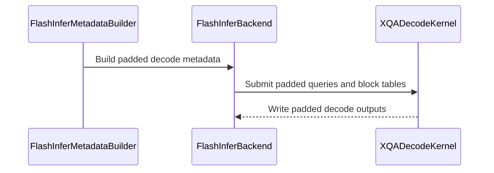

# #50439 [Attention] Extend XQA decode support on SM90

https://github.com/vllm-project/vllm/pull/50439 · askliar · MERGED · created 2026-07-30T14:01:17Z · merged 2026-09-11T06:19:56Z

## Summary

Follow up on #49718, which added the dedicated FlashInfer XQA path for SM12x.

- Use FlashInfer's dedicated XQA API on SM90 for uniform and ragged speculative decode.
- Support non-causal draft attention and attention sinks on the SM90 XQA path.
- Remove the obsolete SM90 sliding-window guard; current `main` pins FlashInfer 0.6.17, which contains the upstream fix.
- Preserve padded query/output rows for single-token full CUDA graphs while keeping multi-token ragged queries packed.
- Keep SM100 DCP CUDA graphs limited to uniform single-token decode because variable-length trtllm-gen decode is not graph-safe with DCP.
- Preserve the SM12x behavior introduced by #49718; the padded single-token XQA correction applies to both XQA architectures.

## Scope and related work

This is not a duplicate of #37592 or #47306. Those drafts target older FlashInfer/base revisions and the legacy shared XQA API. This PR extends the current dedicated XQA path to SM90 and isolates the SM100 DCP graph policy change. #50885 targets the native FlashInfer SM120 path rather than dedicated SM90 XQA.

No dependency update is needed: current `main` already pins FlashInfer 0.6.17 with the required public XQA API.

## Validation

Tested w/ GPT-OSS on H100.

---

## comments

**mergify** (2026-08-09T10:58:32Z):

This pull request has merge conflicts that must be resolved before it can be
merged. Please rebase the PR, @askliar.

https://docs.github.com/en/pull-requests/collaborating-with-pull-requests/working-with-forks/syncing-a-fork

**pavanimajety** (2026-09-02T15:49:43Z):

/ci run

**github-actions** (2026-09-02T15:50:01Z):

✅ Triggered [Buildkite CI #86887](https://buildkite.com/vllm/ci/builds/86887) for commit `4a54cb506353`.

**github-actions** (2026-09-02T17:48:58Z):

✅ @askliar, CI is now available for this PR.

- `/ci run` starts upstream CI; `/amd-ci run` starts AMD CI only.
- `/ci retry` retries failed jobs in the CI build for the current PR head. If the current head has no CI build, it starts a new CI build for the current head containing only jobs that failed in the latest earlier CI build for this PR.
- `/amd-ci retry` retries failed jobs in AMD CI for the current PR head. Use `/amd-ci run` when the current head has no AMD CI build.
- `/ci cancel` cancels scheduled or running CI builds for this PR branch; `/amd-ci cancel` does the same for AMD CI only.

<!-- vllm-ci-authorized -->

**benchislett** (2026-09-02T18:32:19Z):

/ci retry

**github-actions** (2026-09-02T18:32:38Z):

✅ Queued 3 failed job(s) for retry in [Buildkite CI #86887](https://buildkite.com/vllm/ci/builds/86887).

**coderabbitai** (2026-09-03T15:52:31Z):

<!-- This is an auto-generated comment: summarize by coderabbit.ai -->
<!-- review_stack_entry_start -->

[](https://app.coderabbit.ai/change-stack/vllm-project/vllm/pull/50439)

<!-- review_stack_entry_end -->
<!-- recent_review_start -->

No actionable comments were generated in the recent review. 🎉

<details>
<summary>ℹ️ Recent review info</summary>

<details>
<summary>⚙️ Run configuration</summary>

**Configuration used**: Repository UI

**Review profile**: CHILL

**Plan**: Team

**Run ID**: `2ac216db-2b12-4ffd-b97f-7bcc231cbc46`

</details>

<details>
<summary>📥 Commits</summary>

Reviewing files that changed from the base of the PR and between 61519c873501ca36e5c6fa9c9bdea5b0e3998417 and e477b896a3b8e36b39943a7a7afa4897fdcd46c8.

</details>

<details>
<summary>📒 Files selected for processing (1)</summary>

- `vllm/v1/attention/backends/flashinfer.py`

</details>

<details>
<summary>🚧 Files skipped from review as they are similar to previous changes (1)</summary>

- vllm/v1/attention/backends/flashinfer.py

</details>

**Included review availability:** Your plan provides up to 10 included reviews per hour; 7 remain after this review.

</details>

---

<!-- recent_review_end -->
<!-- walkthrough_start -->

<details>
<summary>📝 Summary</summary>

<!-- This is an auto-generated comment: release notes by coderabbit.ai -->

## Summary by CodeRabbit

- **New Features**
  - Expanded FlashInfer attention support to include SM90 and SM12x GPU architectures.
  - Added sliding-window prefill support for supported SM90 GPUs.
  - Improved speculative decoding compatibility with distributed context parallelism.

- **Bug Fixes**
  - Preserved CUDA-graph padding shapes for XQA queries, outputs, and block tables.
  - Corrected packed query-width handling during padded speculative decoding.
  - Improved XQA decode support and attention capability detection across configurations.

<!-- end of auto-generated comment: release notes by coderabbit.ai -->

## Walkthrough

FlashInfer XQA support now includes SM90 and SM12x devices. Decode metadata and CUDA-graph support are updated. The forward path preserves padded shapes for XQA decode, and tests cover routing, sink support, DCP spec decode, and CUDA-graph behavior.

### Changes

**FlashInfer XQA support**

| Layer / File(s)                                                                                                                                                                                  | Summary                                                                                                                                                                  |
| ------------------------------------------------------------------------------------------------------------------------------------------------------------------------------------------------ | ------------------------------------------------------------------------------------------------------------------------------------------------------------------------ |
| **Capability and CUDA-graph support** <br> `vllm/v1/attention/backends/flashinfer.py`, `tests/v1/attention/test_attention_backends.py`, `tests/v1/attention/test_flashinfer_dcp_spec_reorder.py` | XQA and sink support now include SM90. DCP decode returns `UNIFORM_SINGLE_TOKEN_DECODE`. CUDA-graph checks cover uniform-batch support and wide-head decode support.     |
| **Decode metadata and routing** <br> `vllm/v1/attention/backends/flashinfer.py`, `tests/v1/attention/test_attention_backends.py`                                                                 | The `use_xqa` flag replaces `use_dedicated_xqa`. Decode query lengths, routing, prefill splitting, metadata, and sink guards use the updated conditions.                 |
| **Padded XQA decode execution** <br> `vllm/v1/attention/backends/flashinfer.py`, `tests/v1/attention/test_attention_backends.py`                                                                 | XQA decode preserves padded query and output shapes. The trtllm-gen path uses the shared `bmm1_scale`. Tests validate padded non-ragged requests and SM90/SM12x routing. |

**Estimated code review effort:** 3 (Moderate) | ~25 minutes

### Sequence Diagram(s)



</details>

<!-- walkthrough_end -->
<!-- pre_merge_checks_walkthrough_start -->

<details>
<summary>🚥 Pre-merge checks | ✅ 4 | ❌ 1</summary>

### ❌ Failed checks (1 warning)

|     Check name     | Status     | Explanation                                                                                                                                                                                 | Resolution                                                                         |
| :----------------: | :--------- | :------------------------------------------------------------------------------------------------------------------------------------------------------------------------------------------ | :--------------------------------------------------------------------------------- |
| Docstring Coverage | ⚠️ Warning | Docstring coverage is 52.94% which is insufficient. The required threshold is 80.00%. Docstring coverage is scoped to functions touched by this diff. Analyzed 17 functions across 3 files. | Write docstrings for the functions missing them to satisfy the coverage threshold. |

<details>
<summary>✅ Passed checks (4 passed)</summary>

|         Check name         | Status    | Explanation                                                                                                                                                        |
| :------------------------: | :-------- | :----------------------------------------------------------------------------------------------------------------------------------------------------------------- |
|        Title check         | ✅ Passed | The title clearly summarizes the primary change: extending FlashInfer XQA decode support to SM90.                                                                  |
|     Description check      | ✅ Passed | The description is directly related to the changeset. It explains SM90 XQA support, CUDA-graph behavior, removed guards, preserved SM12x behavior, and validation. |
|    Linked Issues check     | ✅ Passed | Check skipped because no linked issues were found for this pull request.                                                                                           |
| Out of Scope Changes check | ✅ Passed | Check skipped because no linked issues were found for this pull request.                                                                                           |

</details>

</details>

<!-- pre_merge_checks_walkthrough_end -->

- [ ] <!-- {"checkboxId":"585bb3f6-faf5-4dbf-96d2-74e382adf19a"} --> Fix all pre-merge checks with AI
<!-- tips_start -->

---

Thanks for using [CodeRabbit](https://coderabbit.ai?utm_source=oss&utm_medium=github&utm_campaign=vllm-project/vllm&utm_content=50439)! It's free for OSS, and your support helps us grow. If you like it, consider giving us a shout-out.

<details>
<summary>❤️ Share</summary>

- [X](https://twitter.com/intent/tweet?text=I%20just%20used%20%40coderabbitai%20for%20my%20code%20review%2C%20and%20it%27s%20fantastic%21%20It%27s%20free%20for%20OSS%20and%20offers%20a%20free%20trial%20for%20the%20proprietary%20code.%20Check%20it%20out%3A&url=https%3A//coderabbit.ai)
- [Mastodon](https://mastodon.social/share?text=I%20just%20used%20%40coderabbitai%20for%20my%20code%20review%2C%20and%20it%27s%20fantastic%21%20It%27s%20free%20for%20OSS%20and%20offers%20a%20free%20trial%20for%20the%20proprietary%20code.%20Check%20it%20out%3A%20https%3A%2F%2Fcoderabbit.ai)
- [Reddit](https://www.reddit.com/submit?title=Great%20tool%20for%20code%20review%20-%20CodeRabbit&text=I%20just%20used%20CodeRabbit%20for%20my%20code%20review%2C%20and%20it%27s%20fantastic%21%20It%27s%20free%20for%20OSS%20and%20offers%20a%20free%20trial%20for%20proprietary%20code.%20Check%20it%20out%3A%20https%3A//coderabbit.ai)
- [LinkedIn](https://www.linkedin.com/sharing/share-offsite/?url=https%3A%2F%2Fcoderabbit.ai&mini=true&title=Great%20tool%20for%20code%20review%20-%20CodeRabbit&summary=I%20just%20used%20CodeRabbit%20for%20my%20code%20review%2C%20and%20it%27s%20fantastic%21%20It%27s%20free%20for%20OSS%20and%20offers%20a%20free%20trial%20for%20proprietary%20code)

</details>

<sub>Comment `@coderabbitai help` to get the list of available commands.</sub>

<!-- tips_end -->

**askliar** (2026-09-03T16:05:34Z):

/ci retry

**github-actions** (2026-09-03T16:05:57Z):

✅ Triggered [Buildkite CI #87098](https://buildkite.com/vllm/ci/builds/87098) for commit `c2ceef2b32a6`, running 3 failed step(s) from [Buildkite CI #86887](https://buildkite.com/vllm/ci/builds/86887).

**mergify** (2026-09-03T16:28:15Z):

Hi @askliar, the pre-commit checks have failed. Please run:

```bash
uv pip install pre-commit>=4.5.1
pre-commit install
pre-commit run --all-files
```

Then, commit the changes and push to your branch.

For future commits, `pre-commit` will run automatically on changed files before each commit.

**askliar** (2026-09-03T17:14:15Z):

/ci retry

**github-actions** (2026-09-03T17:14:34Z):

✅ The previous CI build is still running: https://buildkite.com/vllm/ci/builds/87098

**askliar** (2026-09-04T10:56:24Z):

/ci retry

**github-actions** (2026-09-04T10:56:41Z):

✅ No failed, timed-out, or expired jobs need retrying in [Buildkite CI #87098](https://buildkite.com/vllm/ci/builds/87098).

**askliar** (2026-09-04T10:58:38Z):

@pavanimajety looks like all tests pass. Lmk if you have any other asks - otherwise I'd go ahead and merge it.

**askliar** (2026-09-08T23:58:13Z):

@pavanimajety can you please set it to auto-merge?

**pavanimajety** (2026-09-10T18:45:12Z):

/ci retry

**github-actions** (2026-09-10T18:45:30Z):

✅ No failed, timed-out, or expired jobs need retrying in [Buildkite CI #87098](https://buildkite.com/vllm/ci/builds/87098).

**askliar** (2026-09-11T04:03:30Z):

/ci retry

**github-actions** (2026-09-11T04:03:48Z):

✅ No failed, timed-out, or expired jobs need retrying in [Buildkite CI #87098](https://buildkite.com/vllm/ci/builds/87098).

**askliar** (2026-09-11T04:04:21Z):

/ci run

**github-actions** (2026-09-11T04:04:40Z):

✅ Triggered [Buildkite CI #88243](https://buildkite.com/vllm/ci/builds/88243) for commit `5e377f9bc346`.

**askliar** (2026-09-11T05:54:19Z):

/ci retry

**github-actions** (2026-09-11T05:54:36Z):

✅ Queued 1 failed job(s) for retry in [Buildkite CI #88243](https://buildkite.com/vllm/ci/builds/88243).
