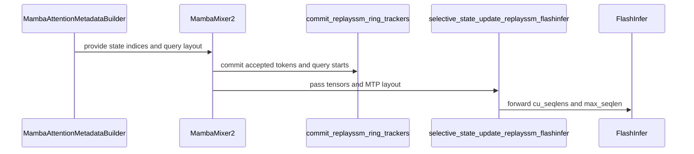

# #52928 [Mamba] Add FlashInfer ReplaySSM support for MTP

https://github.com/vllm-project/vllm/pull/52928 · askliar · MERGED · created 2026-08-19T10:37:28Z · merged 2026-09-30T21:41:18Z

## Summary

This stacked follow-up extends the native FlashInfer ReplaySSM integration from single-token decode in #52506 to multi-token prediction (MTP) verification for Mamba2 models.

With MTP, the model evaluates one target token plus several draft tokens before sampling determines how many were accepted. ReplaySSM avoids materializing a separate recurrent state for every speculative token: each layer keeps a checkpoint and a ring of inputs, the accepted length advances a shared cursor before the next forward, and the checkpoint is updated only when the next verification window would overflow the ring.

## Dependencies

> [!IMPORTANT]
> This PR is stacked on #52506 and must not merge independently. Until #52506 lands, GitHub shows the cumulative base and MTP changes in this diff.

The FlashInfer path also depends on the compatible ReplaySSM API and native autotuning work in [flashinfer-ai/flashinfer#4545](https://github.com/flashinfer-ai/flashinfer/pull/4545).

## Design

- **MTP-shaped execution:** uniform verification batches use dense `(batch, tokens, ...)` inputs so FlashInfer can select its native MTP tactics. Variable-length batches use the packed `cu_seqlens` interface.
- **One acceptance update per cache group:** every Mamba layer observes the same accepted-token count, so ring cursors are shared and advanced once per model forward. Checkpoints and ring payloads remain layer-local.
- **One state page per request:** ReplaySSM stores one physical Mamba state page rather than one page per target/draft position. The causal-conv1d verification length is passed separately from the physical block-table width.
- **CUDA-graph-safe indexing:** the contiguous FlashInfer state-index vector lives in persistent runner-owned storage and is refreshed before replay, keeping its captured address stable.
- **Native FlashInfer selection:** the ReplaySSM call uses FlashInfer’s `checkpointing_ssu` API and native autotuning. PDL is forwarded explicitly but defaults off because it was not a consistent end-to-end win.
- **No duplicate Triton implementation:** #49847 implements MTP ReplaySSM using separate Triton kernels, a token-major ring, and its own cursor lifecycle. This PR retains the FlashInfer layout and delegates the update to native FlashInfer instead of copying the Triton kernel stack into vLLM.

This PR does not modify FlashInfer or add prefix-cache alignment support. ReplaySSM continues to use `mamba_cache_mode=none`.

## Correctness

Matched GSM8K evaluation on GB200 compared FlashInfer ReplaySSM with the exact #49847 Triton implementation:

| Backend       |   Correct | Accuracy | Invalid outputs |
| ------------- | --------: | -------: | --------------: |
| FlashInfer    | 437 / 512 |   85.35% |               0 |
| Triton #49847 | 437 / 512 |   85.35% |               0 |

The comparison used FP32 SSM state with stochastic rounding disabled. A strict H100 B16/AL1 CUDA-graph control also produced identical complete output hashes across the two backends.

## Actual-model throughput

Workload:

- Model: `NVIDIA/NVIDIA-Nemotron-3.5-Lightning-30B-A3B-NVFP4`
- MTP: three draft tokens and a four-token verification window
- Measured acceptance length: 4.0
- ReplaySSM buffer: 16
- SSM state: FP32
- Stochastic rounding: disabled
- CUDA graphs: enabled
- Metric: output tokens/s

### H100 80GB

| Batch | FlashInfer, PDL off | FlashInfer, PDL on | Triton #49847 | Best FI vs Triton |
| ----: | ------------------: | -----------------: | ------------: | ----------------: |
|    16 |        **6,578.81** |           6,563.84 |      6,472.75 |            +1.64% |
|   128 |           19,343.22 |      **19,388.90** |     19,059.60 |            +1.73% |
|   256 |           21,896.57 |      **22,014.13** |     21,725.24 |            +1.33% |
|   512 |       **24,863.34** |          24,852.45 |     24,458.58 |            +1.65% |

### GB200

The allocation identified the device as `NVIDIA GB200`.

| Batch | FlashInfer, PDL off | FlashInfer, PDL on | Triton #49847 | Production FI off vs Triton |
| ----: | ------------------: | -----------------: | ------------: | --------------------------: |
|    16 |        **8,811.71** |           7,921.11 |      8,467.73 |                      +4.06% |
|   128 |           25,532.13 |      **25,948.60** |     24,270.93 |                      +5.20% |
|   256 |           28,687.11 |      **28,703.49** |     27,153.46 |                      +5.65% |
|   512 |       **29,272.09** |          29,170.54 |     27,718.29 |                      +5.61% |

PDL was harmful at GB200 B16 and effectively neutral at larger batches. The production path therefore keeps it disabled while preserving the explicit argument for future FlashInfer tuning and debugging.

## Production-profile findings

Nsight Systems profiles used 64 steady CUDA-graph decode steps and summed ReplaySSM work over all 23 Mamba layers:

| H100 case | FlashInfer kernels |   Triton kernels | FlashInfer tracker | Triton tracker |
| --------- | -----------------: | ---------------: | -----------------: | -------------: |
| B16, AL4  |     739.42 μs/step |   644.74 μs/step |       6.89 μs/step |  10.87 μs/step |
| B128, AL4 |   3,529.11 μs/step | 3,587.91 μs/step |       8.50 μs/step |  12.69 μs/step |

The eager microbenchmark showed a much larger FlashInfer advantage because the Triton path issued several kernels from Python. CUDA-graph replay removes most of that dispatch and inter-launch gap. In production graphs, B16 favors the Triton kernels while B128 is effectively tied; the shared FlashInfer tracker is consistently cheaper.

On GB200 at B256, ReplaySSM accounted for approximately 16% of execute-step GPU time. Its 1.56× in-model improvement predicts a maximum whole-step gain of roughly 6.1%, close to the measured 5.65%. This explains why a much larger isolated-kernel ratio becomes a mid-single-digit end-to-end improvement.

## Cache capacity

After decoupling verification length from physical state-page allocation, both backends admit the full requested concurrency:

| Batch | FlashInfer cache tokens | Triton cache tokens | Difference |
| ----: | ----------------------: | ------------------: | ---------: |
|   256 |                 303,923 |             308,121 |      -1.4% |
|   512 |                 293,990 |             299,008 |      -1.7% |

This removes the previous four-state-pages-per-request over-allocation and brings FlashInfer capacity within 2% of #49847.

## Validation

- Changed-file pre-commit passes, including Ruff, mypy, SPDX, configuration validation, forbidden imports, and CUDA API checks.
- Focused H100 suite: 41 passed, 200 deselected.
- GB200 GSM8K: exact accuracy parity with zero invalid outputs.
- TP2 actual-model MTP smoke completed.

---

## comments

**mergify** (2026-08-28T02:39:34Z):

This pull request has merge conflicts that must be resolved before it can be
merged. Please rebase the PR, @askliar.

https://docs.github.com/en/pull-requests/collaborating-with-pull-requests/working-with-forks/syncing-a-fork

**benchislett** (2026-08-31T22:17:26Z):

/ci run

**github-actions** (2026-08-31T22:17:30Z):

✅ @askliar, CI is now available for this PR.

- `/ci run` starts upstream CI; `/amd-ci run` starts AMD CI only.
- `/ci retry` retries failed jobs in the CI build for the current PR head. If the current head has no CI build, it starts a new CI build for the current head containing only jobs that failed in the latest earlier CI build for this PR.
- `/amd-ci retry` retries failed jobs in AMD CI for the current PR head. Use `/amd-ci run` when the current head has no AMD CI build.
- `/ci cancel` cancels scheduled or running CI builds for this PR branch; `/amd-ci cancel` does the same for AMD CI only.

<!-- vllm-ci-authorized -->

**github-actions** (2026-08-31T22:17:54Z):

✅ Triggered [Buildkite CI #86434](https://buildkite.com/vllm/ci/builds/86434) for commit `1026b27b2792`.

**mergify** (2026-08-31T22:24:16Z):

Hi @askliar, the pre-commit checks have failed. Please run:

```bash
uv pip install pre-commit>=4.5.1
pre-commit install
pre-commit run --all-files
```

Then, commit the changes and push to your branch.

For future commits, `pre-commit` will run automatically on changed files before each commit.

**AndreasKaratzas** (2026-09-01T04:12:47Z):

For new FlashInfer test files, please adda global pytest skipif statement on the top of the files if platform is not cuda and if flashinfer is not found. Otherwise, some CI resources are going to be spent evaluating each function separately before they are skipped. It also makes the test files' purpose clear "Not supported since this is a FlashInfer related test file" or something for msg.

**mergify** (2026-09-01T07:25:25Z):

This pull request has merge conflicts that must be resolved before it can be
merged. Please rebase the PR, @askliar.

https://docs.github.com/en/pull-requests/collaborating-with-pull-requests/working-with-forks/syncing-a-fork

**mergify** (2026-09-01T10:10:21Z):

Hi @askliar, the pre-commit checks have failed. Please run:

```bash
uv pip install pre-commit>=4.5.1
pre-commit install
pre-commit run --all-files
```

Then, commit the changes and push to your branch.

For future commits, `pre-commit` will run automatically on changed files before each commit.

**mergify** (2026-09-01T10:30:13Z):

Hi @askliar, the pre-commit checks have failed. Please run:

```bash
uv pip install pre-commit>=4.5.1
pre-commit install
pre-commit run --all-files
```

Then, commit the changes and push to your branch.

For future commits, `pre-commit` will run automatically on changed files before each commit.

**mergify** (2026-09-01T10:46:57Z):

Hi @askliar, the pre-commit checks have failed. Please run:

```bash
uv pip install pre-commit>=4.5.1
pre-commit install
pre-commit run --all-files
```

Then, commit the changes and push to your branch.

For future commits, `pre-commit` will run automatically on changed files before each commit.

**askliar** (2026-09-02T12:23:04Z):

/ci run

**github-actions** (2026-09-02T12:23:23Z):

✅ Triggered [Buildkite CI #86862](https://buildkite.com/vllm/ci/builds/86862) for commit `2a20d7903e7f`.

**askliar** (2026-09-02T16:42:17Z):

/ci retry

**github-actions** (2026-09-02T16:42:37Z):

✅ Triggered [Buildkite CI #86895](https://buildkite.com/vllm/ci/builds/86895) for commit `65fac9b5f775`, running 2 failed step(s) from [Buildkite CI #86862](https://buildkite.com/vllm/ci/builds/86862).

**coderabbitai** (2026-09-03T17:00:56Z):

<!-- This is an auto-generated comment: summarize by coderabbit.ai -->
<!-- review_stack_entry_start -->

[](https://app.coderabbit.ai/change-stack/vllm-project/vllm/pull/52928)

<!-- review_stack_entry_end -->
<!-- This is an auto-generated comment: review paused by coderabbit.ai -->

> [!NOTE]
>
> ## Reviews paused
>
> It looks like this branch is under active development. To avoid overwhelming you with review comments due to an influx of new commits, CodeRabbit has automatically paused this review. You can configure this behavior by changing the `reviews.auto_review.auto_pause_after_reviewed_commits` setting.
>
> Use the following commands to manage reviews:
>
> - `@coderabbitai resume` to resume automatic reviews.
> - `@coderabbitai review` to trigger a single review.
>
> Use the checkboxes below for quick actions:
>
> - [ ] <!-- {"checkboxId":"7f6cc2e2-2e4e-497a-8c31-c9e4573e93d1"} --> ▶️ Resume reviews
> - [ ] <!-- {"checkboxId":"e9bb8d72-00e8-4f67-9cb2-caf3b22574fe"} --> 🔍 Trigger review

<!-- end of auto-generated comment: review paused by coderabbit.ai -->
<!-- recent_review_start -->

No actionable comments were generated in the recent review. 🎉

<details>
<summary>ℹ️ Recent review info</summary>

<details>
<summary>⚙️ Run configuration</summary>

**Configuration used**: Repository UI

**Review profile**: CHILL

**Plan**: Team

**Run ID**: `1a4d4225-3c2e-441f-b312-2e449b28c01e`

</details>

<details>
<summary>📥 Commits</summary>

Reviewing files that changed from the base of the PR and between 3c6d80e03a0d74c4da0040ea8502702756372dfd and 77dea00cf93e27be20f5d588cc7b7dfc23570b23.

</details>

<details>
<summary>📒 Files selected for processing (1)</summary>

- `.buildkite/test_areas/engine.yaml`

</details>

**Included review availability:** Your plan provides up to 10 included reviews per hour; 5 remain after this review.

</details>

---

<!-- recent_review_end -->
<!-- walkthrough_start -->

<details>
<summary>📝 Summary</summary>

<!-- This is an auto-generated comment: release notes by coderabbit.ai -->

## Summary by CodeRabbit

- **New Features**
  - ReplaySSM now supports Mamba2 speculative decoding with FlashInfer.
  - Added support for multi-token prediction and variable-length speculative queries.
  - ReplaySSM preserves acceptance metadata across decoding steps.

- **Bug Fixes**
  - Improved state tracking, reset behavior, and CUDA graph compatibility.
  - Updated cache sizing and validation for speculative token windows.
  - Warmup now handles zero-request configurations safely.

- **Tests**
  - Added coverage for FlashInfer speculative decoding, MTP, state restoration, and configuration validation.

<!-- end of auto-generated comment: release notes by coderabbit.ai -->

## Walkthrough

ReplaySSM now supports Mamba2 speculative decoding through FlashInfer. The change adds acceptance tracking, MTP tensor layouts, stable CUDA-graph metadata, expanded ring sizing, configuration validation, warmup handling, unit tests, end-to-end tests, and CI coverage.

### Changes

**ReplaySSM speculative decode**

| Layer / File(s)                                                                                                                                                                                                                                                                                                                       | Summary                                                                                                                                                                                               |
| ------------------------------------------------------------------------------------------------------------------------------------------------------------------------------------------------------------------------------------------------------------------------------------------------------------------------------------- | ----------------------------------------------------------------------------------------------------------------------------------------------------------------------------------------------------- |
| **Configuration and state sizing** <br> `vllm/config/*`, `vllm/model_executor/layers/mamba/abstract.py`, `vllm/model_executor/layers/mamba/mamba_utils.py`, `vllm/model_executor/models/nemotron_h.py`, `tests/test_config.py`, `tests/v1/attention/test_attention_backends_selection.py`, `tests/kernels/mamba/test_ssu_dispatch.py` | ReplaySSM validation, cache specifications, and FlashInfer ring sizes now account for speculative tokens.                                                                                             |
| **Tracker commit state** <br> `vllm/model_executor/layers/mamba/ops/ssu_dispatch.py`, `vllm/model_executor/warmup/replayssm_warmup.py`, `tests/model_executor/test_replayssm_warmup.py`, `tests/v1/worker/test_utils.py`, `tests/kernels/mamba/test_ssu_dispatch.py`                                                                  | Tracker state now records previous query lengths. Commit and reset operations handle accepted tokens, ragged queries, invalid slots, warmup, and cache-group sharing.                                 |
| **FlashInfer metadata and layout** <br> `vllm/v1/attention/backends/mamba_attn.py`, `vllm/model_executor/layers/mamba/ops/ssu_dispatch.py`, `tests/v1/attention/test_replayssm_metadata_builder.py`, `tests/kernels/mamba/test_ssu_dispatch.py`                                                                                       | FlashInfer metadata now provides stable ReplaySSM state indices, derives acceptance metadata, sizes scratch storage for speculative tokens, and forwards packed or dense sequence metadata.           |
| **MambaMixer2 execution** <br> `vllm/model_executor/layers/mamba/mamba_mixer2.py`, `tests/v1/e2e/test_replayssm_decode.py`, `.buildkite/test_areas/engine.yaml`                                                                                                                                                                       | `MambaMixer2` commits the previous accepted prefix, processes target-plus-draft windows, selects MTP layouts, and passes ReplaySSM metadata to FlashInfer. End-to-end parity and MTP tests run in CI. |

**Estimated code review effort:** 4 (Complex) | ~60 minutes

<!-- final_review_risk_start -->

**Merge Risk:** _🟡 Moderate_ · up to `77dea`

<!-- final_review_risk_coverage:{"sourceCommitId":"77dea00cf93e27be20f5d588cc7b7dfc23570b23","coveredCommitId":"77dea00cf93e27be20f5d588cc7b7dfc23570b23","kind":"reviewed"} -->

ReplaySSM warmup changes can bypass the E2E test job, leaving speculative-decoding behavior unvalidated for those changes. Add the warmup path as a dependency before merge.

<!-- final_review_risk_end -->

### Sequence Diagram(s)



</details>

<!-- walkthrough_end -->
<!-- pre_merge_checks_walkthrough_start -->

<details>
<summary>🚥 Pre-merge checks | ✅ 4 | ❌ 1</summary>

### ❌ Failed checks (1 warning)

|     Check name     | Status     | Explanation                                                                                                                                                                                               | Resolution                                                                         |
| :----------------: | :--------- | :-------------------------------------------------------------------------------------------------------------------------------------------------------------------------------------------------------- | :--------------------------------------------------------------------------------- |
| Docstring Coverage | ⚠️ Warning | Docstring coverage is 18.87% which is insufficient. The required threshold is 80.00%. Docstring coverage is scoped to functions touched by this diff. Analyzed 53 functions across 16 files. (1 skipped:… | Write docstrings for the functions missing them to satisfy the coverage threshold. |

<details>
<summary>✅ Passed checks (4 passed)</summary>

|         Check name         | Status    | Explanation                                                                                                                                       |
| :------------------------: | :-------- | :------------------------------------------------------------------------------------------------------------------------------------------------ |
|        Title check         | ✅ Passed | The title clearly and concisely summarizes the main change: adding FlashInfer ReplaySSM support for MTP in Mamba.                                 |
|     Description check      | ✅ Passed | The description directly explains the MTP ReplaySSM implementation, design, dependencies, correctness validation, performance results, and scope. |
|    Linked Issues check     | ✅ Passed | Check skipped because no linked issues were found for this pull request.                                                                          |
| Out of Scope Changes check | ✅ Passed | Check skipped because no linked issues were found for this pull request.                                                                          |

</details>

<details>
<summary>Full details: Docstring Coverage</summary>

**Explanation**

Docstring coverage is 18.87% which is insufficient. The required threshold is 80.00%. Docstring coverage is scoped to functions touched by this diff. Analyzed 53 functions across 16 files. (1 skipped: 1 unsupported.)

</details>

</details>

<!-- pre_merge_checks_walkthrough_end -->
<!-- tips_start -->

---

Thanks for using [CodeRabbit](https://coderabbit.ai?utm_source=oss&utm_medium=github&utm_campaign=vllm-project/vllm&utm_content=52928)! It's free for OSS, and your support helps us grow. If you like it, consider giving us a shout-out.

<details>
<summary>❤️ Share</summary>

- [X](https://twitter.com/intent/tweet?text=I%20just%20used%20%40coderabbitai%20for%20my%20code%20review%2C%20and%20it%27s%20fantastic%21%20It%27s%20free%20for%20OSS%20and%20offers%20a%20free%20trial%20for%20the%20proprietary%20code.%20Check%20it%20out%3A&url=https%3A//coderabbit.ai)
- [Mastodon](https://mastodon.social/share?text=I%20just%20used%20%40coderabbitai%20for%20my%20code%20review%2C%20and%20it%27s%20fantastic%21%20It%27s%20free%20for%20OSS%20and%20offers%20a%20free%20trial%20for%20the%20proprietary%20code.%20Check%20it%20out%3A%20https%3A%2F%2Fcoderabbit.ai)
- [Reddit](https://www.reddit.com/submit?title=Great%20tool%20for%20code%20review%20-%20CodeRabbit&text=I%20just%20used%20CodeRabbit%20for%20my%20code%20review%2C%20and%20it%27s%20fantastic%21%20It%27s%20free%20for%20OSS%20and%20offers%20a%20free%20trial%20for%20proprietary%20code.%20Check%20it%20out%3A%20https%3A//coderabbit.ai)
- [LinkedIn](https://www.linkedin.com/sharing/share-offsite/?url=https%3A%2F%2Fcoderabbit.ai&mini=true&title=Great%20tool%20for%20code%20review%20-%20CodeRabbit&summary=I%20just%20used%20CodeRabbit%20for%20my%20code%20review%2C%20and%20it%27s%20fantastic%21%20It%27s%20free%20for%20OSS%20and%20offers%20a%20free%20trial%20for%20proprietary%20code)

</details>

<sub>Comment `@coderabbitai help` to get the list of available commands.</sub>

<!-- tips_end -->

**coderabbitai** (2026-09-03T17:26:46Z):

<!-- This is an auto-generated comment by CodeRabbit -->

> [!NOTE]
> GitHub couldn't provide a complete incremental comparison for this pull request, so CodeRabbit is performing a full review instead. This review may take a little longer.

**askliar** (2026-09-03T17:27:24Z):

/ci run

**github-actions** (2026-09-03T17:27:49Z):

✅ Triggered [Buildkite CI #87112](https://buildkite.com/vllm/ci/builds/87112) for commit `3c6d80e03a0d`.

**askliar** (2026-09-03T17:28:04Z):

@benchislett made sure tests run but not sure if there are actually sufficient resources. LMK!

**askliar** (2026-09-04T09:01:38Z):

/ci run

**github-actions** (2026-09-04T09:01:57Z):

✅ Triggered [Buildkite CI #87227](https://buildkite.com/vllm/ci/builds/87227) for commit `c1dd5a327246`.

**askliar** (2026-09-04T11:30:11Z):

/ci retry

**github-actions** (2026-09-04T11:30:28Z):

✅ The previous CI build is still running: https://buildkite.com/vllm/ci/builds/87227

**askliar** (2026-09-04T13:08:24Z):

/ci retry

**github-actions** (2026-09-04T13:08:41Z):

✅ The previous CI build is still running: https://buildkite.com/vllm/ci/builds/87227

**askliar** (2026-09-08T16:26:03Z):

/ci retry

**github-actions** (2026-09-08T16:26:51Z):

✅ Triggered [Buildkite CI #87730](https://buildkite.com/vllm/ci/builds/87730) for commit `53fe7ed2e7a8`, running 4 failed step(s) from [Buildkite CI #87227](https://buildkite.com/vllm/ci/builds/87227).

**askliar** (2026-09-08T16:38:52Z):

/ci run

**github-actions** (2026-09-08T16:39:24Z):

✅ Triggered [Buildkite CI #87733](https://buildkite.com/vllm/ci/builds/87733) for commit `53fe7ed2e7a8`.

**benchislett** (2026-09-08T19:00:49Z):

test is failing, seems like it's missing the flashinfer kernel

```
(EngineCore pid=9473) ERROR 09-08 17:12:16 [core.py:1385] RuntimeError: Worker failed with error 'cannot import name 'allocate_checkpointing_ssu_scratch' from 'flashinfer.mamba.checkpointing_ssu' (/usr/local/lib/python3.12/dist-packages/flashinfer/mamba/checkpointing_ssu.py)', please check the stack trace above for the root cause
```

are we blocked on a version upgrade?

**mergify** (2026-09-14T22:43:55Z):

This pull request has merge conflicts that must be resolved before it can be
merged. Please rebase the PR, @askliar.

https://docs.github.com/en/pull-requests/collaborating-with-pull-requests/working-with-forks/syncing-a-fork

**askliar** (2026-09-28T14:26:27Z):

/ci run

**github-actions** (2026-09-28T14:26:48Z):

❌ This PR is 1 commit behind upstream `main`. Your branch must contain every commit currently on upstream `main`. No new CI build was started. Merge or rebase onto the latest `main`, then rerun `/ci run`. To test this branch at your own risk, use `/ci run --allow-stale`.

<!-- vllm-ci-command:5871978012 -->

**askliar** (2026-09-28T14:28:23Z):

/ci run

**github-actions** (2026-09-28T14:28:43Z):

✅ Triggered [Buildkite CI #91599](https://buildkite.com/vllm/ci/builds/91599) for commit `b2bc59c381d8`.

**askliar** (2026-09-28T22:09:14Z):

/ci retry

**github-actions** (2026-09-28T22:10:00Z):

✅ Triggered [Buildkite CI #91684](https://buildkite.com/vllm/ci/builds/91684) for commit `95b6ca8ec2ec`, running 4 failed step(s) from [Buildkite CI #91599](https://buildkite.com/vllm/ci/builds/91599).

**askliar** (2026-09-29T07:17:36Z):

/ci retry

**github-actions** (2026-09-29T07:17:57Z):

✅ Triggered [Buildkite CI #91779](https://buildkite.com/vllm/ci/builds/91779) for commit `9844203d18da`, running 1 failed step(s) from [Buildkite CI #91684](https://buildkite.com/vllm/ci/builds/91684).

**askliar** (2026-09-29T08:39:48Z):

/ci retry

**github-actions** (2026-09-29T08:41:00Z):

✅ Triggered [Buildkite CI #91807](https://buildkite.com/vllm/ci/builds/91807) for commit `988269db39fa`, running 1 failed step(s) from [Buildkite CI #91779](https://buildkite.com/vllm/ci/builds/91779).

**askliar** (2026-09-29T08:41:41Z):

/ci retry

**github-actions** (2026-09-29T08:42:11Z):

✅ The previous CI build is still running: https://buildkite.com/vllm/ci/builds/91807

**askliar** (2026-09-29T08:43:55Z):

/ci cancel

**github-actions** (2026-09-29T08:44:15Z):

✅ Requested cancellation of 1 CI build for `feat/add_flashinfer_replayssm_mtp`: [#91807](https://buildkite.com/vllm/ci/builds/91807).

**askliar** (2026-09-29T08:44:37Z):

/ci retry

**github-actions** (2026-09-29T08:44:58Z):

✅ No failed, timed-out, or expired jobs need retrying in [Buildkite CI #91807](https://buildkite.com/vllm/ci/builds/91807).

**askliar** (2026-09-29T08:45:17Z):

/ci run

**github-actions** (2026-09-29T08:45:38Z):

❌ This PR is 68 commits behind upstream `main`. Your branch must contain every commit currently on upstream `main`. No new CI build was started. Merge or rebase onto the latest `main`, then rerun `/ci run`. To test this branch at your own risk, use `/ci run --allow-stale`.

<!-- vllm-ci-command:5886797243 -->

**askliar** (2026-09-29T08:46:19Z):

/ci run

**github-actions** (2026-09-29T08:46:39Z):

✅ Triggered [Buildkite CI #91809](https://buildkite.com/vllm/ci/builds/91809) for commit `ca6586436a00`.

**askliar** (2026-09-29T10:05:19Z):

@benchislett all the relevant tests have passed (some failing still but unrelated) - please feel free to check again and merge if looks good to you!

**askliar** (2026-09-29T16:34:09Z):

/ci retry

**github-actions** (2026-09-29T16:34:30Z):

✅ Triggered [Buildkite CI #91906](https://buildkite.com/vllm/ci/builds/91906) for commit `0b4c212f24ff`, running 2 failed step(s) from [Buildkite CI #91809](https://buildkite.com/vllm/ci/builds/91809).

**askliar** (2026-09-29T22:18:45Z):

/ci retry

**github-actions** (2026-09-29T22:19:06Z):

✅ Triggered [Buildkite CI #91968](https://buildkite.com/vllm/ci/builds/91968) for commit `b04221201e32`, running 2 failed step(s) from [Buildkite CI #91906](https://buildkite.com/vllm/ci/builds/91906).

**benchislett** (2026-09-30T15:03:50Z):

/ci run

**github-actions** (2026-09-30T15:04:16Z):

❌ This PR is 40 commits behind upstream `main`. Your branch must contain every commit currently on upstream `main`. No new CI build was started. Merge or rebase onto the latest `main`, then rerun `/ci run`. To test this branch at your own risk, use `/ci run --allow-stale`.

<!-- vllm-ci-command:5913962297 -->

**askliar** (2026-09-30T15:38:46Z):

/ci run

**github-actions** (2026-09-30T15:39:08Z):

✅ Triggered [Buildkite CI #92186](https://buildkite.com/vllm/ci/builds/92186) for commit `14426dada0ff`.

**vllm-agent** (2026-09-30T16:12:18Z):

<!-- ci-selector-shadow -->

### CI selector (shadow): 62 test steps (109 jobs) instead of 88 (132 jobs)

Shadow mode: this changes nothing about what CI runs. It shows what the evidence-based selector would pick for this PR, next to today's rules. [How it works](https://github.com/vllm-project/ci-infra/tree/main/buildkite/ci_selector).

**Feedback welcome:** reply here if it would skip a step this change needs, or runs something unrelated.

| steps (jobs)           | Today's rules | Selector | Would skip | Would add |
| ---------------------- | ------------- | -------- | ---------- | --------- |
| NVIDIA, CPU and others | 88 (132)      | 62 (109) | 45 (53)    | 19 (30)   |
| AMD mirrors            | 92 (142)      | 49 (86)  | 52 (68)    | 9 (12)    |

<details><summary>Selector would run (62)</summary>

- `amd-kernels-mi355`
- `arm-cpu-test` ×3
- `async-engine-inputs-utils-worker`
- `basic-models-test-other-cpu`
- `basic-models-tests-extra-initialization` ×14
- `basic-models-tests-initialization`
- `basic-models-tests-other`
- `cpu-kernel-tests` ×2
- `cpu-language-generation-and-pooling-model-tests` ×3
- `cpu-multi-modal-model-tests-n` ×4
- `cpu-multimodal-config`
- `cpu-params-env-tokenizers-parser`
- `cpu-reasoning-renderers`
- `cpu-spec-decode-tests`
- `cudagraph`
- `distributed-dp-tests-4-gpus`
- `distributed-model-tests-2-gpus` ×3
- `e2e-core-1-gpu`
- `e2e-core-large-memory`
- `e2e-scheduling-1-gpu`
- `engine`
- `engine-1-gpu`
- `entrypoints-integration-api-server-openai-completion`
- `entrypoints-integration-responses-api`
- `entrypoints-integration-speech_to_text`
- `fusion-and-compile-unit-tests-2xb200`
- `kernels-attention-test` ×7
- `kernels-b200` ×3
- `kernels-mamba-test`
- `kernels-root-misc-test-b200`
- `kimi-k3-unit-tests-b200`
- `kv-offload-large`
- `kv-offload-medium`
- `kv-offload-small`
- `language-models-tests-extra-standard` ×2
- `language-models-tests-granite-l4-compatibility`
- `language-models-tests-hybrid` ×2
- `language-models-tests-standard`
- `model-executor`
- `multi-modal-models-standard-1-qwen2`
- `multi-modal-models-standard-4-other-whisper`
- `multi-modal-processor` ×4
- `multi-modal-processor-cpu` ×4
- `pipeline-context-parallelism-4-gpus`
- `pytorch-compilation-passes-unit-tests`
- `pytorch-compilation-unit-tests`
- `pytorch-fullgraph-cudagraph-l4-compatibility`
- `pytorch-fullgraph-test`
- `quantization` ×4
- `qwen4-exp-unit-tests`
- `qwen4-exp-unit-tests-cpu`
- `rayexecutorv2-4-gpus`
- `spec-decode-eagle-1-deepseek-qwen`
- `spec-decode-eagle-2-llama3-qwen-vl-other`
- `spec-decode-ngram-suffix`
- `v1-attention-b200` ×2
- `v1-attention-h100-mi300` ×2
- `v1-executor-worker`
- `v1-kv-connectors` ×4
- `v1-kv-offload`
- `v1-others-cpu`
- `v1-spec-decode`
</details>

<details><summary>Would skip (today's rules run them) (45)</summary>

- `amd-lm-eval-small-models-harness`
- `ascend-npu-test`
- `basic-correctness` ×2
- `basic-correctness-cpu-offload`
- `basic-correctness-cumem`
- `basic-correctness-prefetch-offload`
- `basic-correctness-sleep-mode`
- `batch-invariance-b200`
- `batch-invariance-h100`
- `benchmarks-cli-test`
- `cpu-tool-parsers`
- `distributed-compile-unit-tests-2xh100`
- `entrypoints-integration-api-server` ×4
- `entrypoints-integration-api-server-generate`
- `entrypoints-integration-api-server-openai-chat_completion`
- `entrypoints-integration-llm`
- `entrypoints-integration-multimodal`
- `entrypoints-integration-pooling`
- `fusion-e2e-quick-h100`
- `fusion-e2e-tp2-b200`
- `fusion-e2e-tp2-quick-h100`
- `jit-monitor-no-runtime-jit`
- `kernels-fla-ops-test-b200`
- `kernels-fusedmoe-layer-test-2-b200s`
- `kernels-fusedmoe-layer-test-2-h100s`
- `kernels-mhc-test-b200`
- `kernels-moe-test` ×5
- `lm-eval-dspark-watermark-2xh100`
- `metrics-tracing-2-gpus`
- `mooncake-ec-tcp-e2e-2-gpus`
- `multi-modal-models-standard-2-qwen3-gemma`
- `multi-modal-models-standard-3-llava-qwen2-vl`
- `pytorch-compilation-dynamic-shapes`
- `pytorch-compilation-unit-tests-h100`
- `regression`
- `samplers-multimodal-beam-search`
- `samplers-test`
- `spec-decode-mtp-deepseek-mimo`
- `spec-decode-mtp-gemma4`
- `spec-decode-mtp-qwen3-5`
- `spec-decode-speculators`
- `v1-core`
- `v1-logits-oracle`
- `v1-metrics-lmeval`
- `v1-sample`
</details>

<details><summary>Would add (today's rules do not run them) (19)</summary>

- `amd-kernels-mi355` (code map)
- `arm-cpu-test` ×3 (code map)
- `cpu-kernel-tests` ×2 (code map)
- `cpu-multi-modal-model-tests-n` ×4 (code map)
- `cudagraph` (code map)
- `distributed-dp-tests-4-gpus` (code map)
- `fusion-and-compile-unit-tests-2xb200` (code map)
- `kernels-b200` ×3 (code map)
- `kimi-k3-unit-tests-b200` (code map)
- `kv-offload-large` (code map)
- `kv-offload-medium` (code map)
- `kv-offload-small` (code map)
- `quantization` ×4 (code map)
- `qwen4-exp-unit-tests` (code map)
- `qwen4-exp-unit-tests-cpu` (code map)
- `rayexecutorv2-4-gpus` (code map)
- `spec-decode-eagle-1-deepseek-qwen` (code map)
- `spec-decode-eagle-2-llama3-qwen-vl-other` (code map)
- `spec-decode-ngram-suffix` (code map)
</details>

<details><summary>AMD mirrors: would skip (52)</summary>

- `basic-correctness` ×2
- `basic-correctness-cpu-offload`
- `basic-correctness-cumem`
- `basic-correctness-prefetch-offload`
- `basic-correctness-sleep-mode`
- `batch-invariance-h100`
- `benchmarks-cli-test`
- `deepseek-v4-kernel-test-b200`
- `entrypoints-integration-api-server` ×4
- `entrypoints-integration-api-server-generate`
- `entrypoints-integration-api-server-openai-chat_completion`
- `entrypoints-integration-llm`
- `entrypoints-integration-multimodal`
- `entrypoints-integration-pooling`
- `extract-hidden-states-integration-2-gpus`
- `fault-tolerance-e2e-2xh100`
- `fusion-e2e-quick-h100`
- `fusion-e2e-tp2-ar-rms-config-sweep-h100`
- `fusion-e2e-tp2-b200`
- `fusion-e2e-tp2-quick-h100`
- `jit-monitor-no-runtime-jit`
- `kernels-fla-ops-test-b200`
- `kernels-fp4-moe-test-b200`
- `kernels-fusedmoe-layer-test-2-b200s`
- `kernels-fusedmoe-layer-test-2-h100s`
- `kernels-mhc-test-b200`
- `kernels-moe-test` ×5
- `kernels-quantization-test` ×6
- `lm-eval-dspark-watermark-2xh100`
- `lm-eval-small-models`
- `metrics-tracing-2-gpus`
- `mooncake-ec-tcp-e2e-2-gpus`
- `mrcr-eval-small-models`
- `multi-modal-models-standard-2-qwen3-gemma`
- `multi-modal-models-standard-3-llava-qwen2-vl`
- `openai-api-correctness`
- `platform-tests`
- `pytorch-compilation-dynamic-shapes`
- `pytorch-compilation-unit-tests-h100`
- `quantized-moe-test-b200`
- `regression`
- `samplers-multimodal-beam-search`
- `samplers-test`
- `spec-decode-draft-model` ×4
- `spec-decode-mtp-deepseek-mimo`
- `spec-decode-mtp-gemma4`
- `spec-decode-mtp-qwen3-5`
- `spec-decode-speculators`
- `v1-core`
- `v1-logits-oracle`
- `v1-metrics-lmeval`
- `v1-sample`
</details>

<details><summary>AMD mirrors: would add (9)</summary>

- `cudagraph` (code map)
- `fusion-e2e-tp2-asynctp-config-sweep-h100` (code map)
- `kernels-flashmla-test-h100` (code map)
- `kimi-k3-unit-tests-b200` (code map)
- `kv-offload-large` (code map)
- `kv-offload-medium` (code map)
- `kv-offload-small` (code map)
- `quantization` ×4 (code map)
- `qwen4-exp-unit-tests` (code map)
</details>

#### CI results (2026-09-30 16:56 UTC)

217 passed, 1 failed, 19 pending.
CI is still running; the picture below is not final.

No misses: the selector would have run every failed job.

- `computer-cpu-reasoning-plus-renderers`: selector runs it

<sub>18 changed files · base `cff08b461e` · head `14426dada0` · Python record: not used (/tmp/ci-infra-selector/buildkite/ci_selector/coverage-data/table.json.gz is table version 5, expected 7; re-merge it from the raw recordings) · kernel record: table 866fa130fa (build 92059), map 866fa130fa · not counted: 10 build steps, 5 A100 steps the generator no longer emits, 33 optional steps the selector would also run</sub>

**askliar** (2026-09-30T21:10:54Z):

/ci retry

**github-actions** (2026-09-30T21:11:15Z):

✅ Triggered [Buildkite CI #92251](https://buildkite.com/vllm/ci/builds/92251) for commit `2a31ab1ea8aa`, running 1 failed step(s) from [Buildkite CI #92186](https://buildkite.com/vllm/ci/builds/92186).
