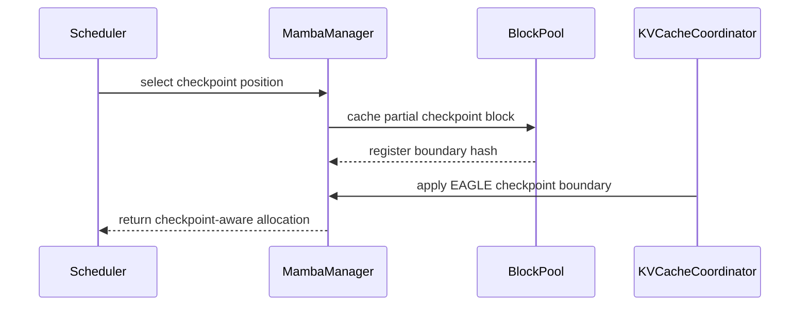

# #53614 [Kimi K3] Support internal prefix checkpoints with partial prefix caching and spec-decoding

https://github.com/vllm-project/vllm/pull/53614 · ZeldaHuang · MERGED · created 2026-08-24T18:26:18Z · merged 2026-09-06T05:18:16Z

## Purpose

Extend the Kimi-K3 prefill checkpoint optimization from #52789 to support:

- speculative decoding / Eagle block rewind;
- partial prefix caching (`prefix_match_unit < Mamba block size`); and
- checkpoint blocks restored through KV connectors such as MooncakeStore.

The cache manager and FlashKDA worker share the same checkpoint-validity rules, so a checkpoint block is allocated and hashed only when the worker can write it. For an aligned partial checkpoint, the already reserved request-owned checkpoint block is re-keyed from its provisional boundary to the state position actually exported by FlashKDA.

This PR keeps the block allocation, eviction, and free lifecycle introduced in #52789.

## Test Plan

- Run pre-commit and the KDA metadata, Mamba aligned-chunk, partial-prefix-cache, and prefix-caching unit tests.
- Deploy Kimi-K3 with TP8/EP8 on two 4-GPU nodes using FlashKDA (`DS` conv-state layout), prefix caching, and public `Inferact/Kimi-K3-DSpark` speculative decoding.
- Compare non-partial prefix caching with `prefix_match_unit=128` by sending exact token-ID prompts to `/v1/completions`: 8 streams grow from 120K to 164K by 2K per round, with a barrier between rounds and three measured repeats per variant.
- With D-Spark-7 and Partial128 enabled, run the complete 1,000-sample OCR-Bench three times sequentially and audit all saved responses.
- Retain the MooncakeStore + NIXL PD E2E coverage previously run for this PR.

Nightly image used for the latest regression:

```text
inferactinc/dev:vllm-k3-arm64-cu13-7b1bb3a
```

The PR source was overlaid on this image and `_C_stable_libtorch.so` was rebuilt
from the same `main` commit because the binary bundled in the image predates the
current Kimi-K3 custom-op ABI.

Important server options for the latest run:

```bash
export VLLM_SSM_CONV_STATE_LAYOUT=DS
export VLLM_ATTENTION_BACKEND=TOKENSPEED_MLA
export VLLM_KIMI_K3_GEMM_RS=1
export TOKENSPEED_MLA_PREFILL_BACKEND=cutedsl

vllm serve "$MODEL" \
  --served-model-name moonshotai/Kimi-K3 \
  --tensor-parallel-size 8 --nnodes 2 \
  --enable-expert-parallel \
  --enable-prefix-caching \
  --prefix-match-unit 128 \
  --max-model-len 180000 \
  --max-num-seqs 8 \
  --max-num-batched-tokens 32768 \
  --long-prefill-token-threshold 16384 \
  --kda-prefill-backend flashkda \
  --speculative-config \
    '{"method":"dspark","model":"Inferact/Kimi-K3-DSpark","num_speculative_tokens":7,"attention_backend":"FLASHINFER_MLA","draft_sample_method":"probabilistic","rejection_sample_method":"block"}' \
  --enforce-eager
```

The non-partial variant uses the same deployment without `--prefix-match-unit 128`.

## Test Result

### Static and unit tests

- Pre-commit: all hooks passed on every changed file.
- Focused unit suite: **113 passed**.
- The aligned re-key regression covers `B=H=32`, prompt length 104, and Eagle rewind: the provisional `hash@96` checkpoint block is re-keyed to the exported `state@64` boundary, and the stale hash is removed.

### Latest-nightly TP8 performance

The PR-description workload was run unchanged: exact token-ID prompts sent to
`/v1/completions`, 8 streams, 120K to 164K, +2K per round, and a barrier after
each group of 8 requests. Each variant used one complete unmeasured workload
warmup followed by three measured repeats. All 528 incremental requests per
variant completed without failures.

| Variant                | Incremental P50 TTFT | Effective req/s | Mean cached tokens | Mean recomputed tokens |
| ---------------------- | -------------------: | --------------: | -----------------: | ---------------------: |
| D-Spark-7, non-partial |          1,526.59 ms |           4.639 |         138,196.36 |               4,803.64 |
| D-Spark-7, Partial128  |      **1,136.22 ms** |       **5.941** |     **140,590.55** |           **2,409.45** |

Partial128 cached 2,394.18 more tokens per incremental request and reduced
recomputation by **49.84%**. Incremental P50 TTFT improved by **25.57%** and
effective throughput improved by **28.08%**. Mean cold TTFT was effectively
unchanged (4,696.35 vs. 4,675.71 ms, -0.44%).

Per-repeat P50 TTFT:

| Variant     |    Repeat 1 |    Repeat 2 |    Repeat 3 |
| ----------- | ----------: | ----------: | ----------: |
| Non-partial | 1,535.89 ms | 1,520.75 ms | 1,523.12 ms |
| Partial128  | 1,110.32 ms | 1,088.71 ms | 1,209.62 ms |

### OCR-Bench: D-Spark-7 + Partial128

All three runs used one unchanged deployment and processed the full benchmark sequentially.

| Run      |   Accuracy | Standard error | Scored samples | Request errors | Suspect outputs |
| -------- | ---------: | -------------: | -------------: | -------------: | --------------: |
| 1        |      0.881 |         0.0102 |          1,000 |              0 |               0 |
| 2        |      0.889 |         0.0099 |          1,000 |              0 |               0 |
| 3        |      0.886 |         0.0101 |          1,000 |              0 |               0 |
| **Mean** | **0.8853** |              — |      **3,000** |          **0** |           **0** |

All 3,000 responses contained non-empty reasoning. Five responses reached the configured 8,192-token generation limit (1/2/2 across the runs); all were saved and scored. No null-block, stale-state, assertion, or engine failures were observed. Slurm job `12088` completed successfully (`0:0`).

### MooncakeStore + NIXL PD E2E

Earlier coverage used one TP8 prefill deployment and one TP8 decode deployment. Prefix caching and MooncakeStore (`kv_both`, TCP) were enabled only on prefill; NIXL transferred KV state to decode. Three sequential full OCR-Bench runs scored 0.884, 0.885, and 0.896 (mean 0.888), with 3,000/3,000 responses scored, zero request errors, zero empty reasoning traces, and zero suspect responses. The connector logs contained no transfer, assertion, or engine failures.

AI assistance was used to implement and refine this change; the author reviewed the changed code and ran the tests above.

---

## comments

**ZeldaHuang** (2026-08-25T09:36:13Z):

PLTA @ZJY0516 @yewentao256

**mergify** (2026-08-29T03:01:18Z):

This pull request has merge conflicts that must be resolved before it can be
merged. Please rebase the PR, @ZeldaHuang.

https://docs.github.com/en/pull-requests/collaborating-with-pull-requests/working-with-forks/syncing-a-fork

**mergify** (2026-08-31T15:22:20Z):

This pull request has merge conflicts that must be resolved before it can be
merged. Please rebase the PR, @ZeldaHuang.

https://docs.github.com/en/pull-requests/collaborating-with-pull-requests/working-with-forks/syncing-a-fork

**coderabbitai** (2026-09-04T06:00:23Z):

<!-- This is an auto-generated comment: summarize by coderabbit.ai -->
<!-- review_stack_entry_start -->

[](https://app.coderabbit.ai/change-stack/vllm-project/vllm/pull/53614)

<!-- review_stack_entry_end -->
<!-- This is an auto-generated comment: review paused by coderabbit.ai -->

> [!NOTE]
>
> ## Reviews paused
>
> It looks like this branch is under active development. To avoid overwhelming you with review comments due to an influx of new commits, CodeRabbit has automatically paused this review. You can configure this behavior by changing the `reviews.auto_review.auto_pause_after_reviewed_commits` setting.
>
> Use the following commands to manage reviews:
>
> - `@coderabbitai resume` to resume automatic reviews.
> - `@coderabbitai review` to trigger a single review.
>
> Use the checkboxes below for quick actions:
>
> - [ ] <!-- {"checkboxId":"7f6cc2e2-2e4e-497a-8c31-c9e4573e93d1"} --> ▶️ Resume reviews
> - [ ] <!-- {"checkboxId":"e9bb8d72-00e8-4f67-9cb2-caf3b22574fe"} --> 🔍 Trigger review

<!-- end of auto-generated comment: review paused by coderabbit.ai -->
<!-- recent_review_start -->

No actionable comments were generated in the recent review. 🎉

<details>
<summary>ℹ️ Recent review info</summary>

<details>
<summary>⚙️ Run configuration</summary>

**Configuration used**: Repository UI

**Review profile**: CHILL

**Plan**: Team

**Run ID**: `7e251a2a-eea5-4f11-b777-af7daa34524d`

</details>

<details>
<summary>📥 Commits</summary>

Reviewing files that changed from the base of the PR and between 054b1b01cdd7d31924966b07e38423843ae9a117 and babae4d9705c323a8b3f6563868b53ff1de8031e.

</details>

<details>
<summary>📒 Files selected for processing (8)</summary>

- `tests/models/kimi_k3/test_kda_metadata.py`
- `tests/v1/core/prefix_cache/test_partial_prefix_cache_hits.py`
- `tests/v1/core/test_mamba_align_chunk_split.py`
- `vllm/models/kimi_k3/nvidia/kda_metadata.py`
- `vllm/v1/core/block_pool.py`
- `vllm/v1/core/kv_cache_coordinator.py`
- `vllm/v1/core/single_type_kv_cache_manager.py`
- `vllm/v1/kv_cache_interface.py`

</details>

<details>
<summary>🚧 Files skipped from review as they are similar to previous changes (1)</summary>

- vllm/v1/core/kv_cache_coordinator.py

</details>

**Included review availability:** Your plan provides up to 10 included reviews per hour; 9 remain after this review.

</details>

---

<!-- recent_review_end -->
<!-- walkthrough_start -->

<details>
<summary>📝 Summary</summary>

<!-- This is an auto-generated comment: release notes by coderabbit.ai -->

## Summary by CodeRabbit

- **Performance**
  - Improved prefix-cache reuse for hybrid Mamba and full-attention models, including partial-prefix and hash-aligned queries.
  - Improved Kimi-K3 FlashKDA prefill checkpoint handling.
  - Enhanced speculative decoding across checkpoint and replay boundaries.

- **Reliability**
  - Improved checkpoint validation, alignment, replacement, and reuse across cache boundaries.
  - Improved handling of partial cache offloads, irregular query ranges, and resumed prefills.
  - Improved checkpoint behavior for multi-stage workloads and configurable Mamba model layouts.

<!-- end of auto-generated comment: release notes by coderabbit.ai -->

## Walkthrough

The change centralizes Mamba prefill-checkpoint rules, adds FlashKDA alignment metadata, updates scheduler and cache-manager handling, supports EAGLE replay boundaries, and expands CUDA and prefix-cache coverage.

### Changes

**Mamba checkpoint flow**

| Layer / File(s)                                                                                                                                                                                                                 | Summary                                                                                                                                                                            |
| ------------------------------------------------------------------------------------------------------------------------------------------------------------------------------------------------------------------------------- | ---------------------------------------------------------------------------------------------------------------------------------------------------------------------------------- |
| **Checkpoint contracts and metadata** <br> `vllm/v1/kv_cache_interface.py`, `vllm/models/kimi_k3/nvidia/kda.py`, `vllm/models/kimi_k3/nvidia/kda_metadata.py`, `tests/models/kimi_k3/test_kda_metadata.py`                      | `MambaSpec` now carries checkpoint alignment. Shared helpers compute checkpoint positions and validity. KDA metadata and CUDA tests use these rules.                               |
| **Checkpoint-aware scheduling** <br> `vllm/v1/core/sched/scheduler.py`, `tests/v1/core/test_mamba_align_chunk_split.py`, `tests/v1/core/prefix_cache/test_partial_prefix_cache_hits.py`, `tests/v1/core/test_prefix_caching.py` | The scheduler selects position-based checkpoints and suppresses conflicting chunk boundaries. Fixtures expose `block_size` directly and test varied scheduling budgets.            |
| **Checkpoint allocation and cache publication** <br> `vllm/v1/core/single_type_kv_cache_manager.py`, `vllm/v1/core/block_pool.py`, `vllm/v1/core/kv_cache_coordinator.py`                                                       | `MambaManager` tracks absolute checkpoint positions, allocates checkpoint slots during speculative execution, and publishes partial checkpoint hashes with exact boundary offsets. |
| **Partial-prefix and replay validation** <br> `tests/v1/core/prefix_cache/test_partial_prefix_cache_hits.py`, `tests/models/kimi_k3/test_kda_metadata.py`                                                                       | Tests cover checkpoint publication, EAGLE boundaries, resumed queries, partial-prefix behavior, and worker-computed metadata.                                                      |

**Estimated code review effort:** 4 (Complex) | ~60 minutes

<!-- final_review_risk_start -->

**Merge Risk:** _🔵 Low_ · up to `babae`

<!-- final_review_risk_coverage:{"sourceCommitId":"babae4d9705c323a8b3f6563868b53ff1de8031e","coveredCommitId":"babae4d9705c323a8b3f6563868b53ff1de8031e","kind":"reviewed"} -->

This change expands Mamba checkpointing for speculative decoding and partial-prefix caching. Wrapped Mamba cache specifications may still bypass checkpoint support, which can reduce caching effectiveness and add unnecessary prefill work; this is a bounded follow-up risk.

<!-- final_review_risk_end -->

**Suggested reviewers:** `zjy0516`, `yewentao256`

### Sequence Diagram(s)



</details>

<!-- walkthrough_end -->
<!-- pre_merge_checks_walkthrough_start -->

<details>
<summary>🚥 Pre-merge checks | ✅ 4 | ❌ 1</summary>

### ❌ Failed checks (1 warning)

|     Check name     | Status     | Explanation                                                                                                                                                                                  | Resolution                                                                         |
| :----------------: | :--------- | :------------------------------------------------------------------------------------------------------------------------------------------------------------------------------------------- | :--------------------------------------------------------------------------------- |
| Docstring Coverage | ⚠️ Warning | Docstring coverage is 30.95% which is insufficient. The required threshold is 80.00%. Docstring coverage is scoped to functions touched by this diff. Analyzed 42 functions across 11 files. | Write docstrings for the functions missing them to satisfy the coverage threshold. |

<details>
<summary>✅ Passed checks (4 passed)</summary>

|         Check name         | Status    | Explanation                                                                                                                                                                      |
| :------------------------: | :-------- | :------------------------------------------------------------------------------------------------------------------------------------------------------------------------------- |
|    Linked Issues check     | ✅ Passed | Check skipped because no linked issues were found for this pull request.                                                                                                         |
| Out of Scope Changes check | ✅ Passed | Check skipped because no linked issues were found for this pull request.                                                                                                         |
|        Title check         | ✅ Passed | The title clearly summarizes the main change: support for internal prefix checkpoints with partial prefix caching and speculative decoding in Kimi K3.                           |
|     Description check      | ✅ Passed | The description directly explains the implementation, objectives, testing, and performance results for the checkpoint, partial-prefix caching, and speculative-decoding changes. |

</details>

</details>

<!-- pre_merge_checks_walkthrough_end -->
<!-- tips_start -->

---

Thanks for using [CodeRabbit](https://coderabbit.ai?utm_source=oss&utm_medium=github&utm_campaign=vllm-project/vllm&utm_content=53614)! It's free for OSS, and your support helps us grow. If you like it, consider giving us a shout-out.

<details>
<summary>❤️ Share</summary>

- [X](https://twitter.com/intent/tweet?text=I%20just%20used%20%40coderabbitai%20for%20my%20code%20review%2C%20and%20it%27s%20fantastic%21%20It%27s%20free%20for%20OSS%20and%20offers%20a%20free%20trial%20for%20the%20proprietary%20code.%20Check%20it%20out%3A&url=https%3A//coderabbit.ai)
- [Mastodon](https://mastodon.social/share?text=I%20just%20used%20%40coderabbitai%20for%20my%20code%20review%2C%20and%20it%27s%20fantastic%21%20It%27s%20free%20for%20OSS%20and%20offers%20a%20free%20trial%20for%20the%20proprietary%20code.%20Check%20it%20out%3A%20https%3A%2F%2Fcoderabbit.ai)
- [Reddit](https://www.reddit.com/submit?title=Great%20tool%20for%20code%20review%20-%20CodeRabbit&text=I%20just%20used%20CodeRabbit%20for%20my%20code%20review%2C%20and%20it%27s%20fantastic%21%20It%27s%20free%20for%20OSS%20and%20offers%20a%20free%20trial%20for%20proprietary%20code.%20Check%20it%20out%3A%20https%3A//coderabbit.ai)
- [LinkedIn](https://www.linkedin.com/sharing/share-offsite/?url=https%3A%2F%2Fcoderabbit.ai&mini=true&title=Great%20tool%20for%20code%20review%20-%20CodeRabbit&summary=I%20just%20used%20CodeRabbit%20for%20my%20code%20review%2C%20and%20it%27s%20fantastic%21%20It%27s%20free%20for%20OSS%20and%20offers%20a%20free%20trial%20for%20proprietary%20code)

</details>

<sub>Comment `@coderabbitai help` to get the list of available commands.</sub>

<!-- tips_end -->

**ZeldaHuang** (2026-09-04T06:18:51Z):

> Thanks for the work!
>
> Please also take a look at these AI generated comments
>
> ```shell
> 1. On test_kda_metadata.py:
> This expectation contradicts the alias guard. Here, initial_state_col = (16 - 1) // 64 = 0 and checkpoint_col = ceil(100 / 64) - 2 = 0, so the checkpoint would overwrite the initial-state slot and must be rejected. This test currently fails because actual.checkpoint is None. Please either assert None and rename the test, or choose dimensions where the two columns are distinct.
>
> 2. On scheduler.py:
> This change breaks test_hybrid_cache_mamba_align_shared_prefix_detection: its scheduler stub only defines cache_config.block_size, so this line raises AttributeError. Please update the stub in test_prefix_caching.py with block_size=block_size.
> ```
>
> Thanks for pointing these out, updated the corresponding tests

**ZeldaHuang** (2026-09-05T10:29:42Z):

> Thanks for the work, could you also shrink the diff so it is easier to land? Ideally < 600 LOC
>
> Also please take a loot at these AI generated comments
>
> ```
> 1. On single_type_kv_cache_manager.py:
> Block-aligned EAGLE checkpoints also need re-keying. With hash_block_size == mamba_block_size == 32 and num_tokens=104, the worker writes state@64 into the reserved slot, but this early return leaves that block registered and offloaded as state@96. A connector may later restore state@64 as state@96, producing incorrect output. Please either write the checkpoint to its natural slot or replace the reserved block’s hash even when the checkpoint is block-aligned.
>
> 2. On kda_metadata.py:
> This direct access breaks test_kda_recoverssm_startup_metadata_flow_without_model, whose cache_config stub does not define prefix_match_unit. The test now fails with AttributeError. Please add prefix_match_unit=None to that fixture or use a compatible fallback here.
> ```
>
> Thanks for the suggestion, both comments are correct, now use `replace_existing_hashes` to force re-key cached checkpoint block(partial/non-partial) and fix the test.

also shrink the diff(mostly the test code) for better landing the PR.

**yewentao256** (2026-09-05T13:32:15Z):

/ci run

**github-actions** (2026-09-05T13:32:32Z):

✅ Triggered [Buildkite CI #87395](https://buildkite.com/vllm/ci/builds/87395) for commit `babae4d9705c`.

**ZeldaHuang** (2026-09-05T17:10:42Z):

/ci run

**github-actions** (2026-09-05T17:11:00Z):

✅ Triggered [Buildkite CI #87405](https://buildkite.com/vllm/ci/builds/87405) for commit `80cd58db5ee1`.
