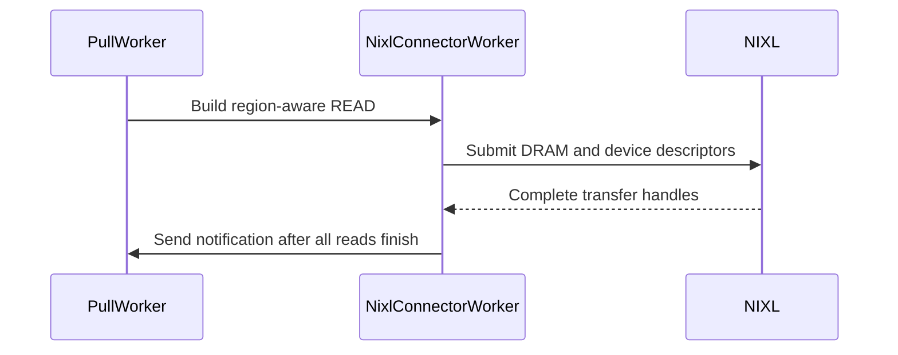

# #53780 [2/N][KV Connector][NIXL] Support per-region transfer geometry

https://github.com/vllm-project/vllm/pull/53780 · MatthewBonanni · MERGED · created 2026-08-25T19:21:01Z · merged 2026-09-08T20:01:13Z

## Summary

- Carry each NIXL region's stride, block capacity, block size, cache-group mapping, and name through metadata exchange and descriptor construction.
- Register packed cache storage without collapsing independently sized regions.
- Pair regions deterministically and support pure-MLA peers whose P/D region layouts differ.

This is the generic geometry prerequisite needed before HiSparse can transfer long-context host regions safely.

## Duplicate check

#50717 is a draft limited to packed-cache block-size synchronization. #51527 is a draft targeting heterogeneous P/D logical block sizes. Neither provides the general per-region metadata, packed registration, group mapping, and descriptor geometry in this PR. The HiSparse stack needs that common substrate independently.

## Tests

```bash
source .venv/bin/activate
python -m pytest tests/v1/kv_connector/unit/test_nixl_desc_geometry.py -q
python -m pytest   tests/v1/kv_connector/unit/test_nixl_connector_hma.py   tests/v1/kv_connector/unit/test_nixl_connector.py   tests/v1/kv_connector/unit/test_nixl_push_connector.py   -m cpu_test -q
```

Results: 200 passed for descriptor geometry; 70 passed and 125 deselected for the broader CPU NIXL selection. Changed-file pre-commit hooks passed.

## Model evaluation

Not applicable: this changes transfer descriptors and validation. The dependent HiSparse PR contains the end-to-end model and performance evaluation.

## AI assistance

AI assistance was used for implementation, tests, review, and documentation. The human submitter is responsible for reviewing every changed line and defending the change end-to-end.


---
## comments

**MatthewBonanni** (2026-08-25T19:59:20Z):

/ci run


**github-actions** (2026-08-25T19:59:39Z):

✅ Triggered [Buildkite CI #85556](https://buildkite.com/vllm/ci/builds/85556) for commit `4445a70686a9`.


**mergify** (2026-08-29T16:12:50Z):

This pull request has merge conflicts that must be resolved before it can be
merged. Please rebase the PR, @MatthewBonanni.

https://docs.github.com/en/pull-requests/collaborating-with-pull-requests/working-with-forks/syncing-a-fork


**coderabbitai** (2026-09-03T21:23:09Z):

<!-- This is an auto-generated comment: summarize by coderabbit.ai -->
<!-- review_stack_entry_start -->

[](https://app.coderabbit.ai/change-stack/vllm-project/vllm/pull/53780)

<!-- review_stack_entry_end -->
<!-- recent_review_start -->

No actionable comments were generated in the recent review. 🎉

<details>
<summary>ℹ️ Recent review info</summary>

<details>
<summary>⚙️ Run configuration</summary>

**Configuration used**: Repository UI

**Review profile**: CHILL

**Plan**: Team

**Run ID**: `c36e7001-2268-41cd-aebf-d064e3f44f34`

</details>

<details>
<summary>📥 Commits</summary>

Reviewing files that changed from the base of the PR and between f4909027680dc75d3c0f256c06f9702d2e66523a and 0c9d83dd5ac5144c5f7d56309197d3150e5c38fb.

</details>

<details>
<summary>📒 Files selected for processing (3)</summary>

* `tests/v1/kv_connector/unit/test_nixl_connector.py`
* `vllm/distributed/kv_transfer/kv_connector/v1/nixl/base_worker.py`
* `vllm/distributed/kv_transfer/kv_connector/v1/nixl/pull_worker.py`

</details>

<details>
<summary>🚧 Files skipped from review as they are similar to previous changes (1)</summary>

* vllm/distributed/kv_transfer/kv_connector/v1/nixl/base_worker.py

</details>

**Included review availability:** Your plan provides up to 10 included reviews per hour; 9 remain after this review.

</details>

---


<!-- recent_review_end -->
<!-- walkthrough_start -->

<details>
<summary>📝 Summary</summary>

<!-- This is an auto-generated comment: release notes by coderabbit.ai -->

## Summary by CodeRabbit

* **New Features**
  * Improved NIXL KV-cache transfers across region-mapped and overlaid cache layouts.
  * Added support for per-region capacities, grouping, memory types, and descriptor mapping.
  * Improved mixed DRAM/device pull transfers and completion notifications.
  * Updated transfer metadata compatibility for the latest region layout format.
  * Push transfers now explicitly reject unsupported mixed-memory KV caches.

* **Tests**
  * Expanded coverage for shared regions, independent memory pools, mixed-memory transfers, descriptor geometry, failure handling, and push-mode operations.

<!-- end of auto-generated comment: release notes by coderabbit.ai -->
## Walkthrough

NIXL now exchanges per-region block counts, group IDs, names, and memory types. Descriptor construction uses region-specific geometry. Pull transfers support mixed DRAM and device memory with deferred completion notifications. Push transfers reject mixed-memory caches.

### Changes

**Per-region NIXL transfer geometry**

|Layer / File(s)|Summary|
|---|---|
|**Metadata and cache-region registration** <br> `vllm/distributed/kv_transfer/kv_connector/v1/nixl/metadata.py`, `vllm/distributed/kv_transfer/kv_connector/v1/nixl/base_worker.py`|Metadata version 12 adds `region_mem_types` and removes obsolete geometry fields. Worker registration records per-region capacities, groups, names, memory types, and shared-region state.|
|**Region-aware descriptor geometry** <br> `vllm/distributed/kv_transfer/kv_connector/v1/nixl/base_worker.py`|Descriptor IDs and local or remote descriptors use cumulative per-region capacities, strides, and shared-region mappings.|
|**Region-aware pull and push transfers** <br> `vllm/distributed/kv_transfer/kv_connector/v1/nixl/tp_mapping.py`, `vllm/distributed/kv_transfer/kv_connector/v1/nixl/pull_worker.py`, `vllm/distributed/kv_transfer/kv_connector/v1/nixl/push_worker.py`, `vllm/distributed/kv_transfer/kv_connector/v1/nixl/base_worker.py`|`ReadSpec` supports region-mapped block IDs. Pull reads split mixed-memory descriptors and delay notifications until completion. Push transfers pass region metadata and reject mixed-memory caches.|
|**Geometry and transfer validation** <br> `tests/v1/kv_connector/unit/test_nixl_connector.py`, `tests/v1/kv_connector/unit/test_nixl_connector_hma.py`, `tests/v1/kv_connector/unit/test_nixl_desc_geometry.py`, `tests/v1/kv_connector/unit/test_nixl_push_connector.py`|Tests cover per-region offsets, overlaid regions, handshake metadata, mixed-memory descriptors, deferred notifications, failure handling, and updated transfer fixtures.|

**Estimated code review effort:** 4 (Complex) | ~60 minutes

<!-- final_review_risk_start -->
**Merge Risk:** _⚪ Minimal_ · up to `0c9d8`
<!-- final_review_risk_coverage:{"sourceCommitId":"0c9d83dd5ac5144c5f7d56309197d3150e5c38fb","coveredCommitId":"0c9d83dd5ac5144c5f7d56309197d3150e5c38fb","kind":"reviewed"} -->

NIXL transfers now carry and use per-region geometry for peers with different cache layouts. No concrete merge-blocking risk remains in the supplied current-head evidence.
<!-- final_review_risk_end -->

### Sequence Diagram(s)



</details>

<!-- walkthrough_end -->
<!-- pre_merge_checks_walkthrough_start -->

<details>
<summary>🚥 Pre-merge checks | ✅ 4 | ❌ 1</summary>

### ❌ Failed checks (1 warning)

|     Check name     | Status     | Explanation                                                                                                                                                                                 | Resolution                                                                         |
| :----------------: | :--------- | :------------------------------------------------------------------------------------------------------------------------------------------------------------------------------------------ | :--------------------------------------------------------------------------------- |
| Docstring Coverage | ⚠️ Warning | Docstring coverage is 63.16% which is insufficient. The required threshold is 80.00%. Docstring coverage is scoped to functions touched by this diff. Analyzed 57 functions across 9 files. | Write docstrings for the functions missing them to satisfy the coverage threshold. |

<details>
<summary>✅ Passed checks (4 passed)</summary>

|         Check name         | Status   | Explanation                                                                                                                                                     |
| :------------------------: | :------- | :-------------------------------------------------------------------------------------------------------------------------------------------------------------- |
|     Linked Issues check    | ✅ Passed | Check skipped because no linked issues were found for this pull request.                                                                                        |
| Out of Scope Changes check | ✅ Passed | Check skipped because no linked issues were found for this pull request.                                                                                        |
|         Title check        | ✅ Passed | The title clearly and concisely identifies the main change: adding per-region transfer geometry support to the NIXL KV Connector.                               |
|      Description check     | ✅ Passed | The description directly explains the per-region geometry, metadata exchange, packed cache registration, peer layout handling, tests, and scope of the changes. |

</details>

</details>

<!-- pre_merge_checks_walkthrough_end -->

- [ ] <!-- {"checkboxId":"585bb3f6-faf5-4dbf-96d2-74e382adf19a"} --> Fix all pre-merge checks with AI
<!-- finishing_touch_checkbox_start -->

<details>
<summary>✨ Finishing Touches 💡 1</summary>

<!-- finishing_touch_suggestion:docstrings -->
<details>
<summary>📝 Generate docstrings 💡</summary>

- [ ] <!-- {"checkboxId":"7962f53c-55bc-4827-bfbf-6a18da830691"} --> Create stacked PR
- [ ] <!-- {"checkboxId":"3e1879ae-f29b-4d0d-8e06-d12b7ba33d98"} --> Commit on current branch

</details>

</details>

<!-- finishing_touch_checkbox_end -->
<!-- tips_start -->

---

Thanks for using [CodeRabbit](https://coderabbit.ai?utm_source=oss&utm_medium=github&utm_campaign=vllm-project/vllm&utm_content=53780)! It's free for OSS, and your support helps us grow. If you like it, consider giving us a shout-out.

<details>
<summary>❤️ Share</summary>

- [X](https://twitter.com/intent/tweet?text=I%20just%20used%20%40coderabbitai%20for%20my%20code%20review%2C%20and%20it%27s%20fantastic%21%20It%27s%20free%20for%20OSS%20and%20offers%20a%20free%20trial%20for%20the%20proprietary%20code.%20Check%20it%20out%3A&url=https%3A//coderabbit.ai)
- [Mastodon](https://mastodon.social/share?text=I%20just%20used%20%40coderabbitai%20for%20my%20code%20review%2C%20and%20it%27s%20fantastic%21%20It%27s%20free%20for%20OSS%20and%20offers%20a%20free%20trial%20for%20the%20proprietary%20code.%20Check%20it%20out%3A%20https%3A%2F%2Fcoderabbit.ai)
- [Reddit](https://www.reddit.com/submit?title=Great%20tool%20for%20code%20review%20-%20CodeRabbit&text=I%20just%20used%20CodeRabbit%20for%20my%20code%20review%2C%20and%20it%27s%20fantastic%21%20It%27s%20free%20for%20OSS%20and%20offers%20a%20free%20trial%20for%20proprietary%20code.%20Check%20it%20out%3A%20https%3A//coderabbit.ai)
- [LinkedIn](https://www.linkedin.com/sharing/share-offsite/?url=https%3A%2F%2Fcoderabbit.ai&mini=true&title=Great%20tool%20for%20code%20review%20-%20CodeRabbit&summary=I%20just%20used%20CodeRabbit%20for%20my%20code%20review%2C%20and%20it%27s%20fantastic%21%20It%27s%20free%20for%20OSS%20and%20offers%20a%20free%20trial%20for%20proprietary%20code)

</details>


<sub>Comment `@coderabbitai help` to get the list of available commands.</sub>

<!-- tips_end -->


**mergify** (2026-09-04T23:31:24Z):

This pull request has merge conflicts that must be resolved before it can be
merged. Please rebase the PR, @MatthewBonanni.

https://docs.github.com/en/pull-requests/collaborating-with-pull-requests/working-with-forks/syncing-a-fork


**mergify** (2026-09-05T02:12:40Z):

Hi @MatthewBonanni, the pre-commit checks have failed. Please run:

```bash 
uv pip install pre-commit>=4.5.1
pre-commit install
pre-commit run --all-files
```

Then, commit the changes and push to your branch.

For future commits, `pre-commit` will run automatically on changed files before each commit.


**MatthewBonanni** (2026-09-08T17:38:37Z):

/ci run


**github-actions** (2026-09-08T17:38:56Z):

✅ Triggered [Buildkite CI #87742](https://buildkite.com/vllm/ci/builds/87742) for commit `8aa03342da39`.

