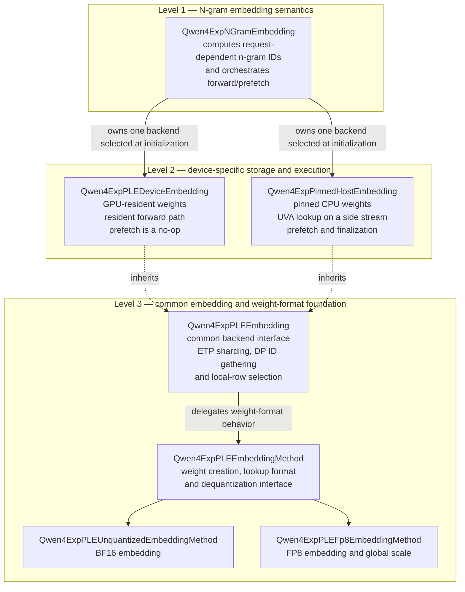
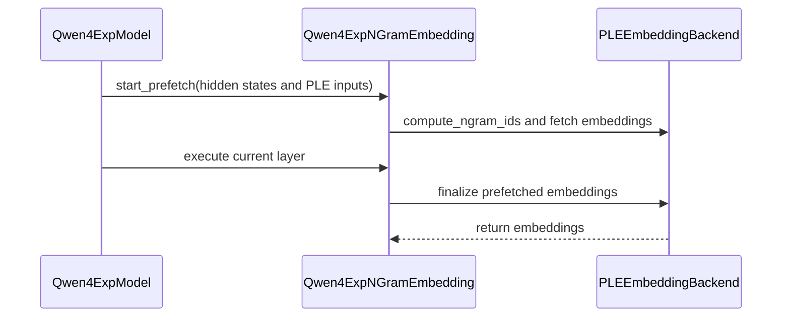

# #54371 [Qwen4Exp] Support UVA PLE-offload and Engram tensor parallelism

https://github.com/vllm-project/vllm/pull/54371 · peakcrosser7 · MERGED · created 2026-08-29T18:32:53Z · merged 2026-09-09T14:32:35Z

## Purpose

Add UVA-based PLE offload and Engram tensor parallelism (ETP) for Qwen3.8-Flash-Next.

`--engram-config` controls PLE weight storage and embedding sharding:

- `cpu_offload=true` stores each local PLE weight shard in pinned CPU memory. The GPU reads the required rows directly through CUDA Unified Virtual Addressing (UVA), using a dedicated CUDA stream. Offload can also be enabled with `VLLM_PLE_CPU_OFFLOAD=1` when `cpu_offload` is omitted; an explicit `cpu_offload` value takes precedence.
- `cpu_offload=false` keeps PLE weights on the GPU.
- `embedding_across_dp=false` uses `ETP=TP`, keeping a separate TP-sharded PLE table in each DP replica.
- `embedding_across_dp=true` uses `ETP=TP×DP`, sharding the PLE table across all DP replicas.

Offload and cross-DP sharding can be enabled independently. Both options default to false. 

## Design

The PLE embedding implementation is organized into three abstraction levels:




- `Qwen4ExpNGramEmbedding` contains the model-specific n-gram computation and coordinates `start_prefetch()` and `forward()`.
- `Qwen4ExpPLEDeviceEmbedding` and `Qwen4ExpPinnedHostEmbedding` encapsulate device-specific allocation and execution. The pinned-host backend implements the asynchronous UVA path, while the device backend retains the resident lookup path.
- `Qwen4ExpPLEEmbedding` provides the shared embedding contract and ETP logic. It delegates weight-format-specific creation and dequantization to  `Qwen4ExpPLEEmbeddingMethod`, with separate BF16 and FP8 implementations.

## Not a duplicate

Searched the open PRs for [Qwen4Exp PLE offload](https://github.com/vllm-project/vllm/pulls?q=is%3Apr+is%3Aopen+Qwen4Exp+PLE+offload), and [PLE UVA](https://github.com/vllm-project/vllm/pulls?q=is%3Apr+is%3Aopen+PLE+UVA).

There are related PRs, but they use materially different designs:

- [#53899](https://github.com/vllm-project/vllm/pull/53899) uses a dedicated CPU offload worker and transfers selected rows back to GPU workers. This PR keeps the table in process-local pinned memory and lets the GPU read the required rows directly through UVA, without an offload worker or IPC row transfer.
- [#54129](https://github.com/vllm-project/vllm/pull/54129) uses disk-backed mmap storage to reduce host-memory residency. This PR intentionally keeps the complete local shard pinned in RAM for direct UVA access.
- [#54431](https://github.com/vllm-project/vllm/pull/54431) optimizes ragged n-gram ID generation for the worker-based offload path.
- [#54517](https://github.com/vllm-project/vllm/pull/54517) fuses the PLE compute kernels and is orthogonal to the pinned-table storage, asynchronous UVA lookup, and NP topology introduced here.

## Test Plan

```bash
python -m pytest -q tests/models/qwen4_exp/test_ple.py
python -m pytest -q tests/engine/test_arg_utils.py -k engram
python -m pytest -q tests/test_config.py -k engram

git diff --check
```

## End-to-end validation:

Run Qwen3.8-Flash-Next with TP4, DP2, and MTP3 for all four `--engram-config` combinations:

| `cpu_offload` | `embedding_across_dp` | Expected PLE storage | Expected ETP topology |
| --- | --- | --- | --- |
| false | false | GPU memory | ETP4, a separate TP-sharded table per DP replica |
| false | true | GPU memory | ETP8, one table sharded across both DP replicas |
| true | false | Pinned CPU memory | ETP4, a separate TP-sharded table per DP replica |
| true | true | Pinned CPU memory | ETP8, one table sharded across both DP replicas |

For each combination, verify storage and topology against the table, exercise CUDA Graph capture and replay with uneven DP loads (including an idle replica), and run GSM8K.

## Test Result

- Added and updated PLE, Engram configuration, and CLI tests: 50 passed.
- Ruff checks on the PLE, Engram configuration, and communicator files: passed.
- `git diff --check`: passed.
- BF16 TP2/DP1/MTP3 startup and serving with `cpu_offload=true` and `embedding_across_dp=false`: passed.
- Both TP ranks reported BF16 PLE weights on CPU with pinned storage enabled.
- GSM8K: `0.9727` mean accuracy over 1,319 samples.

## Performance Results

Model: `Qwen/Qwen3.8-Flash-Next-FP8`. Prefill uses 8K input at concurrency 2; decode uses 1024 output tokens at concurrency 64 with MTP=3. The workloads use synthetic random-token inputs.

The `cpu_offload` and `embedding_across_dp` columns correspond to fields in `--engram-config`.

| `cpu_offload` | `embedding_across_dp` | Parallel Configuration | Prefill tok/s | Raw Decode tok/s | Draft Acceptance | Seq-steps/s | Est. C64 Step (ms) |
| --- | --- | --- | ---: | ---: | ---: | ---: | ---: |
| false | false | TP4/DP1 | 33544.13 | 2261.37 | 53.72% | 865.89 | 73.91 |
| true | false | TP4/DP1 | 33322.61 | 2245.84 | 51.56% | 881.83 | 72.58 |
| false | false | DP2/TP4/EP8/FI2S | 26872.32 | 2762.68 | 39.80% | 1259.20 | 50.83 |
| false | true | DP2/TP4/EP8/FI2S | 26763.57 | 2775.67 | 43.28% | 1207.65 | 53.00 |
| true | false | DP2/TP4/EP8/FI2S | 25751.63 | 3101.35 | 46.48% | 1295.25 | 49.41 |


Notes:

- `Prefill tok/s` is total token throughput. `Raw Decode tok/s` is output-token throughput and is affected by MTP acceptance.
- For MTP=3: `Seq-steps/s = Raw Decode tok/s / (1 + 3 × Draft Acceptance)`.
- `Est. C64 Step = 64 / Seq-steps/s × 1000`.
- `FI2S` means FlashInfer NVLink Two-Sided, the EP MoE All-to-All backend.
- After acceptance normalization, the offload decode differences are +1.84% for TP4 and +2.86% for DP2; these single-run differences should be treated as approximately flat.

> AI assistance was used for code analysis, implementation, refactoring, and test drafting. I reviewed the resulting changes and test results.

---
<details>
<summary>Essential Elements of an Effective PR Description Checklist</summary>

- [x] The purpose of the PR.
- [x] The difference from related open PRs.
- [x] The test plan.
- [x] The unit-test and model-evaluation results.
- [ ] Optional user-facing documentation for the new environment variable and CLI option.

</details>


---
## comments

**mergify** (2026-08-31T06:28:53Z):

This pull request has merge conflicts that must be resolved before it can be
merged. Please rebase the PR, @peakcrosser7.

https://docs.github.com/en/pull-requests/collaborating-with-pull-requests/working-with-forks/syncing-a-fork


**mergify** (2026-09-02T05:50:31Z):

This pull request has merge conflicts that must be resolved before it can be
merged. Please rebase the PR, @peakcrosser7.

https://docs.github.com/en/pull-requests/collaborating-with-pull-requests/working-with-forks/syncing-a-fork


**coderabbitai** (2026-09-06T05:12:41Z):

<!-- This is an auto-generated comment: summarize by coderabbit.ai -->
<!-- review_stack_entry_start -->

[](https://app.coderabbit.ai/change-stack/vllm-project/vllm/pull/54371)

<!-- review_stack_entry_end -->
<!-- walkthrough_start -->

## Walkthrough

The change adds configurable n-gram parallelism, NP process groups, new Qwen4Exp PLE embedding backends, conditional quantized weight loading, and pipelined PLE prefetching. Tests cover topology validation, quantization, CPU offload, lookup, reduction, and request layouts.

### Changes

**Qwen4Exp PLE and n-gram parallelism**

|Layer / File(s)|Summary|
|---|---|
|**N-gram parallel topology and configuration** <br> `vllm/config/parallel.py`, `vllm/engine/arg_utils.py`, `vllm/distributed/parallel_state.py`, `tests/engine/test_arg_utils.py`, `tests/test_config.py`|Adds `ngram_parallel_size`, CLI support, topology validation, NP and NP_DP process groups, lifecycle handling, and related tests.|
|**PLE embedding backends and quantization** <br> `vllm/models/qwen4_exp/nvidia/ple_layer.py`, `vllm/envs.py`, `vllm/model_executor/layers/vocab_parallel_embedding.py`, `tests/models/qwen4_exp/test_ple.py`|Adds resident-device and pinned-host PLE embedding implementations with FP8 handling, NP reduction, UVA lookup, backend selection, and expanded coverage.|
|**Conditional quantized weight loading** <br> `vllm/model_executor/layers/quantization/base_config.py`, `vllm/model_executor/model_loader/utils.py`, `tests/models/qwen4_exp/test_ple.py`|Adds `requires_device_loading` and skips device staging for quantization methods that do not require device-resident parameters.|
|**PLE lookup and prefetch execution** <br> `vllm/models/qwen4_exp/nvidia/model.py`, `vllm/models/qwen4_exp/nvidia/ple_layer.py`, `tests/models/qwen4_exp/test_ple.py`, `tests/test_config.py`|Pipelines PLE prefetching across model layers, uses direct eager-break methods, removes PLE custom operators, and updates graph and prefetch tests.|

**Estimated code review effort:** 5 (Critical) | ~90+ minutes

<!-- final_review_risk_start -->
**Merge Risk:** _🟠 High_ · up to `203fe`
<!-- final_review_risk_coverage:{"sourceCommitId":"203fed4faed6d35e97f7e0624eb1ee57c8b56cc8","coveredCommitId":"203fed4faed6d35e97f7e0624eb1ee57c8b56cc8","kind":"reviewed"} -->

NP configurations spanning DP replicas may silently produce incorrect embeddings when peer token counts change during CUDA graph replay. The capture-safety issue should be fixed before merge.
<!-- final_review_risk_end -->

### Sequence Diagram(s)



**Suggested reviewers:** `gau-nernst`, `jeejeelee`

<!-- walkthrough_end -->
<!-- pre_merge_checks_walkthrough_start -->

<details>
<summary>🚥 Pre-merge checks | ✅ 4 | ❌ 1</summary>

### ❌ Failed checks (1 warning)

|     Check name     | Status     | Explanation                                                                                                                                                                                  | Resolution                                                                         |
| :----------------: | :--------- | :------------------------------------------------------------------------------------------------------------------------------------------------------------------------------------------- | :--------------------------------------------------------------------------------- |
| Docstring Coverage | ⚠️ Warning | Docstring coverage is 37.93% which is insufficient. The required threshold is 80.00%. Docstring coverage is scoped to functions touched by this diff. Analyzed 87 functions across 13 files. | Write docstrings for the functions missing them to satisfy the coverage threshold. |

<details>
<summary>✅ Passed checks (4 passed)</summary>

|         Check name         | Status   | Explanation                                                                                                                                          |
| :------------------------: | :------- | :--------------------------------------------------------------------------------------------------------------------------------------------------- |
|     Linked Issues check    | ✅ Passed | Check skipped because no linked issues were found for this pull request.                                                                             |
| Out of Scope Changes check | ✅ Passed | Check skipped because no linked issues were found for this pull request.                                                                             |
|         Title check        | ✅ Passed | The title clearly summarizes the two main changes: UVA-based PLE offload and Engram tensor parallelism for Qwen4Exp.                                 |
|      Description check     | ✅ Passed | The description is detailed and directly explains the implementation, configuration, testing, validation, and performance results for the changeset. |

</details>

</details>

<!-- pre_merge_checks_walkthrough_end -->
<!-- tips_start -->

---

Thanks for using [CodeRabbit](https://coderabbit.ai?utm_source=oss&utm_medium=github&utm_campaign=vllm-project/vllm&utm_content=54371)! It's free for OSS, and your support helps us grow. If you like it, consider giving us a shout-out.

<details>
<summary>❤️ Share</summary>

- [X](https://twitter.com/intent/tweet?text=I%20just%20used%20%40coderabbitai%20for%20my%20code%20review%2C%20and%20it%27s%20fantastic%21%20It%27s%20free%20for%20OSS%20and%20offers%20a%20free%20trial%20for%20the%20proprietary%20code.%20Check%20it%20out%3A&url=https%3A//coderabbit.ai)
- [Mastodon](https://mastodon.social/share?text=I%20just%20used%20%40coderabbitai%20for%20my%20code%20review%2C%20and%20it%27s%20fantastic%21%20It%27s%20free%20for%20OSS%20and%20offers%20a%20free%20trial%20for%20the%20proprietary%20code.%20Check%20it%20out%3A%20https%3A%2F%2Fcoderabbit.ai)
- [Reddit](https://www.reddit.com/submit?title=Great%20tool%20for%20code%20review%20-%20CodeRabbit&text=I%20just%20used%20CodeRabbit%20for%20my%20code%20review%2C%20and%20it%27s%20fantastic%21%20It%27s%20free%20for%20OSS%20and%20offers%20a%20free%20trial%20for%20proprietary%20code.%20Check%20it%20out%3A%20https%3A//coderabbit.ai)
- [LinkedIn](https://www.linkedin.com/sharing/share-offsite/?url=https%3A%2F%2Fcoderabbit.ai&mini=true&title=Great%20tool%20for%20code%20review%20-%20CodeRabbit&summary=I%20just%20used%20CodeRabbit%20for%20my%20code%20review%2C%20and%20it%27s%20fantastic%21%20It%27s%20free%20for%20OSS%20and%20offers%20a%20free%20trial%20for%20proprietary%20code)

</details>


<sub>Comment `@coderabbitai help` to get the list of available commands.</sub>

<!-- tips_end -->


**mergify** (2026-09-07T01:07:55Z):

This pull request has merge conflicts that must be resolved before it can be
merged. Please rebase the PR, @peakcrosser7.

https://docs.github.com/en/pull-requests/collaborating-with-pull-requests/working-with-forks/syncing-a-fork


**github-actions** (2026-09-09T03:29:58Z):

✅ @peakcrosser7, CI is now available for this PR.

- `/ci run` starts upstream CI; `/amd-ci run` starts AMD CI only.
- `/ci retry` retries failed jobs in the CI build for the current PR head. If the current head has no CI build, it starts a new CI build for the current head containing only jobs that failed in the latest earlier CI build for this PR.
- `/amd-ci retry` retries failed jobs in AMD CI for the current PR head. Use `/amd-ci run` when the current head has no AMD CI build.
- `/ci cancel` cancels scheduled or running CI builds for this PR branch; `/amd-ci cancel` does the same for AMD CI only.

<!-- vllm-ci-authorized -->


**ZJY0516** (2026-09-09T03:56:07Z):

/ci run


**github-actions** (2026-09-09T03:56:25Z):

✅ Triggered [Buildkite CI #87831](https://buildkite.com/vllm/ci/builds/87831) for commit `06f1071ebbd7`.


**ZJY0516** (2026-09-09T06:53:18Z):

/ci run


**github-actions** (2026-09-09T06:53:54Z):

✅ Triggered [Buildkite CI #87854](https://buildkite.com/vllm/ci/builds/87854) for commit `0ff44a6d34c7`.


**ZJY0516** (2026-09-09T10:10:44Z):

/ci run


**github-actions** (2026-09-09T10:11:03Z):

✅ Triggered [Buildkite CI #87890](https://buildkite.com/vllm/ci/builds/87890) for commit `61ea973cac00`.


**Isotr0py** (2026-09-09T12:20:07Z):

/ci run


**github-actions** (2026-09-09T12:20:29Z):

✅ Triggered [Buildkite CI #87905](https://buildkite.com/vllm/ci/builds/87905) for commit `a2f82acf1fd6`.

