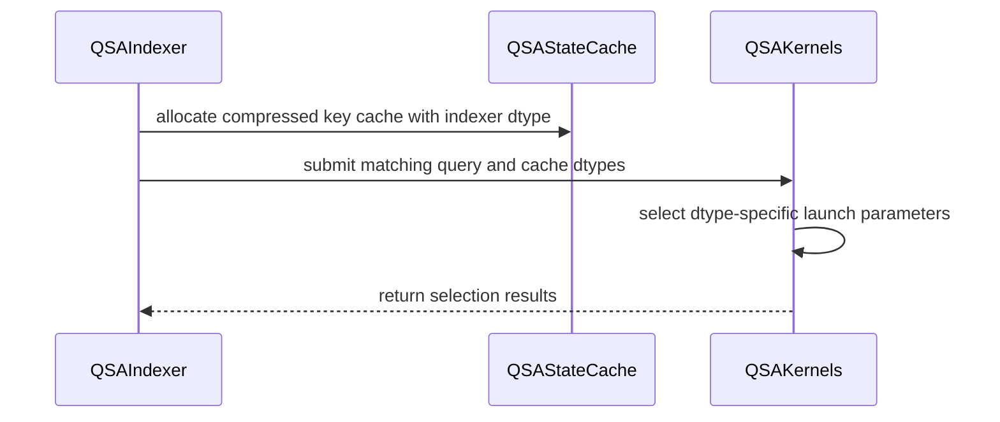

# #54890 [Qwen3.8-Flash-Next] Support FP8 indexer cache for QSA

https://github.com/vllm-project/vllm/pull/54890 · gau-nernst · MERGED · created 2026-09-02T04:59:54Z · merged 2026-09-07T12:15:45Z

## Purpose

This PR adds FP8 support for QSA indexer. This implementation doesn't contain any scaling.

### Microbenchmarks

All measurements are done on GB300

Decode

| bs | ctx | dql=1 bf16 -> fp8 | dql=4 bf16 -> fp8 |
|---:|----:|------:|------:|
| 1 | 8k | 3.9 -> 3.7 (1.0x) | 4.0 -> 4.0 (1.0x) |
| 1 | 64k | 4.8 -> 4.3 (1.1x) | 5.0 -> 4.4 (1.1x) |
| 4 | 8k | 4.3 -> 4.0 (1.1x) | 4.4 -> 4.3 (1.0x) |
| 4 | 64k | 7.6 -> 6.1 (1.3x) | 8.2 -> 6.5 (1.3x) |
| 16 | 8k | 5.8 -> 4.8 (1.2x) | 6.0 -> 5.1 (1.2x) |
| 16 | 64k | 16.9 -> 11.1 (1.5x) | 18.4 -> 12.9 (1.4x) |

Prefill

| ctx | rows | bf16 | fp8 | speedup |
|----:|-----:|-----:|----:|--------:|
| 8k | 2048 | 27.7 | 15.8 | 1.7x |
| 8k | 8192 (chunk) | 43.2 | 31.3 | 1.4x |
| 32k | 2048 | 42.2 | 31.3 | 1.4x |
| 32k | 16384 (chunk) | 272.9 | 187.2 | 1.5x |
| 128k | 2048 | 146.5 | 98.8 | 1.5x |
| 128k | 4096 (chunk) | 260.4 | 186.6 | 1.4x |

Generally the speedup is not linear, hinting Triton's inefficiencies. Future PRs can address FP8 performance (I have WIP branches for CuteDSL decode and Triton TMA prefill)

### E2E performance

TP4 GB300, 8k-1k

| concurrency | TTFT P50 bf16 (s) | TTFT P50 fp8 (s) | TPOT P50 bf16 (ms) | TPOT P50 fp8 (ms) |
|---:|---:|---:|---:|---:|
| 1 | 0.16 | 0.16 | 4.58 | 4.58 |
| 4 | 0.34 | 0.42 | 6.36 | 6.26 |
| 16 | 0.53 | 0.59 | 10.22 | 10.20 |
| 64 | 0.61 | 0.61 | 19.88 | 19.85 |

The result is mostly noise because indexer contributes little to e2e timing at short context + we are using BF16 ckpt. TTFT at c=4 is likely an anomaly.

## Test Plan

### Unit tests

Updated in this PR

### E2E tests

BF16 checkpoint, TP4 on GB300. Both with think=false (fast eval)

Branch | GSM8K (5-shot, n=2638) | LongBench-v2 (n=503)
--|--|--
bf16 (main) | 0.9682 flex / 0.9689 strict | 0.4871
fp8 indexer (this PR)| 0.9678 / 0.9685 | 0.5050

FP8 is better. Likely within noise

## Test Result

---

 Essential Elements of an Effective PR Description Checklist 

- [ ] The purpose of the PR, such as "Fix some issue (link existing issues this PR will resolve)".
- [ ] The test plan, such as providing test command.
- [ ] The test results, such as pasting the results comparison before and after, or e2e results
- [ ] (Optional) The necessary documentation update, such as updating `supported_models.md` and `examples` for a new model.

---
## comments

**mergify** (2026-09-04T09:31:26Z):

This pull request has merge conflicts that must be resolved before it can be
merged. Please rebase the PR, @gau-nernst.

https://docs.github.com/en/pull-requests/collaborating-with-pull-requests/working-with-forks/syncing-a-fork

**coderabbitai** (2026-09-04T11:50:14Z):

<!-- This is an auto-generated comment: summarize by coderabbit.ai -->
<!-- review_stack_entry_start -->

<!-- review_stack_entry_end -->
<!-- recent_review_start -->

No actionable comments were generated in the recent review. 🎉

ℹ️ Recent review info

⚙️ Run configuration

**Configuration used**: Repository UI

**Review profile**: CHILL

**Plan**: Team

**Run ID**: `e98459b1-5078-4aa8-9958-cad683ab1c63`

📥 Commits

Reviewing files that changed from the base of the PR and between c2bf1a6d173c532c8838c06290a658f8a80523e0 and 6fceb71365803ced6bee5f2a0972df05358f7075.

📒 Files selected for processing (3)

* `tests/models/qwen4_exp/test_qsa_pre_indexer.py`
* `tests/models/qwen4_exp/test_qsa_reference.py`
* `vllm/models/qwen4_exp/nvidia/ops/qsa_indexer.py`

**Included review availability:** Your plan provides up to 10 included reviews per hour; 9 remain after this review.

---

<!-- recent_review_end -->
<!-- walkthrough_start -->

📝 Summary

<!-- This is an auto-generated comment: release notes by coderabbit.ai -->

## Summary by CodeRabbit

* **New Features**
  * Added optional FP8 (E4M3) support for Qwen4Exp QSA compressed KV caches, alongside BF16.
  * QSA indexer operations now automatically use the configured cache precision.
* **Bug Fixes**
  * Added validation to detect mismatched query and cache data types and provide clearer error messages.
* **Tests**
  * Expanded correctness coverage for both BF16 and FP8 cache configurations.

<!-- end of auto-generated comment: release notes by coderabbit.ai -->
## Walkthrough

The QSA indexer now supports BF16 and FP8 E4M3 compressed caches. Dtype resolution, cache validation, kernel launch parameters, query handling, and correctness tests cover both formats.

### Changes

**QSA FP8 indexer support**

|Layer / File(s)|Summary|
|---|---|
|**Dtype resolution and cache contracts**   `vllm/models/qwen4_exp/common/qsa_cache.py`, `vllm/models/qwen4_exp/nvidia/indexer_qsa.py`|The backend advertises FP8 cache dtypes. Cache binding validates the configured dtype. The indexer applies BF16 or FP8 E4M3 to query and compressed-key storage.|
|**Dtype-aware QSA kernel execution**   `vllm/models/qwen4_exp/nvidia/ops/qsa_indexer.py`|Decode and prefill kernels require matching query and cache dtypes. FP8 caches select dedicated warp, tile, and stage parameters.|
|**BF16 and FP8 correctness coverage**   `tests/models/qwen4_exp/test_qsa_pre_indexer.py`, `tests/models/qwen4_exp/test_qsa_reference.py`|Tests cover fused, decode, and prefill paths with BF16 and FP8. FP8 comparisons use dtype-specific ULP or tolerance rules.|

**Estimated code review effort:** 3 (Moderate) | ~25 minutes

<!-- final_review_risk_start -->
**Merge Risk:** _🔵 Low_ · up to `6fceb`
<!-- final_review_risk_coverage:{"sourceCommitId":"6fceb71365803ced6bee5f2a0972df05358f7075","coveredCommitId":"6fceb71365803ced6bee5f2a0972df05358f7075","kind":"reviewed"} -->

FP8 QSA cache support is covered across dtype handling and selection paths, but the FP8 correctness check can still accept matching NaN outputs, potentially masking a numerical regression. This is a bounded test-coverage risk to address before relying on the new mode broadly.
<!-- final_review_risk_end -->

### Sequence Diagram(s)

<!-- walkthrough_end -->
<!-- pre_merge_checks_walkthrough_start -->

🚥 Pre-merge checks | ✅ 4 | ❌ 1

### ❌ Failed checks (1 warning)

|     Check name     | Status     | Explanation                                                                                                                                                                                 | Resolution                                                                         |
| :----------------: | :--------- | :------------------------------------------------------------------------------------------------------------------------------------------------------------------------------------------ | :--------------------------------------------------------------------------------- |
| Docstring Coverage | ⚠️ Warning | Docstring coverage is 33.33% which is insufficient. The required threshold is 80.00%. Docstring coverage is scoped to functions touched by this diff. Analyzed 18 functions across 5 files. | Write docstrings for the functions missing them to satisfy the coverage threshold. |

✅ Passed checks (4 passed)

|         Check name         | Status   | Explanation                                                                                                                   |
| :------------------------: | :------- | :---------------------------------------------------------------------------------------------------------------------------- |
|         Title check        | ✅ Passed | The title clearly and concisely describes the main change: adding FP8 indexer-cache support for QSA.                          |
|      Description check     | ✅ Passed | The description is directly related to the changeset and includes the purpose, benchmarks, E2E results, and test information. |
|     Linked Issues check    | ✅ Passed | Check skipped because no linked issues were found for this pull request.                                                      |
| Out of Scope Changes check | ✅ Passed | Check skipped because no linked issues were found for this pull request.                                                      |

<!-- pre_merge_checks_walkthrough_end -->

- [ ] <!-- {"checkboxId":"585bb3f6-faf5-4dbf-96d2-74e382adf19a"} --> Fix all pre-merge checks with AI
<!-- tips_start -->

---

Thanks for using [CodeRabbit](https://coderabbit.ai?utm_source=oss&utm_medium=github&utm_campaign=vllm-project/vllm&utm_content=54890)! It's free for OSS, and your support helps us grow. If you like it, consider giving us a shout-out.

❤️ Share

- [X](https://twitter.com/intent/tweet?text=I%20just%20used%20%40coderabbitai%20for%20my%20code%20review%2C%20and%20it%27s%20fantastic%21%20It%27s%20free%20for%20OSS%20and%20offers%20a%20free%20trial%20for%20the%20proprietary%20code.%20Check%20it%20out%3A&url=https%3A//coderabbit.ai)
- [Mastodon](https://mastodon.social/share?text=I%20just%20used%20%40coderabbitai%20for%20my%20code%20review%2C%20and%20it%27s%20fantastic%21%20It%27s%20free%20for%20OSS%20and%20offers%20a%20free%20trial%20for%20the%20proprietary%20code.%20Check%20it%20out%3A%20https%3A%2F%2Fcoderabbit.ai)
- [Reddit](https://www.reddit.com/submit?title=Great%20tool%20for%20code%20review%20-%20CodeRabbit&text=I%20just%20used%20CodeRabbit%20for%20my%20code%20review%2C%20and%20it%27s%20fantastic%21%20It%27s%20free%20for%20OSS%20and%20offers%20a%20free%20trial%20for%20proprietary%20code.%20Check%20it%20out%3A%20https%3A//coderabbit.ai)
- [LinkedIn](https://www.linkedin.com/sharing/share-offsite/?url=https%3A%2F%2Fcoderabbit.ai&mini=true&title=Great%20tool%20for%20code%20review%20-%20CodeRabbit&summary=I%20just%20used%20CodeRabbit%20for%20my%20code%20review%2C%20and%20it%27s%20fantastic%21%20It%27s%20free%20for%20OSS%20and%20offers%20a%20free%20trial%20for%20proprietary%20code)

Comment `@coderabbitai help` to get the list of available commands.

<!-- tips_end -->

**gau-nernst** (2026-09-07T07:01:48Z):

/ci run

**github-actions** (2026-09-07T07:02:07Z):

✅ Triggered [Buildkite CI #87503](https://buildkite.com/vllm/ci/builds/87503) for commit `c2bf1a6d173c`.

**gau-nernst** (2026-09-07T08:58:21Z):

/ci run

**github-actions** (2026-09-07T08:58:39Z):

✅ Triggered [Buildkite CI #87519](https://buildkite.com/vllm/ci/builds/87519) for commit `6fceb7136580`.

