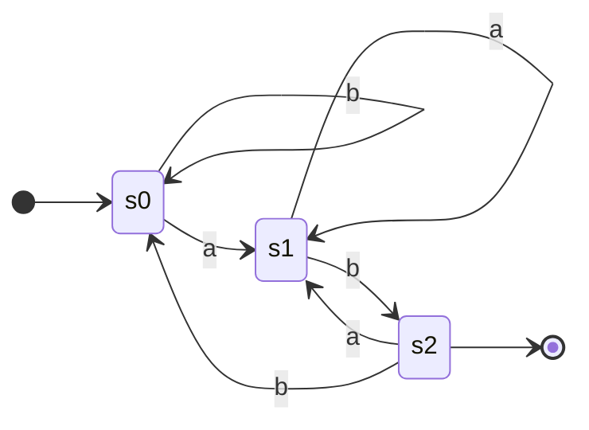
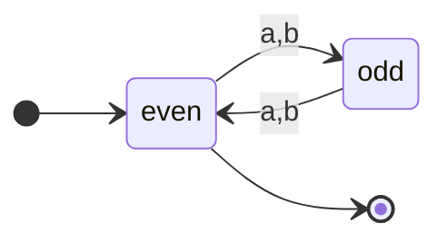
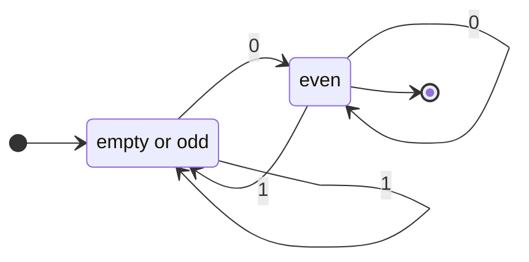

## elements

> [!definition] alphabet
>
> An alphabet $\Sigma$ is a finite set of symbols, for example $\Sigma=\{0,1\}$.

A string is a finite sequence of symbols from the alphabet. Over $\{0,1\}$, $011011$ is a string of length $6$. An unending sequence of bits is outside this definition.

The empty string $\epsilon$ has length $0$. It contains no symbols; it is different from the empty set. For $\Sigma=\{a,b\}$:

$$
\lvert aaba\rvert=4,\qquad \lvert a^3\rvert=\lvert aaa\rvert=3.
$$

### set of string

$\Sigma^n$ is the set of strings of length $n$. In particular, $\Sigma^0=\{\epsilon\}$. The set of all finite strings is

$$
\Sigma^*=\bigcup_{n=0}^{\infty}\Sigma^n.
$$

If $\Sigma$ has at least one symbol, $\Sigma^*$ is infinite, although each of its strings is finite. Allowing an empty alphabet gives $\varnothing^*=\{\epsilon\}$. The empty string is always in $\Sigma^*$; it is not an input symbol. These are the [alphabet, string and language conventions in Western's automata notes](https://www.csd.uwo.ca/~mmorenom/CS447/Lectures/Lexical.html/node2.html).

### concatenation

Concatenation appends one string to another: $x=101$ and $y=111$ give $xy=101111$.

$$
\begin{aligned}
x^0&=\epsilon, & x^n&=xx^{n-1}\quad(n\geq1),\\
(xy)z&=x(yz), & \lvert xy\rvert&=\lvert x\rvert+\lvert y\rvert,\\
\epsilon x&=x\epsilon=x.
\end{aligned}
$$

### language

A language over $\Sigma$ is any subset $L\subseteq\Sigma^*$. It need not come with a procedure for deciding membership. For languages over the same alphabet:

$$
\begin{aligned}
\overline L&=\Sigma^*\setminus L,\\
L_1L_2&=\{xy\mid x\in L_1,\ y\in L_2\},\\
L^0&=\{\epsilon\},\qquad L^n=LL^{n-1}\quad(n\geq1),\\
L^*&=\bigcup_{n=0}^{\infty}L^n.
\end{aligned}
$$

Union and intersection have their usual set meanings. Complement depends on the alphabet: changing $\Sigma$ changes the strings outside $L$.

## definition

A deterministic finite automaton is

$$
\begin{aligned}
M&=(Q,\Sigma,\delta,s,F),\\
Q&:\text{finite, nonempty set of states},\\
\Sigma&:\text{finite input alphabet},\\
\delta&:Q\times\Sigma\to Q,\\
s&\in Q,\qquad F\subseteq Q.
\end{aligned}
$$

Here $\delta$ is total: every state has exactly one next state for each input symbol. If a diagram omits an impossible input, complete it with a rejecting sink whose transitions return to itself. The current state is the machine's entire memory of the prefix it has read. [Cornell's DFA definition](https://www.cs.cornell.edu/courses/cs2800/2017fa/lectures/lec21-dfa.html) uses this total-transition convention.

### examples

Over $\Sigma=\{a,b\}$, accept strings containing at least three occurrences of $a$. Use

$$
Q=\{s_1,s_2,s_3,s_4\},\qquad s=s_1,\qquad F=\{s_4\}.
$$

States $s_1,s_2,s_3$ mean that the prefix contains respectively zero, one or two occurrences of $a$. State $s_4$ means at least three. Once that threshold is reached, the exact count cannot affect acceptance.

| State     | $a$   | $b$   |
| --------- | ----- | ----- |
| $\to s_1$ | $s_2$ | $s_1$ |
| $s_2$     | $s_3$ | $s_2$ |
| $s_3$     | $s_4$ | $s_3$ |
| $*s_4$    | $s_4$ | $s_4$ |

The incoming arrow marks the start; an asterisk marks acceptance. The table is a [[thoughts/representations|representation]] of $\delta$. Reading $b$ leaves the count unchanged, and reading $a$ increments it until the saturated state $s_4$. For example, $ababa$ is accepted and $abbab$ is rejected. Acceptance is checked after the whole input.

## language.

The [[thoughts/Language|language]] recognized by $M$ is a set of strings, so $\mathcal L(M)\subseteq\Sigma^*$. To express it, extend the one-symbol transition function to whole strings.

### transfer function

$$
\begin{aligned}
\delta &:Q\times\Sigma\to Q,\\
\hat\delta &:Q\times\Sigma^*\to Q,\\
\hat\delta(q,\epsilon)&=q,\\
\hat\delta(q,xa)&=\delta(\hat\delta(q,x),a)
\quad(x\in\Sigma^*,\ a\in\Sigma).
\end{aligned}
$$

The recursive rule processes the prefix $x$, then reads $a$. The finite table for $\delta$ therefore determines the result for every finite input.

> [!math] Questions
>
> Construct DFAs for the following languages, or explain why none exists. Use $\Sigma=\{a,b\}$ except where specified.
>
> 1. $\{xab\mid x\in\Sigma^*\}$.
> 2. $\{x\in\Sigma^*\mid \lvert x\rvert\equiv0\pmod2\}$.
> 3. Nonempty binary strings representing even numbers, over $\{0,1\}$. Leading zeros are allowed.
> 4. Strings containing the substring $abc$, over $\{a,b,c\}$.
> 5. Strings whose second-last symbol is $a$.
> 6. $\{a^nb^n\mid n\geq0\}$.
> 7. Strings whose fifth-last symbol is $a$.
> 8. $\varnothing$.
> 9. $\Sigma^*$.

constructions

1. Keep the longest suffix of the input that is also a prefix of $ab$: no match in $s_0$, suffix $a$ in $s_1$, and suffix $ab$ in $s_2$. Only $s_2$ accepts. In all three diagrams, the incoming arrow marks the start and an arrow to the end marker marks acceptance. The end marker consumes no input.

Reading another $a$ from $s_1$ preserves a possible start of $ab$. Reading $b$ from $s_2$ loses the suffix match. Thus $aab$ is accepted and $abb$ is rejected.

2. Toggle between even and odd length on either symbol. The start state accepts because the empty string has even length.

3. Every nonempty binary string is even exactly when its last bit is $0$. State $s_0$ means empty input or a last bit of $1$; state $s_1$ means a last bit of $0$.

4. Track the longest suffix matching a prefix of $abc$: $\epsilon$, $a$, $ab$, or the accepting state for having seen $abc$. The accepting state loops on every symbol. Before reaching it, an $a$ starts a fresh match; unexpected symbols discard the current partial match.
5. Store the last two symbols, with shorter states before two symbols have arrived. Accept when the stored pair begins with $a$.
6. No DFA exists; the argument appears below.
7. Store the last five symbols, with shorter states for shorter inputs. Accept when the stored five-symbol suffix begins with $a$. A fixed-size suffix needs finitely many states.
8. Use one looping state and no accepting states.
9. Use one looping state that is both start and accepting.

## acceptance

$$
M\text{ accepts }x\iff\hat\delta(s,x)\in F,\qquad
\mathcal L(M)=\{x\in\Sigma^*\mid\hat\delta(s,x)\in F\}.
$$

Visiting an accepting state midway through a run does not settle the result. The suffix-$ab$ machine accepts $ab$ and rejects $aba$. The empty string is accepted exactly when $s\in F$. See [Cornell's language-of-a-machine notes](https://www.cs.cornell.edu/courses/cs2800/2016sp/lectures/lec32-languages.html).

For binary strings representing a multiple of three or the number six, six adds no accepted number because it is already a multiple of three. A remainder machine suffices:

$$
\delta(r,b)=(2r+b)\bmod3,\qquad r\in\{0,1,2\},\quad b\in\{0,1\}.
$$

Appending a binary digit doubles the old value and adds the digit. Start in remainder $0$ and accept remainder $0$. This version also accepts $\epsilon$. If the exercise requires a nonempty numeral, add a rejecting start state with the same outgoing transitions as remainder $0$.

## regular

A language is regular when some DFA recognizes exactly that language. Some useful cases:

- $\{a^n\mid n\geq0\}$ and $\{a^nb^m\mid n,m\geq0\}$ are regular. They require tracking which symbols are allowed next.
- $\{a^nb^n\mid0\leq n\leq3\}$ is finite and regular. A DFA can track prefixes of its four strings and reject every other continuation.
- $\{a^nb^n\mid n\geq0\}$ is nonregular. Suppose a DFA had $k$ states. Two of the $k+1$ prefixes $\epsilon,a,\ldots,a^k$ must reach the same state, say $a^i$ and $a^j$ with $i<j$. Appending $b^i$ would then give the same verdict for both, although only $a^ib^i$ belongs to the language. This contradicts recognition.

The same prefixes distinguish strings for $\{x\mid\#_a(x)=\#_b(x)\}$, where $\#_a(x)$ counts occurrences of $a$. A regular language can therefore have nonregular subsets: $\{a^nb^n\mid n\geq0\}\subseteq\{a^nb^m\mid n,m\geq0\}$. Passing to an [[thoughts/NFA|NFA]] does not change which languages are regular. [Stanford's Myhill–Nerode guide](https://web.stanford.edu/class/archive/cs/cs103/cs103.1256/guide_to_myhill_nerode) develops this distinguishing-suffix argument.

For regular languages over the same alphabet, complement, intersection and union are regular.

### proof (1)

For a complete DFA $M=(Q,\Sigma,\delta,s,F)$, replace $F$ with $Q\setminus F$. Every input has exactly one completed run, whose verdict is reversed:

$$
\mathcal L(Q,\Sigma,\delta,s,Q\setminus F)=\Sigma^*\setminus\mathcal L(M).
$$

Completeness matters. A missing transition must lead to a sink before complementing, because an input rejected by getting stuck must become accepted.

### proof (2)

Let $M_1$ and $M_2$ recognize $L_1$ and $L_2$. Run both machines on the same input and store the pair of current states. For every prefix $x$:

$$
\hat\delta_\times((p,q),x)=
(\hat\delta_1(p,x),\hat\delta_2(q,x)).
$$

Induction on the length of $x$ proves this: the empty input leaves both coordinates unchanged, and each next symbol updates both once. Accepting only pairs whose two coordinates accept gives $L_1\cap L_2$. Accepting pairs with at least one accepting coordinate gives $L_1\cup L_2$.

## product construction

The shared transition structure is

$$
\begin{aligned}
Q_\times&=Q_1\times Q_2,\qquad s_\times=(s_1,s_2),\\
\delta_\times((p,q),a)&=(\delta_1(p,a),\delta_2(q,a)).
\end{aligned}
$$

The accepting sets differ:

$$
\begin{aligned}
F_\cap&=F_1\times F_2,\\
F_\cup&=(F_1\times Q_2)\cup(Q_1\times F_2)\\
&=Q_\times\setminus((Q_1\setminus F_1)\times(Q_2\setminus F_2)).
\end{aligned}
$$

These are respectively “both” and “at least one.” [Cornell's union construction](https://www.cs.cornell.edu/courses/cs2800/2017fa/lectures/lec23-union.html) uses the latter choice.

For nonempty binary multiples of six, intersect the even-number machine with the remainder-modulo-three machine. Write $e_r$ or $o_r$ for a product state: $e$ means the last bit was $0$, $o$ means empty input or last bit $1$, and $r$ is the remainder modulo three. Leading zeros and the numeral $0$ are allowed.

| State     | $0$   | $1$   |
| --------- | ----- | ----- |
| $*e_0$    | $e_0$ | $o_1$ |
| $e_1$     | $e_2$ | $o_0$ |
| $e_2$     | $e_1$ | $o_2$ |
| $\to o_0$ | $e_0$ | $o_1$ |
| $o_1$     | $e_2$ | $o_0$ |
| $o_2$     | $e_1$ | $o_2$ |

Only $e_0$ accepts. For instance, $110$ represents $6$ and ends in $e_0$. The strings $11$ and $10$ represent $3$ and $2$; they would pass the union test, while the intersection rejects both.

## quotient construction

_lec feb 4_

Two states are equivalent when every possible remaining input gives the same acceptance verdict:

$$
p\approx q\iff\forall x\in\Sigma^*:
\bigl(\hat\delta(p,x)\in F\iff\hat\delta(q,x)\in F\bigr).
$$

Taking $x=\epsilon$ shows that equivalent states agree on acceptance. They also satisfy the right-congruence condition

$$
p\approx q\implies\delta(p,a)\approx\delta(q,a)
\quad\text{for every }a\in\Sigma.
$$

Otherwise a distinguishing suffix after $a$ would distinguish $p$ and $q$ as well. Define $[p]=\{q\in Q\mid p\approx q\}$. Then $[p]=[q]$ exactly when $p\approx q$. The quotient DFA is

$$
\begin{aligned}
Q'&=\{[p]\mid p\in Q\},\\
\delta'([p],a)&=[\delta(p,a)],\\
s'&=[s],\qquad F'=\{[p]\mid p\in F\}.
\end{aligned}
$$

Right congruence makes the transition independent of the representative chosen from a class. Agreement on acceptance makes $F'$ well-defined. Remove unreachable states first; quotienting the reachable states by this equivalence gives a minimal DFA.

For the product table above, the classes are

$$
A=\{e_0\},\quad B=\{o_0\},\quad
C=\{e_1,o_1\},\quad D=\{e_2,o_2\}.
$$

| State   | $0$ | $1$ |
| ------- | --- | --- |
| $*A$    | $A$ | $C$ |
| $\to B$ | $A$ | $C$ |
| $C$     | $D$ | $B$ |
| $D$     | $C$ | $D$ |

States $A$ and $B$ have identical outgoing transitions, yet differ on the empty suffix. State $B$ differs from $C$ and $D$ on suffix $0$; $C$ differs from $D$ on suffix $10$. All four classes are reachable, so the quotient is minimal.

To find the classes by table filling:

1. List unordered pairs of distinct reachable states.
2. Mark each pair with exactly one accepting state. The empty suffix distinguishes it.
3. Mark an unmarked pair if some symbol leads to a marked pair.
4. Repeat step 3 until a whole pass adds no marks. Only then merge the unmarked pairs.

Each propagated mark has a distinguishing suffix: prepend the transition symbol to the suffix that distinguished its successors. At the fixed point, unmarked pairs agree on acceptance and their successors remain unmarked, so induction gives agreement for every suffix. See [Cornell's minimization notes](https://www.cs.cornell.edu/courses/cs4120/2022sp/notes/leximpl/#dfa-minimization).
