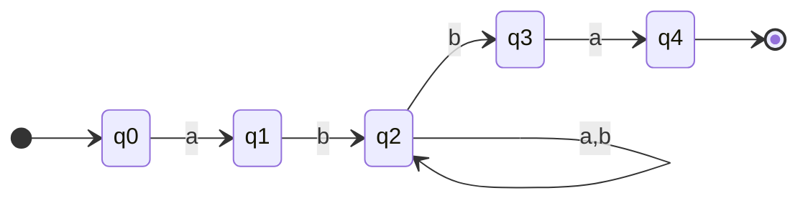
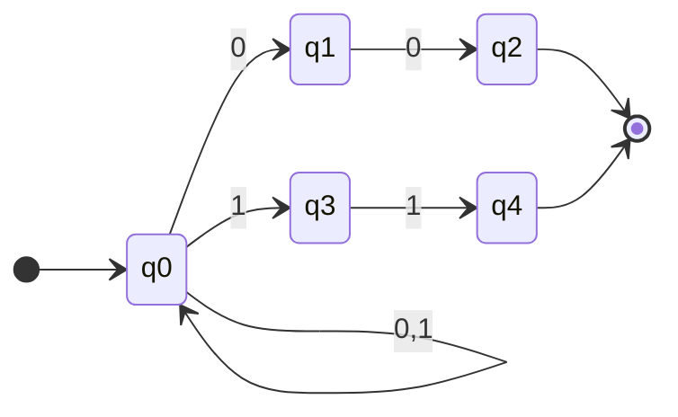
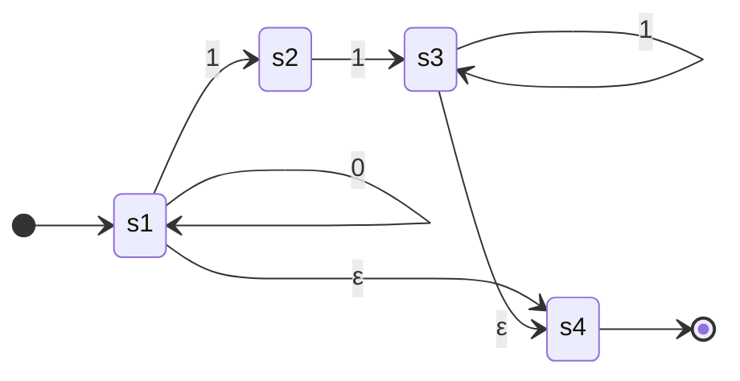

## definition

An NFA can have several next states for the same input symbol. It accepts a string when at least one path consumes the whole string and ends in an accepting state. A path that gets stuck rejects only that path.

I use a set of start states here:

$$
\begin{aligned}
M &= (Q, \Sigma, \Delta, S, F) \\
\Delta &: Q \times \Sigma \to \mathcal{P}(Q) \\
S &\subseteq Q, \qquad F \subseteq Q.
\end{aligned}
$$

$Q$ is a finite set of states, $\Sigma$ a finite alphabet, and $\mathcal{P}(Q)$ the set of subsets of $Q$. The set $\Sigma^*$ contains every finite string over $\Sigma$, including the empty string $\epsilon$. An omitted transition means $\Delta(q,a)=\varnothing$.

Let $R_w$ be the states reachable after reading $w$. For an NFA without epsilon transitions:

$$
\begin{aligned}
R_\epsilon &= S, \\
R_{wa} &= \bigcup_{q \in R_w} \Delta(q,a), \\
\mathcal{L}(M) &= \{w \in \Sigma^* \mid R_w \cap F \neq \varnothing\}.
\end{aligned}
$$

This gives a direct simulation: keep the reachable states and update them for each symbol. Acceptance is checked after the last symbol. See [Cornell's NFA notes](https://www.cs.cornell.edu/courses/cs4120/2021sp/notes/leximpl/#nfa).

## examples

In these diagrams, the incoming arrow marks a start state. An arrow to the end marker identifies an accepting state; it consumes no input and adds no transition to $\Delta$.

### a fixed prefix and suffix

Over $\Sigma=\{a,b\}$, accept

$$
\mathcal{L}(M)=\{abxba \mid x \in \Sigma^*\}.
$$

At $q_2$, a $b$ can extend the middle string or begin the suffix. Both choices remain available. The accepting path for $ababa$ uses $x=a$. The shortest accepted string is $abba$, with $x=\epsilon$; the prefix and suffix occupy separate positions, so $aba$ is rejected.

### ending with two equal bits

Over $\Sigma=\{0,1\}$, accept

$$
\mathcal{L}(M)=\{yx \mid y \in \Sigma^*,\ x \in \{00,11\}\}.
$$

The loop reads an arbitrary prefix. A branch succeeds when it starts exactly two symbols before the input ends and reads equal bits. Thus $100$ and $011$ are accepted. The string $001$ is rejected even though a path reaches $q_2$ after its first two symbols: that path cannot consume the final $1$.

## epsilon transition

An $\epsilon$-transition changes state without consuming a symbol. Extend the transition function to

$$
\Delta:Q\times(\Sigma\cup\{\epsilon\})\to\mathcal{P}(Q).
$$

For $A\subseteq Q$, its **epsilon closure** $E(A)$ contains every state reachable from $A$ by zero or more epsilon transitions, including the states in $A$ themselves. Simulation starts with $R_\epsilon=E(S)$ and takes epsilon closure again after each consumed symbol. See [Aho's definition and construction](https://www.cs.columbia.edu/~aho/cs3261/Lectures/L3-Regular_Expressions.html).

Here $S=\{s_1\}$, $F=\{s_4\}$, and $\Sigma=\{0,1\}$. The language is

$$
\mathcal{L}(M)=\{0^n1^m\mid n,m\in\mathbb{N}_0,\ m=0\text{ or }m\geq2\}.
$$

The path through $s_1$ accepts any number of zeros, including none. Reading one $1$ reaches $s_2$, which cannot accept. A second $1$ reaches $s_3$; further ones stay there. No zero can follow a one. For example, $\epsilon$, $000$, and $00111$ are accepted; $1$, $001$, and $110$ are rejected.

## subset construction

A [[thoughts/DFA|DFA]] can store the NFA's entire reachable-state set as one state. For the epsilon convention above, construct

$$
\begin{aligned}
Q_D &= \mathcal{P}(Q), \\
s_D &= E(S), \\
\delta_D(A,a) &= E\left(\bigcup_{q\in A}\Delta(q,a)\right), \\
F_D &= \{A\subseteq Q\mid A\cap F\neq\varnothing\}.
\end{aligned}
$$

Starting from $E(S)$, generate transitions until no new subsets appear. Only reachable subsets need to be stored. The empty subset is a rejecting sink: it maps to itself on every symbol. Without epsilon transitions, $E(A)=A$.

For the epsilon example, the reachable DFA is:

| DFA state   | NFA subset    | On $0$ | On $1$ | Accepting? |
| ----------- | ------------- | ------ | ------ | ---------- |
| $A$ (start) | $\{s_1,s_4\}$ | $A$    | $B$    | yes        |
| $B$         | $\{s_2\}$     | $D$    | $C$    | no         |
| $C$         | $\{s_3,s_4\}$ | $D$    | $C$    | yes        |
| $D$         | $\varnothing$ | $D$    | $D$    | no         |

After each input prefix, the DFA state equals the set of states the NFA can reach. This invariant proves that they accept the same strings. An NFA with $n$ states has at most $2^n$ subsets, which bounds the size of the constructed DFA. The two models therefore recognize the same regular languages. [Cornell's subset-construction notes](https://www.cs.cornell.edu/courses/cs4120/2021sp/notes/leximpl/#nfa-to-dfa) give the simulation argument.
