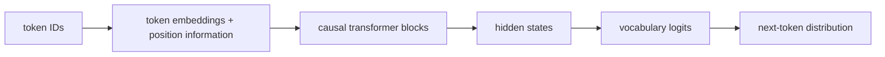

A transformer combines [[thoughts/Attention#Multi-head Attention|attention]] with position-wise feed-forward layers, residual connections, and normalization. Attention lets each position read weighted combinations of other positions' value vectors. The weights come from query–key scores computed from the current representations using learned projections. A high weight says where information enters that computation; it does not identify a high-entropy token or guarantee semantic importance. [@vaswani2023attentionneed]

The architecture and the training objective are separate choices. The original transformer had an encoder and a decoder for translation. Here I focus on a decoder-only [[thoughts/Autoregressive models|autoregressive]] language model: read a prefix, produce a distribution for the next token, append a token, repeat. [Attention Is All You Need, §3](https://arxiv.org/html/1706.03762v7#S3)

## internals

See also: [transformers from scratch](https://e2eml.school/transformers.html), @geva2021transformerfeedforwardlayerskeyvalue

Token IDs select rows from an embedding table. Position information enters through positional embeddings or an operation such as rotary position encoding. Each block updates those representations through attention and a feed-forward network. A final projection produces one logit per vocabulary item. [GPT-2 report, §2.3](https://cdn.openai.com/better-language-models/language_models_are_unsupervised_multitask_learners.pdf)



For one attention head, with queries $Q$, keys $K$, values $V$, and key width $d_k$:

$$
\operatorname{Attention}(Q,K,V)
=\operatorname{softmax}\!\left(\frac{QK^\top}{\sqrt{d_k}}+C\right)V,
\qquad
C_{t,j}=\begin{cases}0&j\leq t,\\-\infty&j>t.\end{cases}
$$

The softmax runs across key positions. The causal mask $C$ prevents position $t$ from reading future tokens. Multiple heads use separate projections, then combine their outputs. [Vaswani et al., §3.2](https://arxiv.org/html/1706.03762v7#S3.SS2)

For a batch of $B$ sequences with $T$ input positions and vocabulary $\mathcal V$, logits have shape $B\times T\times |\mathcal V|$. Let $y_{b,t}=x_{b,t+1}$ be the target after input position $t$, and let $m_{b,t}$ equal one exactly where that target should contribute to training. With $N_{\mathrm{sup}}=\sum_{b,t}m_{b,t}>0$:

$$
\mathcal L(\theta)
=-\frac{1}{N_{\mathrm{sup}}}
\sum_{b=1}^{B}\sum_{t=1}^{T}
 m_{b,t}\log p_\theta(y_{b,t}\mid x_{b,\leq t}).
$$

A batch can contain padding or targets excluded from supervision, so the denominator counts supervised positions. For example, sequences with three and one supervised targets contribute four terms in total. Using the padded batch size would change the loss scale when padding changes.

Training supplies the actual prefix at every position. The causal mask permits all these next-token predictions in one forward pass. During generation, each sampled token becomes part of the next prefix.

## memory limitations.

See also: [[thoughts/state-space models|state-space models]], [Karpathy’s linked thread](https://x.com/karpathy/status/1691571869051445433).

A transformer uses memory for weights, temporary activations, and, during cached decoding, previous keys and values. Dense attention over a sequence of length $T$ computes $T^2$ query–key scores per head. Implementations can avoid storing the complete score matrix; that changes memory traffic and storage without removing all those interactions. [Efficient Transformers: A Survey](https://arxiv.org/abs/2009.06732)

For an ordinary uncompressed KV cache with $L$ layers, $B$ sequences of length $T$, $h_{\mathrm{KV}}$ key/value heads, equal key and value width $d_h$, and $s$ bytes per element:

$$
\operatorname{KVBytes}=2BLTh_{\mathrm{KV}}d_hs.
$$

The factor of two counts keys and values. Under these assumptions, doubling the context doubles cache storage. Grouped-query attention reduces the number of KV heads; compression and offloading change what is stored or where it lives. The serving bottleneck also depends on how quickly hardware can move those bytes. [AI and Memory Wall](https://arxiv.org/abs/2403.14123)

## inference.

Prefill processes a prompt and builds its KV cache. Decode extends the sequence, usually one token per iteration. [[thoughts/PD disaggregated serving#prefill/decode|Disaggregated serving]] runs those stages on separate workers, which requires transferring or sharing the cache between them.

### sampling

Given finite logits $z_i$ over vocabulary $\mathcal V$, the base distribution is

$$
p_i=\frac{e^{z_i}}{\sum_{j\in\mathcal V}e^{z_j}}.
$$

A sampler changes this distribution before drawing a token. The following definitions describe individual operations. Their composition needs an explicit order.

#### temperature

For $\tau>0$:

$$
p_i^{(\tau)}=\frac{e^{z_i/\tau}}{\sum_j e^{z_j/\tau}}.
$$

Let $A=\{i:z_i=\max_j z_j\}$ be the set of tied maxima. Then

$$
\lim_{\tau\to0^+}p_i^{(\tau)}=\frac{\mathbf1[i\in A]}{|A|},
\qquad
\lim_{\tau\to\infty}p_i^{(\tau)}=\frac{1}{|\mathcal V|}.
$$

The low-temperature limit is uniform over exact ties. An implementation's greedy mode can choose one tied token through a separate tie-breaking rule.

For fixed finite logits, entropy is nondecreasing with temperature:

$$
H(p^{(\tau)})=-\sum_i p_i^{(\tau)}\log p_i^{(\tau)},
\qquad
\frac{dH}{d\tau}=\frac{\operatorname{Var}_{p^{(\tau)}}(z)}{\tau^3}\geq0.
$$

This follows by differentiating the softmax partition function. It concerns the next-token distribution before any truncation. It does not establish the quality or diversity of complete answers.

#### top-k

Choose a deterministic ordering for probability ties, and let $S_k$ contain the first $k$ tokens in descending probability order. Keep those tokens and renormalize:

$$
p_i^{(k)}=\frac{p_i\mathbf1[i\in S_k]}{\sum_{j\in S_k}p_j}.
$$

Exactly $k$ candidates survive under this definition. A threshold implementation that keeps every token tied with the $k$th token can retain more. The parameter fixes a count even when probability is distributed unevenly across those candidates.

#### top-p (nucleus)

Write the descending probabilities as $p_{(1)},\ldots,p_{(|\mathcal V|)}$. For a mass threshold $\rho\in(0,1]$, choose

$$
k_\rho=\min\left\{k:\sum_{j=1}^{k}p_{(j)}\geq\rho\right\}.
$$

Retain the first $k_\rho$ tokens, including the token that crosses the threshold, and renormalize. The number retained changes with the distribution. A direct implementation sorts the vocabulary; this is an implementation choice, not a requirement that every sampler use a full sort. [@holtzman2020curiouscaseneuraltext] [Nucleus sampling paper](https://arxiv.org/abs/1904.09751)

#### min-p

For a relative threshold $m\in[0,1]$, retain

$$
S_m=\{i:p_i\geq m\max_j p_j\}.
$$

Then renormalize on $S_m$. At $m=0$, every token survives; at $m=1$, only the maxima survive. For positive $m$ after temperature scaling, the same condition can be written without computing probabilities:

$$
z_i-z_{\max}\geq\tau\log m.
$$

This makes the interaction with temperature explicit. Increasing $\tau$ widens the allowed logit gap for fixed $m$.

Nguyen et al. report gains from min-p, including at high temperatures. [@nguyen2025turningheatminpsampling] A subsequent [reanalysis by Schaeffer et al.](https://arxiv.org/html/2506.13681v1) disputes the claimed advantage after checking the evaluations and matching hyperparameter searches. The relative probability floor defines the method; superiority over top-p remains an empirical claim to evaluate for the model, task, and tuning budget.

#### pipeline order

Filters can change the probabilities that later filters receive. Take

$$
p=(0.60,0.25,0.15),\qquad k=2,\qquad\rho=0.65.
$$

Top-p alone retains the first two tokens. If top-k runs first and its output is renormalized, the first token has probability $0.60/0.85\approx0.706$. Top-p then retains only that token. Reversing these operations retains two tokens.

A serving library's sampler determines its order, renormalization, and tie rules. Check the deployed version before assuming a pipeline. The [vLLM sampler source](https://github.com/vllm-project/vllm/blob/main/vllm/v1/sample/sampler.py) is an implementation reference whose contents can change.

[[thoughts/Speculative decoding#von Neumann acceptance rejection|See also: speculative decoding]].

### KV

A KV cache stores the key and value representations from earlier positions at each cached layer. In a causal model, appending a token leaves those earlier representations unchanged, so the next query can reuse them. Caching avoids recomputing the prefix; the query still has to attend over the available keys and values.

Mooncake organizes serving around this cache and [[thoughts/PD disaggregated serving|prefill and decode disaggregation]]. Its cache transfers and placement policies are system-level choices. [@qin2024mooncakekvcachecentricdisaggregatedarchitecture]

![[thoughts/images/mooncake-pd.webp|KV-centric optimization]]

### next-token prediction.

Ordinary autoregressive sampling draws one token from the distribution conditioned on the existing prefix:

$$
x_{t+1}\sim p_\theta(\cdot\mid x_{\leq t}),
\qquad
p_\theta(x_{1:T})=\prod_{t=1}^{T}p_\theta(x_t\mid x_{<t}).
$$

There is no explicit lookahead over future token sequences in this procedure. Beam search and [[thoughts/Speculative decoding|Speculative decoding]] add different mechanisms for exploring or proposing continuations.

### multi-token prediction.

Gloeckle et al. train several **output prediction heads** on a shared trunk. Each head predicts a different future offset from the same prefix representation. These heads are distinct from the attention heads inside a transformer block. [@gloeckle2024betterfasterlarge] [Paper, §2](https://arxiv.org/html/2404.19737v1#S2)

For a sequence of length $T$, let $q_{\theta,r}(\cdot\mid x_{\leq t})$ be the distribution from offset head $r$. One token-averaged objective is

$$
\mathcal L_{\mathrm{MTP}}
=-\frac{1}{N_{\mathrm{MTP}}}
\sum_{r=1}^{n}\sum_{t=1}^{T-r}
\log q_{\theta,r}(x_{t+r}\mid x_{\leq t}),
\qquad
N_{\mathrm{MTP}}=\sum_{r=1}^{n}(T-r),\quad 1\leq n<T.
$$

All heads must contribute gradients to the shared trunk. Write its sequence of hidden states as $h=f_{\theta_{\mathrm{trunk}}}(x)$, and let $\ell_r$ be the loss from head $r$. The chain rule gives

$$
\nabla_{\theta_{\mathrm{trunk}}}\sum_r\ell_r
=\left(\frac{\partial h}{\partial\theta_{\mathrm{trunk}}}\right)^\top
\sum_r\nabla_h\ell_r.
$$

Detaching the trunk output without returning these accumulated gradients would prevent the head losses from training the trunk.

Ordinary next-token inference can use the first output head. The additional heads can also propose tokens for self-speculative decoding, followed by verification. Predicting future offsets independently does not make their product the model's autoregressive joint distribution.

[[thoughts/DeepSeek|DeepSeek-V3]] uses a different construction: sequential MTP modules incorporate the intervening token embeddings and share the embedding and output layers. The report describes both discarding the auxiliary modules for ordinary inference and using them for speculative decoding. [DeepSeek-V3 report, §2.2](https://arxiv.org/html/2412.19437v2#S2.SS2)

```jsx imports={Zoomable,MTPModules}
<Zoomable label="DeepSeek MTP modules">
  <MTPModules
    depth={2}
    caption="DeepSeek-V3 MTP uses a causal chain: each module combines the previous hidden state with shifted-token embeddings, runs one transformer block, and shares the output head."
  />
</Zoomable>
```

## Byte-Latent Transformer

[Byte Latent Transformer](https://arxiv.org/html/2412.09871v1) models raw bytes through three stages: a local encoder groups byte representations into patches, a larger transformer processes the patch sequence, and a local decoder predicts bytes. Patch boundaries depend on a smaller model's next-byte entropy estimates. Predictable stretches can use longer patches, reducing the number of positions processed by the large transformer.

This removes a fixed subword tokenizer. The byte representation, patching rule, and local encoder/decoder still determine how text enters and leaves the model.

## Feynman-Kac

[Lew et al.](https://arxiv.org/html/2306.03081v1#S2) describe generation as a Markov chain over token strings, reweighted by nonnegative potentials. [@lew2023sequentialmontecarlosteering] The transition proposes a continuation; the potential scores that transition for the target task.

Let $s_0$ be the initial string, $M_t(s_t\mid s_{t-1})$ a normalized transition kernel, and $G_t(s_{t-1},s_t)\geq0$ a potential. Use a fixed horizon $H$ here to make termination explicit. An EOS-terminated string is absorbing, with a self-transition and potential one on subsequent steps. The path target is

$$
\gamma_H(s_{1:H})=\prod_{t=1}^{H}M_t(s_t\mid s_{t-1})G_t(s_{t-1},s_t),
\qquad
\pi_H(s_{1:H})=\frac{\gamma_H(s_{1:H})}{Z_H},
\qquad
Z_H=\sum_{s_{1:H}}\gamma_H(s_{1:H}).
$$

This requires $0<Z_H<\infty$. The endpoint distribution is the marginal of $\pi_H$ at $s_H$. Sequences that have not reached EOS by $H$ remain truncated prefixes unless the target explicitly excludes them. An unbounded construction needs assumptions about termination and integrability before taking a limit.

A simple bootstrap particle approximation proceeds as follows. This is the standard with-replacement construction, separate from Lew et al.'s branching and without-replacement algorithm. [Doucet and Johansen's particle-filter tutorial](https://www.stats.ox.ac.uk/~doucet/doucet_johansen_tutorialPF2011.pdf)

1. Start with $N$ copies of $s_0$, each with normalized weight $W_0^{(i)}=1/N$.
2. At each $t\in\{1,\ldots,H\}$, draw ancestor indices $A_t^{(i)}\sim\operatorname{Categorical}(W_{t-1})$, then propose $S_t^{(i)}\sim M_t(\cdot\mid S_{t-1}^{(A_t^{(i)})})$.
3. Set $g_t^{(i)}=G_t(S_{t-1}^{(A_t^{(i)})},S_t^{(i)})$, and normalize $W_t^{(i)}=g_t^{(i)}/\sum_jg_t^{(j)}$.
4. If every weight is zero, this particle population has failed. It cannot be normalized. At the horizon, use $\sum_i W_H^{(i)}\delta_{S_H^{(i)}}$ as the endpoint approximation.

Resampling favors prefixes that have accumulated weight. Finite populations can lose useful continuations, especially when constraints only become informative near the end. The weighted empirical measure is an approximation; its normalized probabilities are not generally unbiased.

With finite integrable potentials, the bootstrap normalizer estimate is

$$
\widehat Z_H=\prod_{t=1}^{H}\left(\frac1N\sum_{i=1}^{N}g_t^{(i)}\right).
$$

Under the stated multinomial resampling scheme it is unbiased for $Z_H$. A population that reaches zero total weight contributes $\widehat Z_H=0$. This property of the normalizer does not turn a finite particle population into exact posterior samples.
