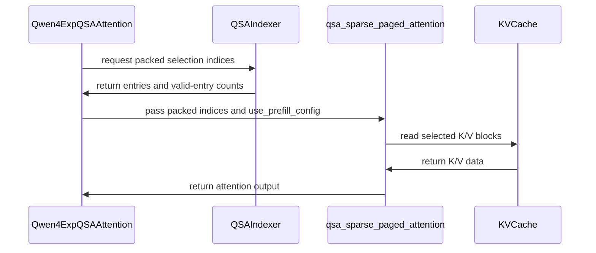

# #54873 [Qwen3.8-Flash-Next] Improve QSA sparse GQA for prefill and short-ctx decode

https://github.com/vllm-project/vllm/pull/54873 · gau-nernst · MERGED · created 2026-09-02T02:50:36Z · merged 2026-09-04T13:08:03Z

## Purpose

QSA sparse attention read topk indices from `[num_tokens, 2048+3]` buffer, where each token can attend up to 2048+3 past KV tokens. This number can be smaller when a new token's position is less than 2048, hence the indices buffer might be padded with -1. This is true for fresh prefill (causal attention) requests and short-context decode.

In the current code, sparse GQA always attend to the full 2048+3 indices (with appropriate masking of course). This is wasteful when there is a lot of padding like mentioned above. To fix this issue, we insert a variable `valid_counts`, representing the total number of valid, non-padding indices, at the **end** of the `logical_indices` table. Why this design?

- The valid counts always go together with the indices table. This can be seen as an encoding of variable length sequences with stable buffer size.
- This also works nicely with topk indices reuse in MTP `compact_topk_indices` -> we don't need to carry another tensor and ensure it's in-sync with the indices table

The key change in the kernel is basically this (notice the loop's upper bound is tightened by `valid_counts`)

```python
valid_count = tl.load(indices_ptr + row * stride_indices_row + TOPK)
tile_end = tl.minimum(
  NUM_TILES, tl.cdiv(tl.minimum(valid_count, TOPK), BLOCK_N)
)
for tile in range(split_id, tile_end, NUM_SPLITS):
  ...
```

Other features included in this PR

- Add proper warmup logic
- Add a tuned config for prefill case

## Microbenchmark

### Prefill (no prefix cache context)

| shape   | tp1 before | tp1 after | speedup | tp4 before | tp4 after | speedup |
| ------- | ---------- | --------- | ------- | ---------- | --------- | ------- |
| 1x1024  | 459.1      | 144.1     | 3.19x   | 319.9      | 81.6      | 3.92x   |
| 1x4096  | 1725.7     | 1268.6    | 1.36x   | 1040.5     | 603.3     | 1.72x   |
| 2x8192  | 6716.9     | 5745.1    | 1.17x   | 3678.8     | 2563.7    | 1.43x   |
| 1x16384 | 6820.3     | 6132.7    | 1.11x   | 4012.9     | 2732.3    | 1.47x   |

The speedup is most significant for short context, where the first 2048 tokens can skip most of the work.

### Decode/Spec-decode

tp1:

| N   | DQL | ctx=1024    | ctx=2048    | ctx=8192    | ctx=51200   |
| --- | --- | ----------- | ----------- | ----------- | ----------- |
| 1   | 1   | 11.9→10.0   | 12.7→10.4   | 12.9→10.6   | 12.8→10.6   |
| 1   | 4   | 15.1→11.9   | 16.0→13.2   | 16.9→14.1   | 17.2→15.1   |
| 4   | 1   | 15.5→12.8   | 17.3→14.5   | 17.6→15.1   | 17.6→15.6   |
| 4   | 4   | 20.2→15.8   | 23.1→20.6   | 26.8→24.3   | 29.9→27.2   |
| 16  | 1   | 21.4→17.5   | 26.7→24.3   | 29.2→26.6   | 30.1→27.8   |
| 16  | 4   | 53.1→29.4   | 57.9→52.2   | 67.3→62.2   | 73.0→67.0   |
| 64  | 1   | 58.7→37.3   | 67.4→62.5   | 72.4→66.2   | 74.5→68.6   |
| 64  | 4   | 154.3→98.8  | 174.3→177.1 | 195.9→197.8 | 205.6→206.3 |
| 256 | 1   | 167.1→112.4 | 196.1→197.3 | 204.2→206.0 | 208.2→209.3 |
| 256 | 4   | 485.4→271.6 | 537.1→547.7 | 633.9→628.7 | 674.6→671.8 |

tp4:

| N   | DQL | ctx=1024    | ctx=2048    | ctx=8192    | ctx=51200   |
| --- | --- | ----------- | ----------- | ----------- | ----------- |
| 1   | 1   | 9.5→8.5     | 10.8→8.7    | 10.9→8.9    | 11.1→9.0    |
| 1   | 4   | 11.4→9.7    | 12.0→10.0   | 12.9→10.7   | 13.2→11.3   |
| 4   | 1   | 11.7→10.1   | 12.8→10.7   | 13.0→10.9   | 13.3→11.4   |
| 4   | 4   | 19.7→13.8   | 20.0→17.1   | 20.8→17.9   | 21.4→18.5   |
| 16  | 1   | 20.1→13.6   | 20.7→17.5   | 21.3→18.7   | 21.4→18.6   |
| 16  | 4   | 31.1→19.0   | 35.8→29.9   | 42.0→37.6   | 46.3→41.8   |
| 64  | 1   | 32.1→22.6   | 42.1→37.4   | 45.4→41.0   | 46.9→42.4   |
| 64  | 4   | 82.0→50.5   | 92.4→90.7   | 104.7→106.1 | 111.1→113.2 |
| 256 | 1   | 90.6→61.1   | 104.7→106.3 | 110.7→112.1 | 113.4→114.7 |
| 256 | 4   | 312.2→155.7 | 338.3→309.4 | 375.3→354.5 | 392.7→374.1 |

Similarly, the speedup is most significant for short context.

### E2E perf

TP4 GB300, BF16 ckpt, no MTP

| conc | tok/s before → after | Δ     | TTFT p50 before → after | Δ     | TPOT p50 before → after | Δ     |
| ---- | -------------------- | ----- | ----------------------- | ----- | ----------------------- | ----- |
| 1    | 1901.7 → 1901.1      | −0.0% | 155.1 → 157.1 ms        | +1.2% | 4.58 → 4.58 ms          | −0.1% |
| 4    | 5388.9 → 5377.1      | −0.2% | 433.9 → 398.4 ms        | −8.2% | 6.26 → 6.27 ms          | +0.1% |
| 16   | 13213.6 → 13376.0    | +1.2% | 592.1 → 582.3 ms        | −1.7% | 10.31 → 10.16 ms        | −1.4% |
| 64   | 27246.9 → 27756.2    | +1.9% | 661.7 → 626.1 ms        | −5.4% | 20.39 → 19.97 ms        | −2.0% |

Good improvements in TTFT, except at concurrency 1 which is probably noisy.

## Test Plan

TP4 GB300, BF16 ckpt, MTP3

- GSM8K (no think): 0.9678
- MMMU Pro (thinking): 0.7694

## Test Result

---

<details>
<summary> Essential Elements of an Effective PR Description Checklist </summary>

- [ ] The purpose of the PR, such as "Fix some issue (link existing issues this PR will resolve)".
- [ ] The test plan, such as providing test command.
- [ ] The test results, such as pasting the results comparison before and after, or e2e results
- [ ] (Optional) The necessary documentation update, such as updating `supported_models.md` and `examples` for a new model.
</details>

---

## comments

**coderabbitai** (2026-09-04T00:42:08Z):

<!-- This is an auto-generated comment: summarize by coderabbit.ai -->
<!-- review_stack_entry_start -->

[](https://app.coderabbit.ai/change-stack/vllm-project/vllm/pull/54873)

<!-- review_stack_entry_end -->
<!-- walkthrough_start -->

<details>
<summary>📝 Summary</summary>

<!-- This is an auto-generated comment: release notes by coderabbit.ai -->

## Summary by CodeRabbit

- **Performance**
  - Improved Qwen4 sparse attention performance for both prompt processing and token generation.
  - Enhanced handling of varied context lengths, including short and full-context requests.
  - Improved compatibility across supported cache page sizes and multi-head configurations.

- **Stability**
  - Expanded kernel warmup coverage for supported Qwen4 attention workloads.
  - Improved sparse attention indexing reliability across different request shapes and context lengths.

<!-- end of auto-generated comment: release notes by coderabbit.ai -->

## Walkthrough

The QSA path now uses packed selection buffers with a trailing valid-entry count. Sparse attention consumes this count, selects prefill-aware configurations, and receives packed-width buffers from the QSA layer. Warmup and correctness tests cover the updated execution paths.

### Changes

**QSA packed sparse attention**

| Layer / File(s)                                                                                                                                                                            | Summary                                                                                                                                                                 |
| ------------------------------------------------------------------------------------------------------------------------------------------------------------------------------------------ | ----------------------------------------------------------------------------------------------------------------------------------------------------------------------- |
| **Packed selection-buffer contract** <br> `vllm/models/qwen4_exp/nvidia/indexer_qsa.py`, `vllm/models/qwen4_exp/nvidia/ops/qsa_indexer.py`, `tests/models/qwen4_exp/test_qsa_reference.py` | The selection buffer adds a trailing valid-entry count column. Allocation, validation, expansion, fallback handling, and tests use the packed width.                    |
| **Packed sparse-kernel execution** <br> `vllm/models/qwen4_exp/nvidia/ops/qsa.py`, `vllm/models/qwen4_exp/nvidia/qsa.py`                                                                   | Sparse attention reads per-row counts, limits tile processing, uses int64 row offsets, and selects configurations with `use_prefill_config`.                            |
| **Prefill-aware QSA integration** <br> `vllm/models/qwen4_exp/nvidia/qsa.py`, `vllm/models/qwen4_exp/nvidia/indexer_qsa.py`, `tests/models/qwen4_exp/test_qsa_reference.py`                | The QSA layer allocates packed buffers and passes the renamed configuration selector. Tests cover prefill selection, production page sizes, and mixed request contexts. |
| **Sparse-kernel warmup wiring** <br> `vllm/model_executor/warmup/qwen4_exp_qsa_warmup.py`, `vllm/models/qwen4_exp/nvidia/ops/qsa.py`                                                       | Warmup resolves the QSA attention layer and cache block tables, then compiles sparse attention configurations for prefill and decode paths.                             |

**Estimated code review effort:** 4 (Complex) | ~45 minutes

<!-- final_review_risk_start -->

**Merge Risk:** _🟡 Moderate_ · up to `37d3e`

<!-- final_review_risk_coverage:{"sourceCommitId":"37d3e21fe316315c0db92e5806b2e4367ad5e464","coveredCommitId":"37d3e21fe316315c0db92e5806b2e4367ad5e464","kind":"reviewed"} -->

The QSA performance changes may leave sparse attention unable to compile for affected prefill and decode workloads. Replace the runtime Python range with Triton's runtime iterator or establish compatibility before merging.

<!-- final_review_risk_end -->

**Suggested reviewers:** `peakcrosser7`

### Sequence Diagram(s)



</details>

<!-- walkthrough_end -->
<!-- pre_merge_checks_walkthrough_start -->

<details>
<summary>🚥 Pre-merge checks | ✅ 4 | ❌ 1</summary>

### ❌ Failed checks (1 warning)

|     Check name     | Status     | Explanation                                                                                                                                                                                 | Resolution                                                                         |
| :----------------: | :--------- | :------------------------------------------------------------------------------------------------------------------------------------------------------------------------------------------ | :--------------------------------------------------------------------------------- |
| Docstring Coverage | ⚠️ Warning | Docstring coverage is 37.50% which is insufficient. The required threshold is 80.00%. Docstring coverage is scoped to functions touched by this diff. Analyzed 24 functions across 6 files. | Write docstrings for the functions missing them to satisfy the coverage threshold. |

<details>
<summary>✅ Passed checks (4 passed)</summary>

|         Check name         | Status    | Explanation                                                                                                                                          |
| :------------------------: | :-------- | :--------------------------------------------------------------------------------------------------------------------------------------------------- |
|        Title check         | ✅ Passed | The title clearly summarizes the main change: improving QSA sparse GQA for prefill and short-context decode. It is specific and concise.             |
|     Description check      | ✅ Passed | The description directly explains the valid-count optimization, warmup logic, prefill configuration, benchmarks, and test results for the changeset. |
|    Linked Issues check     | ✅ Passed | Check skipped because no linked issues were found for this pull request.                                                                             |
| Out of Scope Changes check | ✅ Passed | Check skipped because no linked issues were found for this pull request.                                                                             |

</details>

</details>

<!-- pre_merge_checks_walkthrough_end -->

- [ ] <!-- {"checkboxId":"585bb3f6-faf5-4dbf-96d2-74e382adf19a"} --> Fix all pre-merge checks with AI
<!-- tips_start -->

---

Thanks for using [CodeRabbit](https://coderabbit.ai?utm_source=oss&utm_medium=github&utm_campaign=vllm-project/vllm&utm_content=54873)! It's free for OSS, and your support helps us grow. If you like it, consider giving us a shout-out.

<details>
<summary>❤️ Share</summary>

- [X](https://twitter.com/intent/tweet?text=I%20just%20used%20%40coderabbitai%20for%20my%20code%20review%2C%20and%20it%27s%20fantastic%21%20It%27s%20free%20for%20OSS%20and%20offers%20a%20free%20trial%20for%20the%20proprietary%20code.%20Check%20it%20out%3A&url=https%3A//coderabbit.ai)
- [Mastodon](https://mastodon.social/share?text=I%20just%20used%20%40coderabbitai%20for%20my%20code%20review%2C%20and%20it%27s%20fantastic%21%20It%27s%20free%20for%20OSS%20and%20offers%20a%20free%20trial%20for%20the%20proprietary%20code.%20Check%20it%20out%3A%20https%3A%2F%2Fcoderabbit.ai)
- [Reddit](https://www.reddit.com/submit?title=Great%20tool%20for%20code%20review%20-%20CodeRabbit&text=I%20just%20used%20CodeRabbit%20for%20my%20code%20review%2C%20and%20it%27s%20fantastic%21%20It%27s%20free%20for%20OSS%20and%20offers%20a%20free%20trial%20for%20proprietary%20code.%20Check%20it%20out%3A%20https%3A//coderabbit.ai)
- [LinkedIn](https://www.linkedin.com/sharing/share-offsite/?url=https%3A%2F%2Fcoderabbit.ai&mini=true&title=Great%20tool%20for%20code%20review%20-%20CodeRabbit&summary=I%20just%20used%20CodeRabbit%20for%20my%20code%20review%2C%20and%20it%27s%20fantastic%21%20It%27s%20free%20for%20OSS%20and%20offers%20a%20free%20trial%20for%20proprietary%20code)

</details>

<sub>Comment `@coderabbitai help` to get the list of available commands.</sub>

<!-- tips_end -->

**gau-nernst** (2026-09-04T08:35:28Z):

/ci run

**github-actions** (2026-09-04T08:35:46Z):

✅ Triggered [Buildkite CI #87223](https://buildkite.com/vllm/ci/builds/87223) for commit `09fa1f359762`.

**gau-nernst** (2026-09-04T10:23:41Z):

/ci run

**github-actions** (2026-09-04T10:24:22Z):

✅ Triggered [Buildkite CI #87237](https://buildkite.com/vllm/ci/builds/87237) for commit `37d3e21fe316`.
