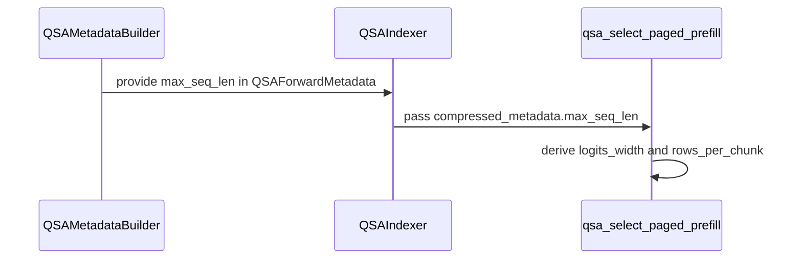

# #54915 [Qwen3.8-Flash-Next] Compact indexer logits workspace to improve prefill efficiency

https://github.com/vllm-project/vllm/pull/54915 · gau-nernst · MERGED · created 2026-09-02T07:06:10Z · merged 2026-09-04T07:43:21Z

## Purpose

During prefill, we apply chunking on indexer to cap the memory usage consumed by logits workspace. This logits workspace have shape `[num_tokens, ctx_len]` representing QK product. Currently we size `ctx_len` based on worst possible case

https://github.com/vllm-project/vllm/blob/c00091e026709b149d80246a18928f514871c160/vllm/models/qwen4_exp/nvidia/ops/qsa_indexer.py#L580-L587

Notice `columns = page_table.shape[1] * k_cache.shape[1]`. Page table accommodates up to max model len size, thus this hugely overestimates the logits workspace. By deriving a lower upper bound based on Python scalar `max_seq_len`, we can process more tokens per chunk and reduce total number of chunks, thus overall improve GPU efficiency.

This PR also removes ` / HEAD_DIM**0.5` in the indexer (both prefill and decode) since the constant normalization factor doesn't affect topk ranking.

## Microbenchmarks

Measured on GB300

### Indexer-score only

| reqs x q_len | k_len      | chunks | baseline | this PR | speedup | PR TFLOP/s | PR GB/s |
| ------------ | ---------- | -----: | -------: | ------: | ------: | ---------: | ------: |
| 4 x 4096     | 4096       | 9 -> 1 |  402.0us |  37.7us |  10.66x |        228 |    1364 |
| 1 x 8192     | 8192       | 5 -> 1 |  273.5us |  39.6us |   6.91x |        217 |    1072 |
| 2 x 8192     | 8192       | 9 -> 1 |  357.7us |  52.4us |   6.83x |        328 |    1622 |
| 1 x 8192     | 16384      | 5 -> 1 |  199.9us |  72.8us |   2.75x |        354 |    1512 |
| 1 x 16384    | 16384      | 9 -> 1 |  380.3us |  84.0us |   4.53x |        409 |    1809 |
| 2 x 8192     | 8192+16384 | 9 -> 1 |  360.4us |  85.4us |   4.22x |        402 |    1787 |
| 1 x 16384    | 32768      | 9 -> 1 |  385.8us | 216.2us |   1.78x |        477 |    1950 |
| 1 x 16384    | 65536      | 9 -> 2 |  692.7us | 492.1us |   1.41x |        489 |    1952 |

### Indexer-score + topk

| reqs x q_len | k_len      | baseline |  this PR | speedup |
| ------------ | ---------- | -------: | -------: | ------: |
| 4 x 4096     | 4096       |  825.3us |  232.5us |   3.55x |
| 1 x 8192     | 8192       |  470.3us |  169.1us |   2.78x |
| 2 x 8192     | 8192       |  863.6us |  309.2us |   2.79x |
| 1 x 8192     | 16384      |  463.0us |  249.9us |   1.85x |
| 1 x 16384    | 16384      |  957.0us |  396.5us |   2.41x |
| 2 x 8192     | 8192+16384 |  823.2us |  396.5us |   2.08x |
| 1 x 16384    | 32768      |  853.1us |  683.5us |   1.25x |
| 1 x 16384    | 65536      | 1408.4us | 1173.3us |   1.20x |

## E2E perf

TP4 GB300, Qwen/Qwen3.8-Flash-Next, MTP3

| concurrency | TTFT mean (base -> PR)   | TPOT mean (base -> PR)   |
| ----------- | ------------------------ | ------------------------ |
| 1           | 178.4 -> 171.4ms (-3.9%) | 4.27 -> 3.98ms (-6.8%)   |
| 4           | 237.4 -> 223.4ms (-5.9%) | 5.65 -> 5.58ms (-1.2%)   |
| 16          | 346.1 -> 348.8ms (+0.8%) | 10.08 -> 9.82ms (-2.6%)  |
| 64          | 686.8 -> 672.8ms (-2.0%) | 21.08 -> 20.36ms (-3.4%) |

## Test Plan

TP4 GB300, Qwen/Qwen3.8-Flash-Next-FP8, MTP3

- GSM8K (no think, max_tokens=1024, temp=0): 0.9647
- MMMU Pro (think, max_tokens=65536): 0.7711

## Test Result

---

 Essential Elements of an Effective PR Description Checklist 

- [ ] The purpose of the PR, such as "Fix some issue (link existing issues this PR will resolve)".
- [ ] The test plan, such as providing test command.
- [ ] The test results, such as pasting the results comparison before and after, or e2e results
- [ ] (Optional) The necessary documentation update, such as updating `supported_models.md` and `examples` for a new model.

---

## comments

**gau-nernst** (2026-09-02T10:05:40Z):

/ci run

**github-actions** (2026-09-02T10:06:00Z):

✅ Triggered [Buildkite CI #86852](https://buildkite.com/vllm/ci/builds/86852) for commit `0b334b517a01`.

**coderabbitai** (2026-09-04T04:50:58Z):

<!-- This is an auto-generated comment: summarize by coderabbit.ai -->
<!-- review_stack_entry_start -->

<!-- review_stack_entry_end -->
<!-- recent_review_start -->

No actionable comments were generated in the recent review. 🎉

ℹ️ Recent review info

⚙️ Run configuration

**Configuration used**: Repository UI

**Review profile**: CHILL

**Plan**: Team

**Run ID**: `c8f3b459-b520-4a3a-921e-6800cd9e5aca`

📥 Commits

Reviewing files that changed from the base of the PR and between 8a728663c1c3eeace834a95f5654fa653cc1998c and a1f86a8e96a0ded8c1c6add340b7861e9044be6d.

📒 Files selected for processing (4)

- `tests/models/qwen4_exp/test_qsa_reference.py`
- `vllm/models/qwen4_exp/common/qsa_cache.py`
- `vllm/models/qwen4_exp/nvidia/indexer_qsa.py`
- `vllm/models/qwen4_exp/nvidia/ops/qsa_indexer.py`

**Included review availability:** Your plan provides up to 10 included reviews per hour; 9 remain after this review.

---

<!-- recent_review_end -->
<!-- walkthrough_start -->

📝 Summary

<!-- This is an auto-generated comment: release notes by coderabbit.ai -->

## Summary by CodeRabbit

- **Bug Fixes**
  - Improved Qwen4 experimental model attention selection for variable and longer sequence lengths.
  - Corrected prefill and decode attention score handling for more consistent inference results.
  - Improved handling of constrained memory and chunked-prefill scenarios.

- **Performance**
  - Reduced unnecessary attention-selection work by sizing intermediate computations to the active sequence length, which may improve prefill efficiency and memory usage.

<!-- end of auto-generated comment: release notes by coderabbit.ai -->

## Walkthrough

QSA metadata now includes `max_seq_len`. Prefill selection passes this value to the kernel, which uses it to size logits and chunk processing. The kernels also use runtime page geometry and no longer apply score scaling.

### Changes

**QSA prefill bounds**

| Layer / File(s)                                                                                                                                                          | Summary                                                                                                                                                                    |
| ------------------------------------------------------------------------------------------------------------------------------------------------------------------------ | -------------------------------------------------------------------------------------------------------------------------------------------------------------------------- |
| **Metadata propagation**   `vllm/models/qwen4_exp/common/qsa_cache.py`, `vllm/models/qwen4_exp/nvidia/indexer_qsa.py`, `tests/models/qwen4_exp/test_qsa_reference.py` | `QSAForwardMetadata` stores `max_seq_len`. The metadata builder and prefill selection path propagate it. Metadata tests provide the new field.                             |
| **Runtime kernel and logits geometry**   `vllm/models/qwen4_exp/nvidia/ops/qsa_indexer.py`                                                                            | The prefill kernel uses runtime page-table geometry. Logits width and chunk size derive from `max_seq_len`. Decode and prefill scores no longer divide by `HEAD_DIM**0.5`. |
| **Prefill selection validation**   `tests/models/qwen4_exp/test_qsa_reference.py`                                                                                     | Prefill tests cover sequence-length slack, forced chunking, updated kernel arguments, and page-table capacity clamping.                                                    |

**Estimated code review effort:** 3 (Moderate) | ~20 minutes

<!-- final_review_risk_start -->

**Merge Risk:** _⚪ Minimal_ · up to `a1f86`

<!-- final_review_risk_coverage:{"sourceCommitId":"a1f86a8e96a0ded8c1c6add340b7861e9044be6d","coveredCommitId":"a1f86a8e96a0ded8c1c6add340b7861e9044be6d","kind":"reviewed"} -->

QSA prefill now sizes its logits workspace from the batch sequence-length bound rather than full page-table capacity, reducing workspace and chunk count while retaining page-capacity clamping. The updated selection tests cover the new bounded and chunked behavior, with no remaining merge-readiness concern identified.

<!-- final_review_risk_end -->

### Sequence Diagram(s)

<!-- walkthrough_end -->
<!-- pre_merge_checks_walkthrough_start -->

🚥 Pre-merge checks | ✅ 4 | ❌ 1

### ❌ Failed checks (1 warning)

|     Check name     | Status     | Explanation                                                                                                                                                                                 | Resolution                                                                         |
| :----------------: | :--------- | :------------------------------------------------------------------------------------------------------------------------------------------------------------------------------------------ | :--------------------------------------------------------------------------------- |
| Docstring Coverage | ⚠️ Warning | Docstring coverage is 16.67% which is insufficient. The required threshold is 80.00%. Docstring coverage is scoped to functions touched by this diff. Analyzed 12 functions across 4 files. | Write docstrings for the functions missing them to satisfy the coverage threshold. |

✅ Passed checks (4 passed)

|         Check name         | Status    | Explanation                                                                                                                         |
| :------------------------: | :-------- | :---------------------------------------------------------------------------------------------------------------------------------- |
|     Description check      | ✅ Passed | The description clearly explains the logits workspace compaction, score scaling change, performance impact, and validation results. |
|        Title check         | ✅ Passed | The title clearly summarizes the main change: compacting the indexer logits workspace to improve prefill efficiency.                |
|    Linked Issues check     | ✅ Passed | Check skipped because no linked issues were found for this pull request.                                                            |
| Out of Scope Changes check | ✅ Passed | Check skipped because no linked issues were found for this pull request.                                                            |

<!-- pre_merge_checks_walkthrough_end -->

- [ ] <!-- {"checkboxId":"585bb3f6-faf5-4dbf-96d2-74e382adf19a"} --> Fix all pre-merge checks with AI
<!-- tips_start -->

---

Thanks for using [CodeRabbit](https://coderabbit.ai?utm_source=oss&utm_medium=github&utm_campaign=vllm-project/vllm&utm_content=54915)! It's free for OSS, and your support helps us grow. If you like it, consider giving us a shout-out.

❤️ Share

- [X](https://twitter.com/intent/tweet?text=I%20just%20used%20%40coderabbitai%20for%20my%20code%20review%2C%20and%20it%27s%20fantastic%21%20It%27s%20free%20for%20OSS%20and%20offers%20a%20free%20trial%20for%20the%20proprietary%20code.%20Check%20it%20out%3A&url=https%3A//coderabbit.ai)
- [Mastodon](https://mastodon.social/share?text=I%20just%20used%20%40coderabbitai%20for%20my%20code%20review%2C%20and%20it%27s%20fantastic%21%20It%27s%20free%20for%20OSS%20and%20offers%20a%20free%20trial%20for%20the%20proprietary%20code.%20Check%20it%20out%3A%20https%3A%2F%2Fcoderabbit.ai)
- [Reddit](https://www.reddit.com/submit?title=Great%20tool%20for%20code%20review%20-%20CodeRabbit&text=I%20just%20used%20CodeRabbit%20for%20my%20code%20review%2C%20and%20it%27s%20fantastic%21%20It%27s%20free%20for%20OSS%20and%20offers%20a%20free%20trial%20for%20proprietary%20code.%20Check%20it%20out%3A%20https%3A//coderabbit.ai)
- [LinkedIn](https://www.linkedin.com/sharing/share-offsite/?url=https%3A%2F%2Fcoderabbit.ai&mini=true&title=Great%20tool%20for%20code%20review%20-%20CodeRabbit&summary=I%20just%20used%20CodeRabbit%20for%20my%20code%20review%2C%20and%20it%27s%20fantastic%21%20It%27s%20free%20for%20OSS%20and%20offers%20a%20free%20trial%20for%20proprietary%20code)

Comment `@coderabbitai help` to get the list of available commands.

<!-- tips_end -->

**gau-nernst** (2026-09-04T04:51:15Z):

/ci run

**github-actions** (2026-09-04T04:51:31Z):

✅ Triggered [Buildkite CI #87193](https://buildkite.com/vllm/ci/builds/87193) for commit `a1f86a8e96a0`.
