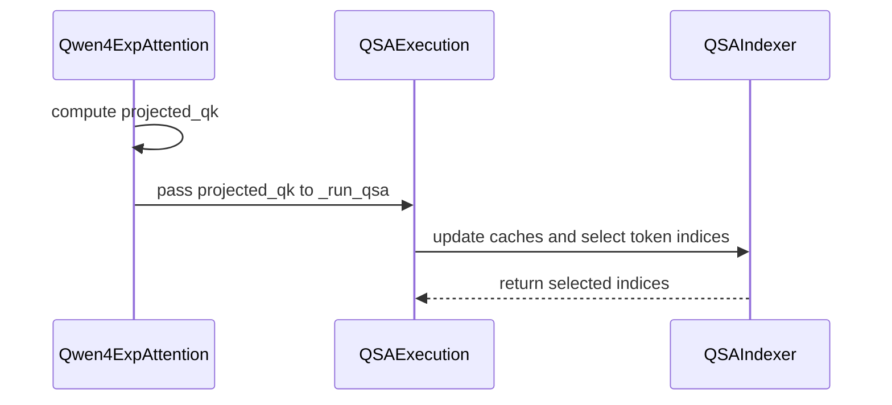

# #55272 [Qwen3.8-Flash-Next] Remove torch.compile for NVIDIA implementation

https://github.com/vllm-project/vllm/pull/55272 · gau-nernst · MERGED · created 2026-09-04T02:46:57Z · merged 2026-09-07T04:57:57Z

## Purpose

Fixes #54688

- Remove `@support_torch_compile` as model decorator
- Remove all custom op registrations, which were meant to bypass torch.compile inspection: `qwen4_exp_compute_ple_ngram_ids`, `qwen4_exp_ple_short_conv`, `qwen4_exp_qsa_with_output`
- Eager break insertion points (**IMPORTANT**):

Another benefit of removing torch.compile is that now we can load FP8 ckpt on a single GB300. Previously, torch.compile attempts to autotune the embedding op, causing an extra ngram table tensor that consumes ~50GB -> OOM. Removing torch.compile naturally removes this activation peak.

## Test Plan

| Model | MTP tokens | GSM8K  | MMMU-Pro |
| ----- | ---------- | ------ | -------- |
| BF16  | 0          | 96.85% | 77.23%   |
| BF16  | 3          | 96.66% | 77.57%   |
| FP8   | 0          | 96.74% | 76.99%   |
| FP8   | 3          | 96.82% | 75.61%   |

## E2E perf result

| Model | Concurrency |    Output tok/s | Throughput delta |         TTFT ms |         TPOT ms |
| ----- | ----------: | --------------: | ---------------: | --------------: | --------------: |
| BF16  |           1 |   303.6 → 288.9 |           -4.83% | 160.62 → 162.63 |   3.309 → 3.288 |
| BF16  |           4 |   759.8 → 742.6 |           -2.26% | 195.19 → 188.14 |   5.020 → 5.259 |
| BF16  |          16 | 1582.2 → 1663.9 |           +5.16% | 206.47 → 202.19 |   9.469 → 9.252 |
| BF16  |          64 | 3052.7 → 3123.3 |           +2.31% | 231.19 → 222.05 | 20.354 → 20.173 |
| FP8   |           1 |   240.5 → 232.9 |           -3.14% | 219.70 → 217.63 |   4.093 → 4.149 |
| FP8   |           4 |   642.8 → 631.8 |           -1.72% | 238.66 → 238.27 |   5.858 → 6.150 |
| FP8   |          16 | 1345.7 → 1390.0 |           +3.30% | 252.93 → 252.33 | 11.280 → 10.990 |
| FP8   |          64 | 2076.9 → 2066.3 |           -0.51% | 308.32 → 309.84 | 30.071 → 30.199 |

Generally the results look noisy, so I don't think removing torch.compile right now is significantly worse. Future manual fusion will further improve perf.

## Test Result

---

<details>
<summary> Essential Elements of an Effective PR Description Checklist </summary>

- [ ] The purpose of the PR, such as "Fix some issue (link existing issues this PR will resolve)".
- [ ] The test plan, such as providing test command.
- [ ] The test results, such as pasting the results comparison before and after, or e2e results
- [ ] (Optional) The necessary documentation update, such as updating `supported_models.md` and `examples` for a new model.
</details>

---

## comments

**coderabbitai** (2026-09-04T02:47:05Z):

<!-- This is an auto-generated comment: summarize by coderabbit.ai -->
<!-- review_stack_entry_start -->

[](https://app.coderabbit.ai/change-stack/vllm-project/vllm/pull/55272)

<!-- review_stack_entry_end -->
<!-- recent_review_start -->

No actionable comments were generated in the recent review. 🎉

<details>
<summary>ℹ️ Recent review info</summary>

<details>
<summary>⚙️ Run configuration</summary>

**Configuration used**: Repository UI

**Review profile**: CHILL

**Plan**: Team

**Run ID**: `6d401541-94c0-4ab6-b644-f5371657b469`

</details>

<details>
<summary>📥 Commits</summary>

Reviewing files that changed from the base of the PR and between b74b765c3758bb69dd76b5b44417b50fc2c18eac and 888404ef5963b536338f8e081575895959da93ae.

</details>

<details>
<summary>📒 Files selected for processing (3)</summary>

- `tests/models/qwen4_exp/test_ple.py`
- `vllm/config/vllm.py`
- `vllm/model_executor/layers/mamba/gdn/qwen_gdn_linear_attn.py`

</details>

**Included review availability:** Your plan provides up to 10 included reviews per hour; 9 remain after this review.

</details>

---

<!-- recent_review_end -->
<!-- walkthrough_start -->

<details>
<summary>📝 Summary</summary>

<!-- This is an auto-generated comment: release notes by coderabbit.ai -->

## Summary by CodeRabbit

- **New Features**
  - Added default breakable CUDA graph support for Qwen4 experimental model architectures on supported platforms.
  - Added support for EAGLE3 speculative decoding with pipeline parallelism.
  - Improved handling of padded and trailing zero-length requests during inference.

- **Bug Fixes**
  - Fixed attention, n-gram processing, and cache updates involving padded requests.
  - Improved buffer reuse and CUDA graph capture behavior across changing request layouts.
  - Qwen4 experimental models are no longer registered for `torch.compile` support.

<!-- end of auto-generated comment: release notes by coderabbit.ai -->

## Walkthrough

Qwen4Exp removes selected custom-operation paths, adds eager breaks for CUDA graph capture, stabilizes PLE buffer shapes, and passes pre-projected Q/K tensors through QSA. Tests cover padded requests, buffer reuse, platform defaults, strided state indices, and cache updates.

### Changes

**Qwen4Exp capture and attention updates**

| Layer / File(s)                                                                                                                                                                                                            | Summary                                                                                                                                                                                                                                                                                        |
| -------------------------------------------------------------------------------------------------------------------------------------------------------------------------------------------------------------------------- | ---------------------------------------------------------------------------------------------------------------------------------------------------------------------------------------------------------------------------------------------------------------------------------------------- |
| **Breakable CUDA graph configuration** <br> `vllm/config/compilation.py`, `vllm/config/vllm.py`, `vllm/model_executor/layers/mamba/gdn/qwen_gdn_linear_attn.py`, `tests/test_config.py`                                    | Qwen4Exp architectures default to breakable CUDA graphs. Gated DeltaNet operations use eager breaks during capture. The attention splitting configuration and platform-default tests are updated. The V2 model runner no longer rejects EAGLE3 speculative decoding with pipeline parallelism. |
| **PLE operations and fixed-capacity state** <br> `vllm/models/qwen4_exp/nvidia/model_state.py`, `vllm/models/qwen4_exp/nvidia/ple_layer.py`, `tests/models/qwen4_exp/test_config.py`, `tests/models/qwen4_exp/test_ple.py` | PLE calls direct methods instead of removed custom ops. Short-convolution state routing uses an eager break. N-gram buffers keep fixed shapes and addresses. Tests cover trailing padded requests, strided state indices, and buffer reuse.                                                    |
| **Projected Q/K QSA execution** <br> `vllm/models/qwen4_exp/nvidia/indexer_qsa.py`, `vllm/models/qwen4_exp/nvidia/qsa.py`                                                                                                  | QSA computes projected Q/K before the eager break. `QSAIndexer.forward` accepts projected Q/K tensors and updates caches from that input.                                                                                                                                                      |
| **QSA cache validation** <br> `tests/models/qwen4_exp/test_qsa_reference.py`                                                                                                                                               | Tests validate projected-input handling and ensure padded Q/K rows do not update invalid cache entries.                                                                                                                                                                                        |

**Estimated code review effort:** 4 (Complex) | ~45 minutes

<!-- final_review_risk_start -->

**Merge Risk:** _🟡 Moderate_ · up to `88840`

<!-- final_review_risk_coverage:{"sourceCommitId":"888404ef5963b536338f8e081575895959da93ae","coveredCommitId":"888404ef5963b536338f8e081575895959da93ae","kind":"reviewed"} -->

This change refactors Qwen4Exp CUDA-graph and QSA execution, but the unresolved unfused QSA row-mapping issue can produce incorrect cache or token-selection behavior. It should be corrected before merge.

<!-- final_review_risk_end -->

### Sequence Diagram(s)



**Suggested reviewers:** `peakcrosser7`

</details>

<!-- walkthrough_end -->
<!-- pre_merge_checks_walkthrough_start -->

<details>
<summary>🚥 Pre-merge checks | ✅ 3 | ❌ 2</summary>

### ❌ Failed checks (2 warnings)

|         Check name         | Status     | Explanation                                                                                                                                                                                  | Resolution                                                                                                                                                 |
| :------------------------: | :--------- | :------------------------------------------------------------------------------------------------------------------------------------------------------------------------------------------- | :--------------------------------------------------------------------------------------------------------------------------------------------------------- |
| Out of Scope Changes check | ⚠️ Warning | Most changes support issue `#54688`, but removing the V2 model runner rejection for EAGLE3 speculative decoding with pipeline parallelism is not connected to the linked issue objectives.   | Remove the unrelated EAGLE3 pipeline-parallelism change, or link an issue and document acceptance criteria that justify including it in this pull request. |
|     Docstring Coverage     | ⚠️ Warning | Docstring coverage is 16.67% which is insufficient. The required threshold is 80.00%. Docstring coverage is scoped to functions touched by this diff. Analyzed 24 functions across 11 files. | Write docstrings for the functions missing them to satisfy the coverage threshold.                                                                         |

<details>
<summary>✅ Passed checks (3 passed)</summary>

|     Check name      | Status    | Explanation                                                                                                                                                                                                 |
| :-----------------: | :-------- | :---------------------------------------------------------------------------------------------------------------------------------------------------------------------------------------------------------- |
|     Title check     | ✅ Passed | The title clearly summarizes the primary change: removing torch.compile from the NVIDIA Qwen3.8-Flash-Next implementation.                                                                                  |
|  Description check  | ✅ Passed | The description directly explains the torch.compile removal, custom-operation changes, eager breaks, motivation, tests, and performance results.                                                            |
| Linked Issues check | ✅ Passed | The changes satisfy issue `#54688` by removing support_torch_compile from the Qwen4Exp model and MTP classes, removing NVIDIA compile-only custom operations, retaining the AMD-required operation, and ad… |

</details>

</details>

<!-- pre_merge_checks_walkthrough_end -->

- [ ] <!-- {"checkboxId":"585bb3f6-faf5-4dbf-96d2-74e382adf19a"} --> Fix all pre-merge checks with AI
<!-- tips_start -->

---

Thanks for using [CodeRabbit](https://coderabbit.ai?utm_source=oss&utm_medium=github&utm_campaign=vllm-project/vllm&utm_content=55272)! It's free for OSS, and your support helps us grow. If you like it, consider giving us a shout-out.

<details>
<summary>❤️ Share</summary>

- [X](https://twitter.com/intent/tweet?text=I%20just%20used%20%40coderabbitai%20for%20my%20code%20review%2C%20and%20it%27s%20fantastic%21%20It%27s%20free%20for%20OSS%20and%20offers%20a%20free%20trial%20for%20the%20proprietary%20code.%20Check%20it%20out%3A&url=https%3A//coderabbit.ai)
- [Mastodon](https://mastodon.social/share?text=I%20just%20used%20%40coderabbitai%20for%20my%20code%20review%2C%20and%20it%27s%20fantastic%21%20It%27s%20free%20for%20OSS%20and%20offers%20a%20free%20trial%20for%20the%20proprietary%20code.%20Check%20it%20out%3A%20https%3A%2F%2Fcoderabbit.ai)
- [Reddit](https://www.reddit.com/submit?title=Great%20tool%20for%20code%20review%20-%20CodeRabbit&text=I%20just%20used%20CodeRabbit%20for%20my%20code%20review%2C%20and%20it%27s%20fantastic%21%20It%27s%20free%20for%20OSS%20and%20offers%20a%20free%20trial%20for%20proprietary%20code.%20Check%20it%20out%3A%20https%3A//coderabbit.ai)
- [LinkedIn](https://www.linkedin.com/sharing/share-offsite/?url=https%3A%2F%2Fcoderabbit.ai&mini=true&title=Great%20tool%20for%20code%20review%20-%20CodeRabbit&summary=I%20just%20used%20CodeRabbit%20for%20my%20code%20review%2C%20and%20it%27s%20fantastic%21%20It%27s%20free%20for%20OSS%20and%20offers%20a%20free%20trial%20for%20proprietary%20code)

</details>

<sub>Comment `@coderabbitai help` to get the list of available commands.</sub>

<!-- tips_end -->

**mergify** (2026-09-04T13:21:02Z):

This pull request has merge conflicts that must be resolved before it can be
merged. Please rebase the PR, @gau-nernst.

https://docs.github.com/en/pull-requests/collaborating-with-pull-requests/working-with-forks/syncing-a-fork

**mergify** (2026-09-07T01:48:22Z):

This pull request has merge conflicts that must be resolved before it can be
merged. Please rebase the PR, @gau-nernst.

https://docs.github.com/en/pull-requests/collaborating-with-pull-requests/working-with-forks/syncing-a-fork

**ZJY0516** (2026-09-07T02:22:07Z):

/ci run

**mergify** (2026-09-07T02:22:23Z):

Hi @gau-nernst, the pre-commit checks have failed. Please run:

```bash
uv pip install pre-commit>=4.5.1
pre-commit install
pre-commit run --all-files
```

Then, commit the changes and push to your branch.

For future commits, `pre-commit` will run automatically on changed files before each commit.

**github-actions** (2026-09-07T02:23:57Z):

✅ Triggered [Buildkite CI #87466](https://buildkite.com/vllm/ci/builds/87466) for commit `888404ef5963`.

**0xDe1ty** (2026-09-07T08:43:13Z):

A field data point for the ~50 GB figure, from unified-memory hardware where the failure mode is worse than an OOM.

**Setup**: 2× DGX Spark (GB10, sm_121), TP2 across two nodes, vLLM nightly `e962733e`, `nvidia/Qwen3.8-Flash-Next-NVFP4`, MTP `k=5`, `gpu_memory_utilization=0.835`, `max_model_len=524288`. Standing config is compile off — `{"mode": 0, "cudagraph_mode": "FULL_DECODE_ONLY"}` — because compilation had already bitten us once on day 0.

On 2026-09-06 we A/B'd it back on as one rung of a performance ladder: `{"mode": 3, "cudagraph_mode": "FULL_AND_PIECEWISE"}`, everything else identical to a configuration that had just completed a full benchmark matrix. Weight loading was normal (~10 min). Once compilation started, **both hosts went unreachable at the same moment** and stayed that way for over two hours:

- ICMP kept responding;
- TCP connect to 22 and 8888 still completed;
- but the sshd handshake never finished and the API never answered — including retries with a 180 s timeout.

Recovery required power-cycling both machines.

On GB10 the CPU and GPU share one memory pool, so vLLM's 0.835 utilization already reserves roughly 100 GB per node. An extra ~50 GB ngram table for the embedding autotune does not land as a clean CUDA OOM there — it pushes the _host_ into thrash, and userspace stops making progress while the kernel stays up. That is why there is no traceback to attach: no error, no crash, no core. Our supervisor did not fire either, because both its liveness checks needed the host to be able to run bash.

Two things this implies for anyone on unified-memory parts, which I think supports merging this:

1. The failure is silent and unattended-hostile. A compile-related OOM on a discrete-GPU box gets you an exception and a restart; here it gets you two dead nodes and no signal.
2. Any autotune or compile step whose peak allocation is a meaningful fraction of total system memory needs to account for host memory on these SKUs, not just free VRAM.

Removing `@support_torch_compile` for this path takes the whole class of failure off the table for us. Thanks for pushing it through.

**gau-nernst** (2026-09-07T08:46:30Z):

@de1tydev Glad it helps you!
