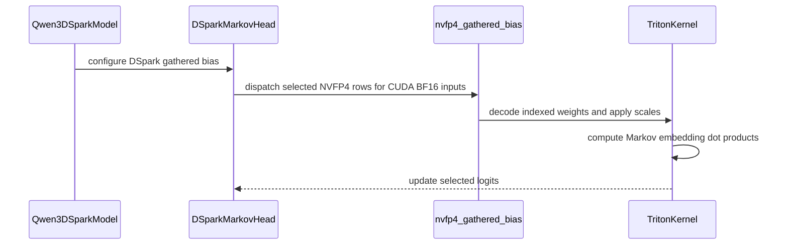

# #55713 [Spec Decode] Add NVFP4 DSpark gathered top-k projection

https://github.com/vllm-project/vllm/pull/55713 · askliar · MERGED · created 2026-09-07T10:43:37Z · merged 2026-09-09T17:33:47Z

## Motivation

DSpark's Markov head computes the draft correction by selecting rows from its W2 projection. With a quantized W2 Markov head, those rows are stored as packed NVFP4 values plus per-group/global scales, so they cannot be indexed and used as ordinary dense weights. The selected rows must be gathered and dequantized before the correction matmul.

This is required to run `nvidia/NVIDIA-Nemotron-3.5-Lightning-30B-A3B-NVFP4-DSpark`, whose Markov head is quantized. Without this path, draft top-k either cannot run or falls back to an incompatible dense-weight assumption.

## What changed

- Retain packed NVFP4 W2 weights and scales after ModelOpt loading when DSpark draft top-k is enabled.
- Add a Triton gathered-row dequantization and bias kernel for CUDA BF16.
- Preserve the dequantize/scatter fallback for CPU and CUDA FP16/W4A16 paths.
- Add focused parity coverage for the gathered NVFP4 path.

## Showcase

Matched Nemotron 3.5 Lightning run with DL=5, synthetic AL=3.3, natural routing, ISL=34,817, OSL=1,024, concurrency 1, and 5 measured requests:

| Temperature | Top-k | TPS/user | Global TPS | Observed AL | Avg OSL |
| ----------- | ----- | -------: | ---------: | ----------: | ------: |
| T=0         | 512   |  135.337 |    128.986 |      3.5168 |  864.06 |
| T=0         | Off   |  130.861 |    124.296 |      3.4944 |  872.42 |
| T=1         | 512   |  133.502 |    126.880 |      3.4628 |  857.34 |
| T=1         | Off   |  128.542 |    121.981 |      3.4275 |  873.52 |

Top-k off versus top-k=512:

- T=0: -3.31% TPS/user, -3.64% global TPS, -0.0224 AL
- T=1: -3.72% TPS/user, -3.86% global TPS, -0.0353 AL

Both configurations completed 2 warmups and 5/5 measured requests with zero errors; observed synthetic acceptance length was 3.2636 in both runs.

## Validation

- `python3 -m compileall -q` on all changed Python files
- `git diff --check`
- Direct CUDA gathered-kernel parity passed for batches 1, 2, 4, and 8.

---

## comments

**coderabbitai** (2026-09-07T10:46:27Z):

<!-- This is an auto-generated comment: summarize by coderabbit.ai -->
<!-- review_stack_entry_start -->

<!-- review_stack_entry_end -->
<!-- recent_review_start -->

No actionable comments were generated in the recent review. 🎉

ℹ️ Recent review info

⚙️ Run configuration

**Configuration used**: Repository UI

**Review profile**: CHILL

**Plan**: Team

**Run ID**: `b31e9512-4eac-49fb-8e48-23806c31a513`

📥 Commits

Reviewing files that changed from the base of the PR and between 5b83e0e283c0b2a8094410a1f8efe000128c642a and ff3b9df5b7d48e2e18bea4e9ac0215684fc1d7e3.

📒 Files selected for processing (3)

- `tests/v1/spec_decode/test_dspark_topk.py`
- `vllm/model_executor/layers/quantization/utils/nvfp4_emulation_utils.py`
- `vllm/model_executor/models/qwen3_dspark.py`

**Included review availability:** Your plan provides up to 10 included reviews per hour; 7 remain after this review.

---

<!-- recent_review_end -->
<!-- walkthrough_start -->

📝 Summary

<!-- This is an auto-generated comment: release notes by coderabbit.ai -->

## Summary by CodeRabbit

- **New Features**
  - Added support for ModelOpt NVFP4-quantized weights in DSpark top-k gathered-bias calculations.
  - Added CUDA-accelerated processing with a fallback path for supported environments.
  - Improved compatibility with DSpark draft top-k workflows across supported batch sizes.

- **Bug Fixes**
  - Preserved non-selected logits and configured scaling during gathered-bias updates.
  - Added validation and clearer errors for unsupported quantization formats, incompatible data types, and invalid configurations.

<!-- end of auto-generated comment: release notes by coderabbit.ai -->

## Walkthrough

### Changes

The DSpark Markov head now supports gathered bias correction from retained ModelOpt W4A16 NVFP4 weights. CUDA BF16 inputs use a registered Triton operation. Other supported inputs use indexed dequantization. Tests cover numerical results, validation, input preservation, and CUDA graph replay.

**DSpark NVFP4 gathered bias**

| Layer / File(s)                                                                                                                                                                      | Summary                                                                                                                                                                                      |
| ------------------------------------------------------------------------------------------------------------------------------------------------------------------------------------ | -------------------------------------------------------------------------------------------------------------------------------------------------------------------------------------------- |
| **NVFP4 retention and gathered-bias operation**   `vllm/model_executor/layers/quantization/modelopt.py`, `vllm/model_executor/layers/quantization/utils/nvfp4_emulation_utils.py` | ModelOpt retains NVFP4 weight and scale buffers. The registered operation validates inputs, decodes indexed weights, and updates selected logits.                                            |
| **DSpark gathered-bias integration**   `vllm/model_executor/models/qwen3_dspark.py`                                                                                               | `DSparkMarkovHead` selects the CUDA NVFP4 operation or the indexed dequantization fallback. `Qwen3DSparkModel` enables weight retention when draft top-k is configured.                      |
| **Gathered-bias validation**   `tests/v1/spec_decode/test_dspark_topk.py`                                                                                                         | Tests compare results with dequantized references across batch sizes and validate group sizes, alpha scaling, untouched logits, input preservation, mocked repacking, and CUDA graph replay. |

**Estimated code review effort:** 4 (Complex) | ~45 minutes

<!-- final_review_risk_start -->

**Merge Risk:** _🟡 Moderate_ · up to `ff3b9`

<!-- final_review_risk_coverage:{"sourceCommitId":"ff3b9df5b7d48e2e18bea4e9ac0215684fc1d7e3","coveredCommitId":"ff3b9df5b7d48e2e18bea4e9ac0215684fc1d7e3","kind":"reviewed"} -->

The NVFP4 gathered-bias path has focused parity coverage, but unresolved configuration and test correctness issues elsewhere in the current change should be fixed or explicitly accepted before merge.

<!-- final_review_risk_end -->

### Sequence Diagram(s)

<!-- walkthrough_end -->
<!-- pre_merge_checks_walkthrough_start -->

🚥 Pre-merge checks | ✅ 4 | ❌ 1

### ❌ Failed checks (1 warning)

|     Check name     | Status     | Explanation                                                                                                                                                                                  | Resolution                                                                         |
| :----------------: | :--------- | :------------------------------------------------------------------------------------------------------------------------------------------------------------------------------------------- | :--------------------------------------------------------------------------------- |
| Docstring Coverage | ⚠️ Warning | Docstring coverage is 28.57% which is insufficient. The required threshold is 80.00%. Docstring coverage is scoped to functions touched by this diff. Analyzed 56 functions across 13 files. | Write docstrings for the functions missing them to satisfy the coverage threshold. |

✅ Passed checks (4 passed)

|         Check name         | Status    | Explanation                                                                                                                 |
| :------------------------: | :-------- | :-------------------------------------------------------------------------------------------------------------------------- |
|    Linked Issues check     | ✅ Passed | Check skipped because no linked issues were found for this pull request.                                                    |
| Out of Scope Changes check | ✅ Passed | Check skipped because no linked issues were found for this pull request.                                                    |
|        Title check         | ✅ Passed | The title clearly identifies the addition of NVFP4 DSpark gathered top-k projection support, which matches the main change. |
|     Description check      | ✅ Passed | The description directly explains the NVFP4 DSpark gathered projection changes, motivation, implementation, and validation. |

<!-- pre_merge_checks_walkthrough_end -->

- [ ] <!-- {"checkboxId":"585bb3f6-faf5-4dbf-96d2-74e382adf19a"} --> Fix all pre-merge checks with AI
<!-- tips_start -->

---

Thanks for using [CodeRabbit](https://coderabbit.ai?utm_source=oss&utm_medium=github&utm_campaign=vllm-project/vllm&utm_content=55713)! It's free for OSS, and your support helps us grow. If you like it, consider giving us a shout-out.

❤️ Share

- [X](https://twitter.com/intent/tweet?text=I%20just%20used%20%40coderabbitai%20for%20my%20code%20review%2C%20and%20it%27s%20fantastic%21%20It%27s%20free%20for%20OSS%20and%20offers%20a%20free%20trial%20for%20the%20proprietary%20code.%20Check%20it%20out%3A&url=https%3A//coderabbit.ai)
- [Mastodon](https://mastodon.social/share?text=I%20just%20used%20%40coderabbitai%20for%20my%20code%20review%2C%20and%20it%27s%20fantastic%21%20It%27s%20free%20for%20OSS%20and%20offers%20a%20free%20trial%20for%20the%20proprietary%20code.%20Check%20it%20out%3A%20https%3A%2F%2Fcoderabbit.ai)
- [Reddit](https://www.reddit.com/submit?title=Great%20tool%20for%20code%20review%20-%20CodeRabbit&text=I%20just%20used%20CodeRabbit%20for%20my%20code%20review%2C%20and%20it%27s%20fantastic%21%20It%27s%20free%20for%20OSS%20and%20offers%20a%20free%20trial%20for%20proprietary%20code.%20Check%20it%20out%3A%20https%3A//coderabbit.ai)
- [LinkedIn](https://www.linkedin.com/sharing/share-offsite/?url=https%3A%2F%2Fcoderabbit.ai&mini=true&title=Great%20tool%20for%20code%20review%20-%20CodeRabbit&summary=I%20just%20used%20CodeRabbit%20for%20my%20code%20review%2C%20and%20it%27s%20fantastic%21%20It%27s%20free%20for%20OSS%20and%20offers%20a%20free%20trial%20for%20proprietary%20code)

Comment `@coderabbitai help` to get the list of available commands.

<!-- tips_end -->

**benchislett** (2026-09-08T19:02:45Z):

/ci run

**github-actions** (2026-09-08T19:02:57Z):

✅ @askliar, CI is now available for this PR.

- `/ci run` starts upstream CI; `/amd-ci run` starts AMD CI only.
- `/ci retry` retries failed jobs in the CI build for the current PR head. If the current head has no CI build, it starts a new CI build for the current head containing only jobs that failed in the latest earlier CI build for this PR.
- `/amd-ci retry` retries failed jobs in AMD CI for the current PR head. Use `/amd-ci run` when the current head has no AMD CI build.
- `/ci cancel` cancels scheduled or running CI builds for this PR branch; `/amd-ci cancel` does the same for AMD CI only.

<!-- vllm-ci-authorized -->

**github-actions** (2026-09-08T19:03:03Z):

✅ Triggered [Buildkite CI #87760](https://buildkite.com/vllm/ci/builds/87760) for commit `460a6dcf0a6a`.

**askliar** (2026-09-09T00:26:42Z):

@benchislett fixed failing tests. Will rerun CI once it's fully completed.

**benchislett** (2026-09-09T15:54:06Z):

/ci run

**github-actions** (2026-09-09T15:54:25Z):

✅ Triggered [Buildkite CI #87948](https://buildkite.com/vllm/ci/builds/87948) for commit `bd31e0dc2e6d`.
