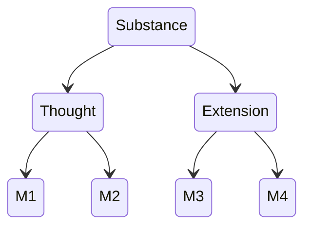

Substance = God = Nature. There is only one substance (1P14).

Substance has infinitely many attributes; the human intellect knows two (2P1, 2P2):

- Thought
- Extension

Each attribute is expressed in infinitely many modes. A finite mode is what Aristotle would call an individual substance: this horse, this idea of the horse. For Spinoza it exists in God and is conceived through an attribute (1D5).

_Think Least of Death: Spinoza on How to Live and How to Die_ by Steven Nadler (2020)

## Principle of Sufficient reason

> For each thing there must be assigned a cause, or reason, as much for its existence as for its nonexistence. (1P11, second demonstration)

The principle covers non-existence too. If a triangle does not exist, something in nature (or in the concept of a triangle) explains why. Spinoza uses this to argue that nothing could prevent God from existing.

## Ethics Part II, pp. 190

> The order and connection of ideas is the same as the order and connection of things. (2P7)

Thought and extension are two attributes of the same substance, so a mode of extension and the idea of that mode are one thing described two ways (2P7 scholium). The mind is the idea of the body (2P13). Neither attribute causes changes in the other (3P2), which removes Descartes's problem of how mind and body interact.
