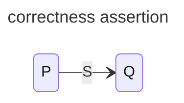

# Annotations and correctness

A correctness assertion connects a statement to conditions on its initial and final states:

$$
\{P\}\;S\;\{Q\}.
$$

Under partial correctness, starting in a state satisfying $P$ guarantees $Q$ whenever $S$ terminates normally. Termination needs a separate argument.



### rules for correctness

For a transition that tests guard $B$ without changing variables, the destination assertion $Q$ follows when

$$
P\land B\implies Q.
$$

For an assignment, substitute the assigned expression into the desired postcondition:

$$
\frac{P\implies Q[x\leftarrow E]}{\{P\}\;x:=E\;\{Q\}}.
$$

Expressions must be defined where evaluated. The examples below use mathematical integers, so arithmetic overflow is outside this model.

# Sequential composition

An intermediate assertion connects the two statements:

$$
\frac{\{P\}\;S\;\{R\}\qquad\{R\}\;T\;\{Q\}}
     {\{P\}\;S;T\;\{Q\}}.
$$

The state left by $S$ must satisfy the precondition of $T$.

_Array as a partial function_

An array is a function $x:D\to T$ on an integer index range $D$. Reading outside $D$ is undefined. An element update replaces the array with an altered function:

$$
x(E):=F\quad\equiv\quad x:=(x;E:F),
$$

where $E\in D$, $F\in T$, and, for $G\in D$,

$$
(x;E:F)(G)=
\begin{cases}
F & \text{if }G=E,\\
x(G) & \text{if }G\ne E.
\end{cases}
$$

For example, with $0,1\in D$:

$$
\{x(0)=a\land x(1)=b\}\;
x(1):=c\;
\{x(0)=a\land x(1)=c\}.
$$

Only the selected index changes.

## loop invariants

For multiplication by repeated addition, assume integer $x\ge0$ and integer $y$:

```algorithm
z, u := 0, x
while u > 0 do
    z, u := z + y, u - 1
```

The invariant is $z+uy=xy\land u\ge0$. Each iteration adds $y$ to $z$ and subtracts one from $u$, preserving the total. At exit $u=0$, so $z=xy$. The nonnegative integer $u$ decreases each iteration, proving termination.

For an unchanged array $a$ of length $N\ge0$, use the empty prefix to initialize its sum:

```algorithm
s, k := 0, 0
while k < N do
    s, k := s + a(k), k + 1
```

The invariant is

$$
s=\sum_{i=0}^{k-1}a(i)\quad\land\quad0\le k\le N.
$$

The empty sum is zero, so initialization works when $N=0$. Under the guard, $k<N$ makes the next access valid. The parallel assignment uses the old values on both right-hand sides and extends the summed prefix by one element. At exit, $k=N$, giving the complete sum. The nonnegative integer $N-k$ decreases by one per iteration.

Source: Emil Sekerinski's [[thoughts/university/twenty-three-twenty-four/sfwr-3bb4/01 Sequential Programming/SequentialProgramming.ipynb|Sequential Programming course notebook]], sections on correctness assertions, arrays and summation. Dijkstra's [EWD418 §3](https://www.cs.utexas.edu/~EWD/transcriptions/EWD04xx/EWD418.html) distinguishes invariant preservation from the decreasing variant needed for termination.
