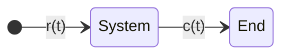

A control system takes a reference input $r(t)$ and produces an output $c(t)$. Open loop means the input to the plant is computed without looking at $c(t)$. Closed loop means $c(t)$ is measured and fed back, so the controller can correct for disturbances and model error.

The output of a linear system splits into two parts:

- Total response = natural response + forced response
  - Natural response (homogeneous solution): what the system does from its initial conditions with zero input. Its shape is set by the poles.
  - Forced response (particular solution): what the input drives. A step input gives a constant forced response, a sine gives a sine at the same frequency.

The transient response is the part that dies out; the steady-state response is what remains as $t \to \infty$. Stability asks whether the natural response dies out at all.

Control objectives:

- Stabilize the system
- Produce the desired transient response (rise time, overshoot, settling time)
- Decrease or eliminate steady-state error
- Keep the behaviour acceptable under disturbances and parameter variation (robustness)
- Meet these goals at an acceptable cost in actuator effort or energy

## [[thoughts/university/twenty-three-twenty-four/sfwr-3dx4/Block Diagrams|Block diagrams]] representation of a system

_System as linear differential equation_

![[thoughts/Laplace transform]]

### Properties

The Laplace transform turns differentiation into multiplication by $s$, so a linear ODE with constant coefficients becomes an algebraic equation in $s$. The properties below do that work.

$$
\begin{aligned}
& f(0^-)\text{: initial condition just before } t = 0 \\[12pt]
& \textbf{Linearity:} \quad \mathcal{L}\{k_1 f_1(t) \pm k_2 f_2(t)\} = k_1 F_1(s) \pm k_2 F_2(s) \\[12pt]
& \textbf{Differentiation:} \\
& \quad \mathcal{L}\left\{\frac{df(t)}{dt}\right\} = sF(s) - f(0^-) \\
& \quad \mathcal{L}\left\{\frac{d^2f(t)}{dt^2}\right\} = s^2 F(s) - sf(0^-) - f'(0^-) \\[12pt]
& \textbf{Frequency Shifting:} \quad \mathcal{L}\{e^{-at}f(t)\} = F(s + a) \\
\end{aligned}
$$

### Transfer function

$n^{th}$ order _linear, time-invariant_ (LTI) differential equation:

$$
a_n \frac{d^n c(t)}{dt^n} + a_{n-1} \frac{d^{n-1} c(t)}{dt^{n-1}} + \cdots + a_0 c(t) = b_m \frac{d^m r(t)}{dt^m} + b_{m-1} \frac{d^{m-1} r(t)}{dt^{m-1}} + \cdots + b_0 r(t)
$$

_take the Laplace transform of both sides_

$$
\begin{aligned}
& a_n s^n C(s) + a_{n-1} s^{n-1} C(s) + \cdots + a_0 C(s) + \text{initial-condition terms of } c(t) \\
& = b_m s^m R(s) + b_{m-1} s^{m-1} R(s) + \cdots + b_0 R(s) + \text{initial-condition terms of } r(t) \\
\end{aligned}
$$

_assume all initial conditions are zero_

$$
\begin{aligned}
(a_n s^n + a_{n-1} s^{n-1} + \cdots + a_0)C(s) &= (b_m s^m + b_{m-1} s^{m-1} + \cdots + b_0)R(s) \\[8pt]
\frac{C(s)}{R(s)} &= G(s) = \frac{b_m s^m + b_{m-1} s^{m-1} + \cdots + b_0}{a_n s^n + a_{n-1} s^{n-1} + \cdots + a_0}
\end{aligned}
$$

> [!important] Transfer function
>
> $$
> G(s)=\frac{C(s)}{R(s)}
> $$
>
> The ratio is defined with zero initial conditions, so $G(s)$ describes the forced response only. The natural response from nonzero initial conditions has to be added separately.

The denominator of $G(s)$ is the characteristic polynomial of the ODE. Its roots are the exponents of the natural response, which is why the rest of the note looks at them.

Q: $G(s) = \frac{1}{s+2}$. Input: unit step $u(t)$, so $U(s) = \frac{1}{s}$. What is $y(t)$?

$$
\begin{aligned}
Y(s) &= G(s)\,U(s) = \frac{1}{s(s+2)} = \frac{A}{s} + \frac{B}{s+2}, \qquad A = \left.\frac{1}{s+2}\right|_{s=0} = \frac{1}{2}, \quad B = \left.\frac{1}{s}\right|_{s=-2} = -\frac{1}{2} \\
y(t) &= \frac{1}{2}\left(1-e^{-2t}\right)u(t)
\end{aligned}
$$

The pole at $s = 0$ comes from the step and gives the forced response $\frac{1}{2}$. The pole at $s = -2$ comes from the system and gives the natural response $-\frac{1}{2}e^{-2t}$, which decays.

## Partial fraction expansion

$$
\begin{aligned}
F(s) &= \frac{N(s)}{D(s)} \\[8pt]
N(s) &: m^{th} \text{ order polynomial in } s \\
D(s) &: n^{th} \text{ order polynomial in } s \\
\end{aligned}
$$

### Decomposition of $\frac{N(s)}{D(s)}$

1. **Divide if improper**: the fraction is improper when $m \geq n$. Polynomial division then gives $\frac{N(s)}{D(s)} = Q(s) + \frac{N_1(s)}{D(s)}$, with $\deg N_1 < \deg D$. The quotient $Q(s)$ inverts to impulses and their derivatives, so only the strictly proper remainder needs the steps below.
2. **Factor the denominator** into real factors of the form
   $$
   (ps+q)^m \text{ and } (as^2+bs+c)^n, \qquad b^2 - 4ac < 0
   $$
3. **Linear factors**: each $(ps+q)^m$ contributes
   $$
   \sum_{j=1}^{m}\frac{A_j}{(ps+q)^j}
   $$
4. **Quadratic factors**: each irreducible $(as^2+bs+c)^n$ contributes
   $$
   \sum_{j=1}^{n}{\frac{B_j s+C_j}{(as^2+bs+c)^j}}
   $$
5. **Determine the unknowns**: for a simple pole at $s = -p$, multiply by $(s+p)$ and set $s = -p$ (cover-up). For repeated or quadratic factors, match coefficients or differentiate.

## Stability analysis using roots of $D(s)$

> [!important] roots of $D(s)$
> The roots of $D(s)$ are the **poles** of $G(s)$. The roots of $N(s)$ are the **zeros**.

Take a strictly proper $G(s)$ whose poles are all distinct, and write each pole as $s = -p_j$:

$$
G(s) = \frac{N(s)}{D(s)} = \frac{N(s)}{a_n\prod_{j=1}^{n}(s+p_j)} = \sum_{j=1}^{n}{\frac{A_j}{s+p_j}}
$$

> $p_j$ can be complex. Complex poles come in conjugate pairs because $D(s)$ has real coefficients.

The impulse response is the inverse transform:

$$
g(t) = \sum_{j=1}^{n}{\mathcal{L}^{-1}\left\{\frac{A_j}{s+p_j}\right\}} = \sum_{j=1}^{n}{A_je^{-p_jt}}
$$

Each pole contributes one exponential. Write $p_j = \sigma_j \pm j\omega_j$, so the pole sits at $s = -\sigma_j \mp j\omega_j$. The magnitude of $e^{-p_jt}$ is $e^{-\sigma_j t}$, so the real part of the pole alone decides whether that term grows or decays.

### stability analysis

> [!important]
>
> - Every pole in the open left half-plane ($\sigma_j > 0$ in the convention above, so $\operatorname{Re}(s) = -\sigma_j < 0$): every term decays, and the system is **stable**.
> - Any pole in the right half-plane ($\sigma_j < 0$): that term grows without bound, and the system is **unstable**. Example: $p_j = -1$ puts the pole at $s = 1$ and gives $e^{t}$.
> - Simple poles on the imaginary axis ($\sigma_j = 0$) and none in the right half-plane: the natural response neither decays nor grows. The slides call this "technically stable". The usual name is **marginally stable**, and a bounded input at that frequency drives an unbounded output, so it fails BIBO stability. Repeated imaginary-axis poles give terms like $t\cos\omega t$ and are unstable. See [[thoughts/university/twenty-three-twenty-four/sfwr-3dx4/stability|stability]].

A repeated pole $(s+p)^k$ gives terms $t^{i}e^{-pt}$ for $i < k$. The polynomial factor cannot beat a decaying exponential, so the left half-plane rule still holds.

### Complex root

For the pair $p = \sigma \pm j\omega$, the residues are complex conjugates, giving

$$
\frac{\alpha + j\beta}{s + \sigma + j\omega} + \frac{\alpha - j\beta}{s + \sigma - j\omega}
$$

whose inverse transform is real:

$$
(\alpha + j\beta)e^{-(\sigma + j\omega)t} + (\alpha - j\beta)e^{-(\sigma - j\omega)t} = 2e^{-\sigma t}\left(\alpha\cos\omega t + \beta\sin\omega t\right)
$$

The imaginary part $\omega$ sets the oscillation frequency, and the real part $\sigma$ sets the envelope $e^{-\sigma t}$. The pair is stable when $\sigma > 0$, i.e. when the poles $-\sigma \mp j\omega$ lie in the left half-plane.

## Impedance of Inductor

$$
Z(s) = \frac{V(s)}{I(s)} = Ls
$$

since the voltage-current relation for an inductor is $v(t) = L\frac{di(t)}{dt}$. With $i(0^-) = 0$, the differentiation property gives $V(s) = LsI(s)$.

## Impedance of Capacitor

$$
Z(s) = \frac{V(s)}{I(s)} = \frac{1}{Cs}
$$

since the voltage-current relation for a capacitor is $v(t) = \frac{1}{C} \int_0^{t}{i(\tau) d\tau}$ with $v(0) = 0$. Integration divides by $s$ in the Laplace domain, so $V(s) = \frac{1}{Cs}I(s)$.

With impedances, series elements add and parallel elements combine like resistors, so a circuit's transfer function comes from algebra on $Z(s)$ instead of from writing the ODE first.
